# 58 · 陆军历代团营编制树

> 职责：集中管理已确认的团、营及其下级编制树，按年代区分常设建制、纸面定额和战役任务编组。装备原理、战术解释、战史与团号仍由所属专题维护。

本页由[统一编制数据](编制树/编制数据.json)生成。同类下级单位共用固定模板编号；树下的“下钻”链接进入相应营、连、排模板，数量按当前父单位理解，不把多张视图相加。

**图例**：实线为建制隶属或组成；虚线标明“配属”“支援”“任务指挥”或“待定”。“×3”表示三个同类单位；下级数量均为每个上级单位的数量。“待定”节点只是缺项提示，不等于已经成立该单位。

**战时TG身份**：1970年代改革后，团营连进入战区通常迅速组织为RTG／BTG／CTG，并逐级受领、保留和下放任务资产；即使尚未得到额外加强，也不影响TG身份。团营连的永久行政建制另记。

**年代与总量**：不得把后期装备、班排人数、坦克或FSV下放关系倒套早期；150条团史及历史300团峰值不进入本页的单团编制算式。缺少依据的团部、保障、车型与人员留空，已知车辆小计不表示全团／营完整总额。

## 按年代与类型进入

| 模板 | 年代／适用阶段 | 团／营及下级模板 | 状态 |
|---|---|---|---|
| [command-1938](#command-1938) | 1938年团制至1970年代改革前的任务示意；常设基层关系后续延续 | 团营建制与纵队任务指挥 | 已确认编制；缺项另标 |
| [ww2-rgt-1938](#ww2-rgt-1938) | 1938年基础；1942年以后另有改进 | 标准徒步步兵团 | 已确认编制；缺项另标 |
| [ww2-hq-1938](#ww2-hq-1938) | 1938年基础团 | 团部指挥、通信与医疗连 | 已确认编制；缺项另标 |
| [ww2-bn-1938](#ww2-bn-1938) | 1938年后营骨架；1942年成熟连排及营级员额 | 一线步兵营 | 已确认编制；缺项另标 |
| [ww2-co-1942](#ww2-co-1942) | 1942年班排岗位基准 | 步兵连、排与11人班 | 已确认编制；缺项另标 |
| [ww2-reserve-1938](#ww2-reserve-1938) | 1938年基础团 | 团属410人后备营与干部轮换 | 已确认编制；缺项另标 |
| [ww2-transport-1938](#ww2-transport-1938) | 1938年基础团 | 团运输营与六资产连 | 已确认编制；缺项另标 |
| [ww2-medical-1938](#ww2-medical-1938) | 1938年基础团 | 团144人医疗连与下放营医疗排 | 已确认编制；缺项另标 |
| [ww2-tank-attachment](#ww2-tank-attachment) | 1942—1946年，纵队受领独立40式坦克营并按任务加强步兵团 | 纵队装甲力量对步兵团的临时加强 | 任务加强示意；非永久团型 |
| [ww2-cavalry-46](#ww2-cavalry-46) | 早期40式装甲骑兵组织；改编衔接未定 | 46辆混型装甲骑兵大队 | 早期专业组织；非团属坦克营模板 |
| [ww2-rocket-bn](#ww2-rocket-bn) | 1944年起优先战区列装 | 43式250毫米自行火箭炮营 | 已确认编制；缺项另标 |
| [armour-bn-44](#armour-bn-44) | 冷战独立FSV营与团属坦克营的后续统一组织定额 | 44车坦克营／FSV营 | 已确认编制；缺项另标 |
| [armour-co-14](#armour-co-14) | 统一连排定额；各阶段实到另核 | 14车装甲连与四车排 | 已确认编制；缺项另标 |
| [task-forces-1970s](#task-forces-1970s) | 1970年代改革后；具体改革年份未定 | 纵队—RTG—BTG—CTG战区任务指挥体系 | 战时TG身份与逐级资源分配；不另建永久机关 |
| [cw-infantry-rgt](#cw-infantry-rgt) | 冷战初期普通／半摩托化团 | 普通步兵团的已知骨架 | 已知骨架；团属机构未全定 |
| [cw-infantry-bn](#cw-infantry-bn) | 1950年代至1960年代普通／半摩托化营 | 战后步兵营的火力重组 | 已确认编制；缺项另标 |
| [cw-squad-7](#cw-squad-7) | 1950年代起，先于机械化步兵 | 战后7人步兵班 | 已确认编制；缺项另标 |
| [cw-mech-rgt-1960](#cw-mech-rgt-1960) | 1960年前后成熟机械化团；1965年前 | 早期无坦克营机械化团 | 已确认编制；缺项另标 |
| [cw-mech-rgt-1965](#cw-mech-rgt-1965) | 1965年ZTZ-65服役后，逐团改编 | 增设团属坦克营的机械化团 | 已确认编制；缺项另标 |
| [cw-mech-bn-1960](#cw-mech-bn-1960) | 1960年前后成熟；1970年代延用核心结构 | 47式机械化步兵营 | 已确认编制；缺项另标 |
| [cw-mech-co-1960](#cw-mech-co-1960) | 1960年前后成熟；1970年代延用 | 47式机械化步兵连与排 | 已确认编制；缺项另标 |
| [cw-standard-rgt-1970s](#cw-standard-rgt-1970s) | 1976年后标准徒步步兵团 | 2630人标准步兵团与RTG(M)加强 | 2630人及主要车辆火力已定，技术留白另记 |
| [cw-standard-bn-1976](#cw-standard-bn-1976) | 1976年75式「剑」成熟后的标准步兵营 | 498人标准步兵营、39人九车运输连 | 全营498人及专业分队定额已确定 |
| [cw-standard-co-1970s](#cw-standard-co-1970s) | 1970年代标准徒步步兵连 | 107人标准步兵连 | 已确认编制；缺项另标 |
| [cw-standard-platoon-1970s](#cw-standard-platoon-1970s) | 1970年代标准步兵排 | 24人步兵排与7人班 | 编制已确认，未定项另标 |
| [cw-standard-mg-platoon-1970s](#cw-standard-mg-platoon-1970s) | 1970年代连属机枪排 | 19人机枪排 | 编制已确认，未定项另标 |
| [cw-standard-heavy-co-1976](#cw-standard-heavy-co-1976) | 1976年后营属重武器连 | 100人重武器连：三个专业排 | 编制已确认，未定项另标 |
| [cw-standard-transport-1970s](#cw-standard-transport-1970s) | 1970年代营属运输连 | 39人营属运输连、9辆卡车 | 编制已确认，未定项另标 |
| [cw-armoured-cavalry](#cw-armoured-cavalry) | 1970年代战区专业力量 | 装甲骑兵战斗群 | 已确认编制；缺项另标 |
| [late-cavalry-regiment](#late-cavalry-regiment) | 1990年代至2003年军改撤编前 | 装甲骑兵团 | 已确认编制；缺项另标 |
| [modern-foot-rgt](#modern-foot-rgt) | 2003年后；普通步兵团的定稿原则，内部编制待续议 | 现代普通步兵团的已知任务与运输边界 | 任务与车辆归属原则已定；营连与装备数量未定 |
| [modern-armored-pl](#modern-armored-pl) | 2003年军改后 | 现代装甲排四车制 | 已确认团营连排核心，其他编制和人装待定 |
| [modern-armored-co](#modern-armored-co) | 2003年军改后 | 现代装甲连三排制 | 已确认团营连排核心，其他编制和人装待定 |
| [modern-armored-bn](#modern-armored-bn) | 2003年军改后 | 现代装甲营三连制 | 已确认团营连排核心，其他编制和人装待定 |
| [modern-armored-rgt](#modern-armored-rgt) | 2003年军改后 | 2003年军改后独立装甲团 | 已确认团营连排核心，其他编制和人装待定 |
| [modern-force-baseline](#modern-force-baseline) | 2003年第四次军改完成时即有30个常设团；后续装备逐年升级 | 现代30团六类型规模清单 | 作者确认的2003年30团基准；战区与战史后续整理 |
| [modern-command-2014](#modern-command-2014) | 2003年后：战区直属BTG与临时派出纵队 | 现代战区直辖BTG／RTG与临时纵队指挥 | 确认的现代任务指挥关系；机关员额待定 |
| [modern-theater-replacements](#modern-theater-replacements) | 现代职业化成熟阶段（具体改革落实年月待定） | 国内战区野战军训练与兵员补充（旧团后备营索引兼容） | 团直属后备营撤销，改由国内战区组织第二年专业训练及合格兵员补充；战区训练单位细编、年度录用比例待按需求确定 |
| [modern-personnel](#modern-personnel) | 2003年军改后7人班、24人排组织；2014年成熟单兵装备状态 | 统一7人班与24人排 | 已确认编制；缺项另标 |
| [modern-motor-hq](#modern-motor-hq) | 2003年军改后 | 摩步营部指挥通信与物资运输 | 已确认编制；缺项另标 |
| [modern-motor-spare-pl](#modern-motor-spare-pl) | 2003年军改后 | 摩步营备损后备排 | 已确认编制；缺项另标 |
| [modern-motor-ad-squad](#modern-motor-ad-squad) | 2003年军改后 | 营属双组单兵防空班 | 已确认编制；缺项另标 |
| [modern-motor-mortar-co](#modern-motor-mortar-co) | 2003年军改后 | 营属九车120毫米自行迫击炮连 | 已确认编制；缺项另标 |
| [modern-motor-mortar-pl](#modern-motor-mortar-pl) | 2003年军改后 | 三车迫击炮排及独立FDC | 已确认编制；缺项另标 |
| [modern-motor-service-bn](#modern-motor-service-bn) | 2003年军改后 | 摩步团勤务营（固定BTG保障模块） | 已确认编制；缺项另标 |
| [modern-motor-maint-co](#modern-motor-maint-co) | 2003年军改后 | 团勤务营维修连 | 已确认编制；缺项另标 |
| [modern-motor-maint-pl](#modern-motor-maint-pl) | 2003年后；12人仅为待核工作定额 | 三车制前沿维修排 | 已确认编制；缺项另标 |
| [modern-motor-supply-co](#modern-motor-supply-co) | 2003年军改后 | BTG固定配对的团属保障连 | 已确认编制；缺项另标 |
| [modern-motor-transport-pl-10t](#modern-motor-transport-pl-10t) | 2003年军改后 | 三车制10T运输排 | 已确认编制；缺项另标 |
| [modern-motor-transport-pl-5t](#modern-motor-transport-pl-5t) | 2003年军改后 | 三车制5T运输排 | 已确认编制；缺项另标 |
| [modern-motor-med-co](#modern-motor-med-co) | 2003年军改后 | 团勤务营医疗连 | 已确认编制；缺项另标 |
| [modern-motor-med-pl](#modern-motor-med-pl) | 2003年后；12人仅为待核工作定额 | 三车制前沿医疗排 | 已确认编制；缺项另标 |
| [modern-emi-btg](#modern-emi-btg) | 2003年后；海外部署时任务配属 | EMI-BTG标准远征摩步营战术群 | 已确认编制；缺项另标 |
| [modern-motor-rgt](#modern-motor-rgt) | 2003年军改后；95式轮式体系自2000年开始试点换装 | 现代摩托化团 | 已确认编制；缺项另标 |
| [modern-motor-bn](#modern-motor-bn) | 2003年改革后摩步营组织基准；2000年95式初代已用无人站，2015年B型为后续完善 | 现代摩步营有机编制 | 已确认编制；缺项另标 |
| [modern-motor-co](#modern-motor-co) | 2003年后 | 95式摩步连 | 已确认编制；缺项另标 |
| [modern-wheel-platoon](#modern-wheel-platoon) | 2003年后95式摩步排 | 轮式摩步排的人员与车辆 | 已确认编制；缺项另标 |
| [modern-mech-rgt](#modern-mech-rgt) | 2003年后；2020年起13式逐步换装 | 现代机械化团 | 已确认编制；缺项另标 |
| [modern-mech-bn](#modern-mech-bn) | 2003年后；2020年起前沿排渐换13式 | 现代履带机步营已知骨架 | 已确认编制；缺项另标 |
| [modern-ifv-co](#modern-ifv-co) | 2020年起13式列装单位 | 13式机步连已知部分 | 已确认编制；缺项另标 |
| [modern-ifv-platoon](#modern-ifv-platoon) | 2020年开始列装；未定义全军换装完成年 | 四车13式机步排 | 已确认编制；缺项另标 |
| [modern-btg](#modern-btg) | 2003年后；按具体任务临时组成 | 现代摩步BTG的一般任务编组 | 临时战术编组；非永久建制 |
| [modern-ctg](#modern-ctg) | 2003年后；条件性合成加强 | 现代CTG整连基干加强示例 | 临时战术编组；加强量按任务 |
| [modern-ce-bn](#modern-ce-bn) | 2003—2015年及后续专业CE基准 | 四连制战斗工兵营 | 已确认编制；缺项另标 |
| [modern-ce-co](#modern-ce-co) | 2003年后 | 普通战斗工兵连（2003年起四车制、2020年前后轮式换装） | 已确认编制；缺项另标 |
| [modern-ce-platoon](#modern-ce-platoon) | 2003年军改后四辆ZS-47；2020年前后逐步换四辆ZS-95 | 战斗工兵排 | 已确认编制；缺项另标 |
| [modern-ce-heavy-co](#modern-ce-heavy-co) | 2003—2015年专业编制；少数攻坚排实装 | 三排制重装工兵连 | 已确认编制；缺项另标 |
| [modern-signal-bn](#modern-signal-bn) | 2015年前后战区集中掌握 | 专业通信营通用模板 | 已确认编制；缺项另标 |
| [air-cavalry-regiment](#air-cavalry-regiment) | 冷战后期至1998年等已定阶段 | 空中骑兵团 | 已确认编制；缺项另标 |
| [special-command](#special-command) | 当前已确认组织；转隶年份各自待定 | 特种作战司令部四个团 | 已确认编制；缺项另标 |
| [special-56-airborne](#special-56-airborne) | 1960年代，具体改编年未定 | 第56空降团 | 已知团营骨架；下级未全定 |
| [special-56-1973](#special-56-1973) | 1973年起 | 第56特种空降团 | 已知团营骨架；下级未全定 |
| [special-rgt-56](#special-rgt-56) | 至1983年前后完成专业化；现代职业化阶段不设团直属后备营 | 特战第56团 | 已确认编制；缺项另标 |
| [light-rgts-1940s](#light-rgts-1940s) | 1940年代，日本投降前改编；精确年份未定 | 两个海军陆战团 | 团营隶属已定；详细编制留白 |
| [light-rgts-1960s](#light-rgts-1960s) | 1960年代改称；具体年份未定 | 两个滨海战斗团 | 团营隶属已定；详细编制留白 |
| [light-rgts-current](#light-rgts-current) | 三个轻步兵团现行编制；第187团改编与转隶年份待定 | 第118、第187、第234轻步兵团 | 团营隶属已定；详细编制留白 |
| [mission-fast-group-1998](#mission-fast-group-1998) | 1998年沙漠军刀；任务编组 | 装甲骑兵快速集群 | 战役任务编组；非永久团营 |
| [mission-logistics-bn-1998](#mission-logistics-bn-1998) | 1998年科威特战争（海湾战争） | 海湾战争额外加强后勤营 | 战役配属比例已定；内部编制与实际团数待核 |
| [mission-cmef-1998](#mission-cmef-1998) | 1998年增援完成后的阶段性战役序列 | CMEF团级接口与专业任务力量 | 保留已定战役节点；常规团级序列待核 |
| [mission-homs-2015](#mission-homs-2015) | 2015年霍姆斯战役：战区三BTG＋国内第6摩步RTG、第36装甲RTG（-） | 霍姆斯纵队的8个主战营基干 | 战时兵力与番号已定；员额、后勤和车辆实到待核 |
| [mission-signal-homs](#mission-signal-homs) | 2015年霍姆斯OG受领的双连制 | 霍姆斯专业通信营 | 该战役已定双连制；非全军统一连数 |
| [ww2-tank-co-40](#ww2-tank-co-40) | 1942年以后40式坦克连成熟编制；各部队实到另核 | 40式坦克连（14车64人） | 已确认编制；专业岗位可细化 |
| [ww2-tank-bn-40](#ww2-tank-bn-40) | 1944年后期在热点战区广泛列装的40式坦克营 | 40式坦克营（44车296人） | 已确认编制；专用维护装备与装载细目另核 |
| [cw-reg-hq-1976](#cw-reg-hq-1976) | 1976年后标准步兵团 | 60人团部 | 正式定额；未定专业装备另标 |
| [cw-reg-reserve-bn-1976](#cw-reg-reserve-bn-1976) | 1976年后标准步兵团 | 302人团属后备营 | 正式定额；未定专业装备另标 |
| [cw-reg-scout-co-1976](#cw-reg-scout-co-1976) | 1976年后标准步兵团 | 107人团属侦察连 | 正式定额；未定专业装备另标 |
| [cw-reg-mortar-co-1976](#cw-reg-mortar-co-1976) | 1976年后标准步兵团 | 113人团属120毫米重迫击炮连 | 正式定额；未定专业装备另标 |
| [cw-reg-ad-pl-1976](#cw-reg-ad-pl-1976) | 1976年后标准步兵团 | 20人团属IRSAM防空排 | 正式定额；未定专业装备另标 |
| [cw-reg-transport-bn-1976](#cw-reg-transport-bn-1976) | 1976年后标准步兵团 | 179人团属运输营 | 正式定额；未定专业装备另标 |
| [cw-reg-engineer-co-1976](#cw-reg-engineer-co-1976) | 1976年后标准步兵团 | 145人团属工兵连 | 正式定额；未定专业装备另标 |
| [cw-reg-medical-co-1976](#cw-reg-medical-co-1976) | 1976年后标准步兵团 | 144人团属医疗连 | 正式定额；未定专业装备另标 |
| [cw-reg-signals-co-1976](#cw-reg-signals-co-1976) | 1976年后标准步兵团 | 66人团属通信连 | 正式定额；未定专业装备另标 |
| [cw-mech-pl-1976](#cw-mech-pl-1976) | 1976年标准机步营 | 35人机械化步兵排与四车组 | 1976年新编制：明确项与暂定工作定额分别标注 |
| [cw-mech-co-1976](#cw-mech-co-1976) | 1976年标准机步营 | 129人机械化步兵连 | 1976年新编制：明确项与暂定工作定额分别标注 |
| [cw-mech-bn-ad-1976](#cw-mech-bn-ad-1976) | 1976年标准机步营 | 20人营属单兵防空排 | 1976年新编制：明确项与暂定工作定额分别标注 |
| [cw-mech-bn-mortar-1976](#cw-mech-bn-mortar-1976) | 1976年标准机步营 | 42人ZS-47底盘自行120毫米迫击炮连 | 1976年新编制：明确项与暂定工作定额分别标注 |
| [cw-mech-bn-transport-1976](#cw-mech-bn-transport-1976) | 1976年标准机步营 | 39人九车营运输连 | 1976年新编制：明确项与暂定工作定额分别标注 |
| [cw-mech-bn-hq-1976](#cw-mech-bn-hq-1976) | 1976年标准机步营 | 60人机械化营部（含维修与防空） | 1976年新编制：明确项与暂定工作定额分别标注 |
| [cw-mech-bn-1976](#cw-mech-bn-1976) | 1976年标准机步营 | 528人标准机械化步兵营 | 1976年新编制：明确项与暂定工作定额分别标注 |
| [cw-mech-tank-bn-1976](#cw-mech-tank-bn-1976) | 1976年标准重型机械化团 | 208人42坦克营与T-65F维修排 | 1976年新编制：明确项与暂定工作定额分别标注 |
| [cw-mech-engineer-co-1976](#cw-mech-engineer-co-1976) | 1976年标准重型机械化团 | 125人13辆ZS-47机械化工兵连 | 1976年新编制：明确项与暂定工作定额分别标注 |
| [cw-mech-rgt-maint-co-1976](#cw-mech-rgt-maint-co-1976) | 1976年标准重型机械化团 | 60人团级专业维修连 | 1976年新编制：明确项与暂定工作定额分别标注 |
| [cw-mech-rgt-transport-co-1976](#cw-mech-rgt-transport-co-1976) | 1976年标准重型机械化团 | 61人15车团运输连 | 1976年新编制：明确项与暂定工作定额分别标注 |
| [cw-mech-rgt-ad-pl-1976](#cw-mech-rgt-ad-pl-1976) | 1976年标准重型机械化团 | 16人三车团防空排 | 1976年新编制：明确项与暂定工作定额分别标注 |
| [cw-mech-rgt-1976](#cw-mech-rgt-1976) | 1976年标准重型机械化团 | 2626人工作定额重型机械化步兵团 | 1976年新编制：明确项与暂定工作定额分别标注 |

各模板的详细树如下。折叠标题可展开；同一单位的多张图分别展示其主战、直属火力或保障，不新增中间建制。

<a id="era-ww2"></a>

## 1938—1946年：标准步兵团与独立装甲加强

1938年确立标准步兵团；1942年普及连级无线电。独立40式坦克营由纵队按任务分配给团，不再设二战常设混成团。

<a id="command-1938"></a>

<details>
<summary>command-1938 · 团营建制与纵队任务指挥</summary>

**适用阶段：** 1938年团制至1970年代改革前的任务示意；常设基层关系后续延续。**记录性质：** 已确认编制；缺项另标。

### 战区直接指挥纵队的方向

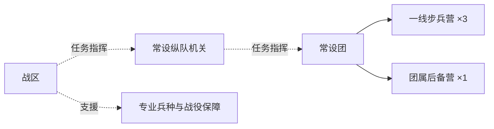

### 需要OG统筹的大型方向

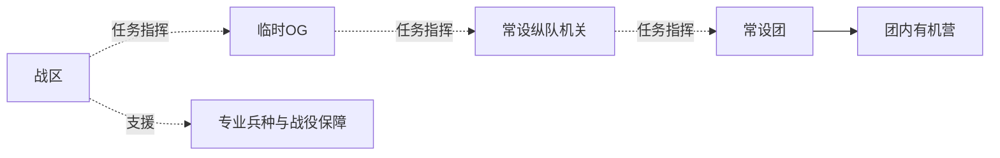

**边界与未定：**

- 纵队与OG不是永久辖团的建制上级；树中任务指挥边不表示固定隶属。OG按方向需要设置，可省略。
- 二战任务规模参照：战区大致对应集团军群，OG介于军与集团军之间，纵队介于师与军之间；纵队通常受领5—6个团、小型方向2—3个，OG通常统筹2—4个纵队、大型任务5—6个，均非固定辖属。
- 三个一线营与后备营是普通团的基础；特战和轻步兵团按各自专题，不套用完整普通团定额。
- 1970年代以后纵队—RTG—BTG—CTG任务链另见task-forces-1970s；此处不把临时战斗队倒填二战。

**对照：** [task-forces-1970s](#task-forces-1970s)。

**依据：** [03号 · topic-02](03-陆军军制.md#topic-02)。

</details>

<a id="ww2-rgt-1938"></a>

<details>
<summary>ww2-rgt-1938 · 标准徒步步兵团</summary>

**适用阶段：** 1938年基础；1942年以后另有改进。**记录性质：** 已确认编制；缺项另标。

### 主战、后备及工兵

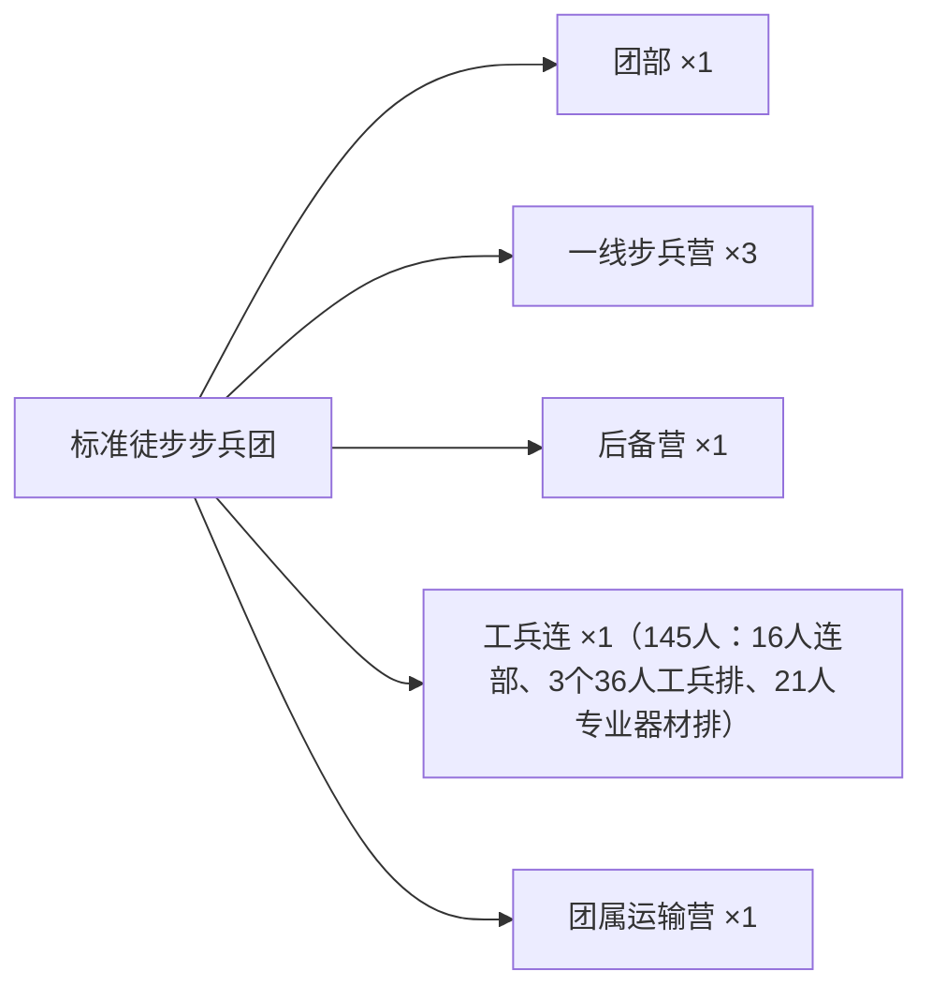

### 团直属火力

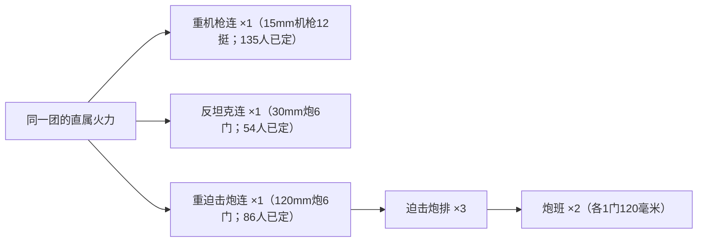

**下钻：** [ww2-bn-1938 · 一线步兵营](#ww2-bn-1938)；[ww2-hq-1938 · 团部指挥、通信与医疗连](#ww2-hq-1938)；[ww2-reserve-1938 · 团属410人后备营与干部轮换](#ww2-reserve-1938)；[ww2-transport-1938 · 团运输营与六资产连](#ww2-transport-1938)。

| 已知小计 | 核算 | 结果 |
|---|---|---|
| 标准团已明确机动车 | 18＋18＋6＋3 | 45辆 |
| 载货卡车名义运载量 | 54＋18 | 72吨 |
| 含0.5T车名义载重 | 54＋18＋1.5 | 73.5吨 |
| 标准步兵团正式常设员额 | 1752＋410＋144＋145＋86＋54＋135＋182＋90 | 2998人 |

**边界与未定：**

- 同一团的主战与直属火力视图分别展示不同方面，不重复计人。三个常设一线营共1752人；后备营410人；医疗连144人；工兵连145人。
- 团属重机枪、反坦克、120mm迫击炮连人数135、54、86均已正式定额，各连不设独立常设勤务班，普通装卸由后备营按任务支援。
- 团运输营新增第三个1.5T运输连，现有三个1.5T运输连和一个3T运输连，共24辆载货卡车。全团明确45辆机动车，后备营配用的3辆从中调拨。
- 全团2998人已正式定为1942年成熟标准步兵团员额；各专业分队内部技术岗位与专用装备仍可后续细化，但不能将尚待细化误认为人数未定。
- 1938年不默认后期37式机枪及40式坦克已普及；标准步兵团不编有机坦克，独立装甲的临时加强不计入永久定额。

**对照：** [ww2-tank-attachment](#ww2-tank-attachment)。

**依据：** [10号 · topic-01](10-二战陆军与空军编制.md#topic-01)、[04号 · topic-02](04-二战陆军战术与保障.md#topic-02)。

</details>

<a id="ww2-hq-1938"></a>

<details>
<summary>ww2-hq-1938 · 团部指挥、通信与医疗连</summary>

**适用阶段：** 1938年基础团。**记录性质：** 已确认编制；缺项另标。

### 团部已知组织

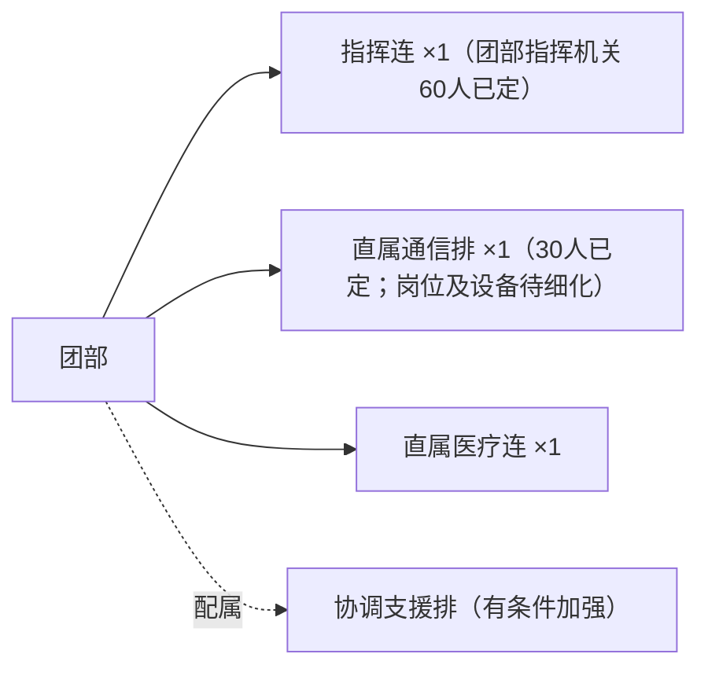

**下钻：** [ww2-medical-1938 · 团144人医疗连与下放营医疗排](#ww2-medical-1938)。

**边界与未定：**

- 指挥连与直属通信排分别定额60人与30人，已经正式认可，具体岗位和通信器材可继续细化；医疗连已认可144人，属团直属，不包含于团部90人。协调支援排为战役协调军条件性临时加强。

**依据：** [10号 · topic-01](10-二战陆军与空军编制.md#topic-01)。

</details>

<a id="ww2-bn-1938"></a>

<details>
<summary>ww2-bn-1938 · 一线步兵营</summary>

**适用阶段：** 1938年后营骨架；1942年成熟连排及营级员额。**记录性质：** 已确认编制；缺项另标。

### 营有机单位

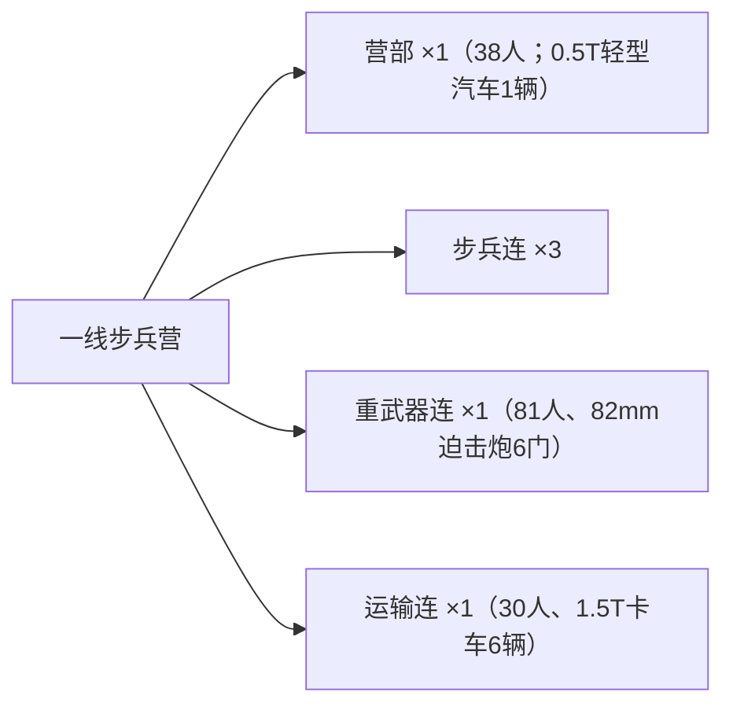

### 营部38人常设人员

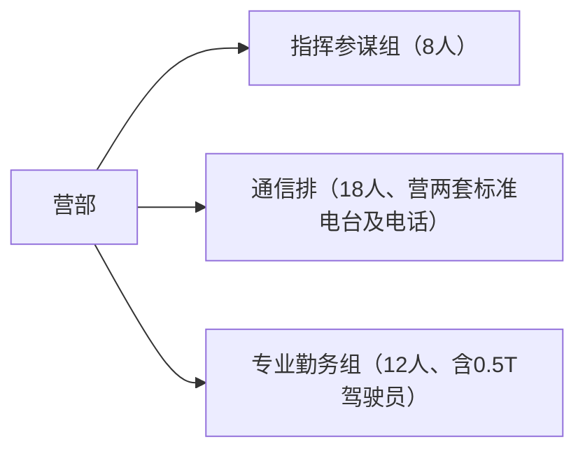

### 重武器连81人

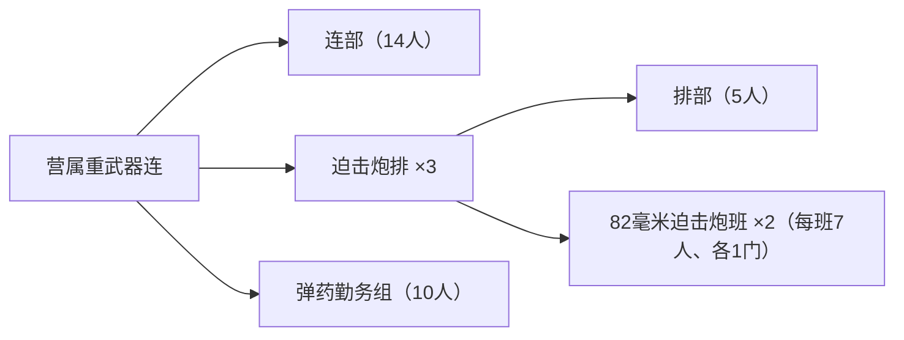

### 运输连30人

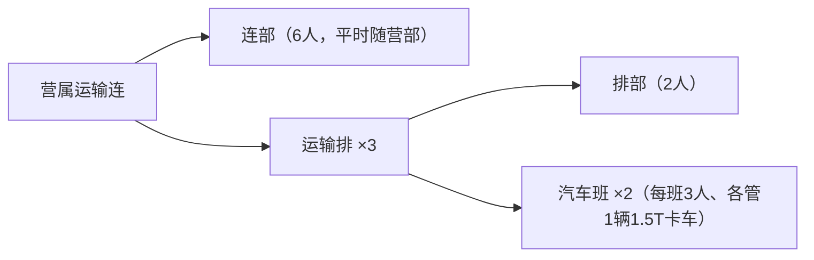

### 可受领的团级加强

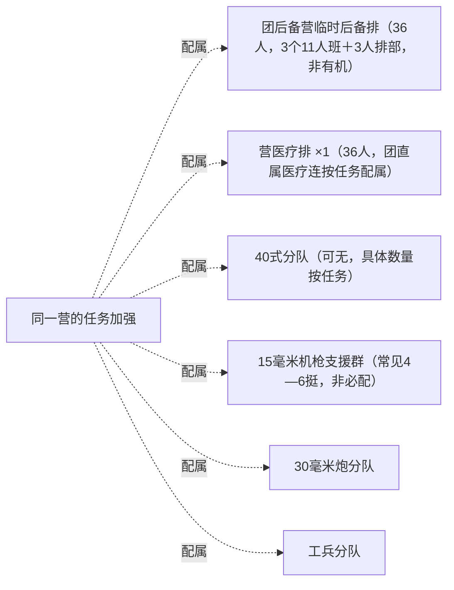

**下钻：** [ww2-co-1942 · 步兵连、排与11人班](#ww2-co-1942)。

| 已知小计 | 核算 | 结果 |
|---|---|---|
| 成熟营常设员额 | 145＋145＋145＋38＋81＋30 | 584人 |
| 申领36人后备排后使用人员（非营定额） | 584＋36 | 620人 |
| 再计入团医疗连36人营医疗排（非营定额） | 620＋36 | 656人 |

**边界与未定：**

- 按1942年成熟连排岗位口径：三个步兵连各145人＋营部38人＋重武器连81人＋营运输连30人，合计584人常设，已逐项定员。1938年不倒套后期换装。
- 团后备营可临时派出36人后备排（33名班员＋3名排部），负责一般勤务与轮换，不属于营常设员额；三个步兵连不设常备或常态申领后备班。
- 团医疗连配属36人营医疗排不计入584人；其9人前沿医疗班仍按三个步兵连各2人、营部3人分配。
- 6辆1.5T卡车配用：三个步兵连各1、营部1、重武器连2；运输连连部平时随营部。营部0.5T轻型车另计。
- 团属专业兵种按任务加强，不计入常设营额。

**依据：** [10号 · topic-01](10-二战陆军与空军编制.md#topic-01)。

</details>

<a id="ww2-co-1942"></a>

<details>
<summary>ww2-co-1942 · 步兵连、排与11人班</summary>

**适用阶段：** 1942年班排岗位基准。**记录性质：** 已确认编制；缺项另标。

### 连至班

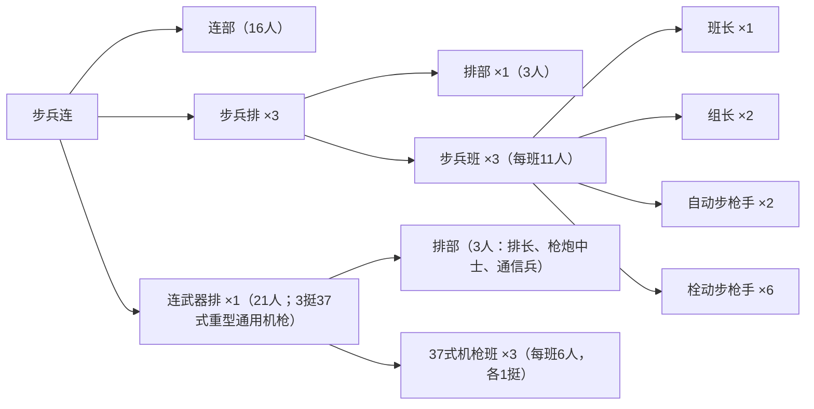

### 连部16人常设岗位

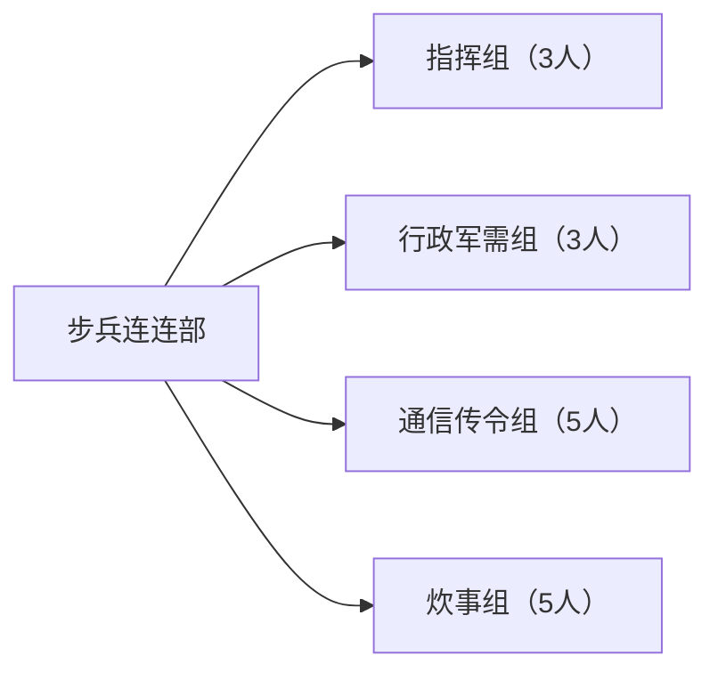

| 已知小计 | 核算 | 结果 |
|---|---|---|
| 每排人员 | 3＋11＋11＋11 | 36人 |
| 连基本人员 | 16＋36＋36＋36 | 124人 |
| 连含3挺机枪武器排定员 | 124＋21 | 145人 |

**边界与未定：**

- 连部16人＋三个36人步兵排＋21人武器排＝145人，均已定员；武器排3人排部、3个6人机枪班。
- 枪炮中士为武器排排部专业士官，兼任全连武器维护教官和连军士长之一；不因此在连部另增岗位。连部既有军械维修兵负责具体维修勤务。
- 不编驮马或独立辎重勤务组；连不设常备或常态申领后备班。配用卡车和3人车组属营运输连，2名配属医疗人员属团医疗排，均不重复计入145人。
- 1937—1940年曾有3挺十四式轻机枪临时顶用；1940年37式重型通用机枪服役后换装3挺，1941年前后逐步完成。

**依据：** [10号 · topic-01](10-二战陆军与空军编制.md#topic-01)。

</details>

<a id="ww2-reserve-1938"></a>

<details>
<summary>ww2-reserve-1938 · 团属410人后备营与干部轮换</summary>

**适用阶段：** 1938年基础团。**记录性质：** 已确认编制；缺项另标。

### 后备营三级编制和人数

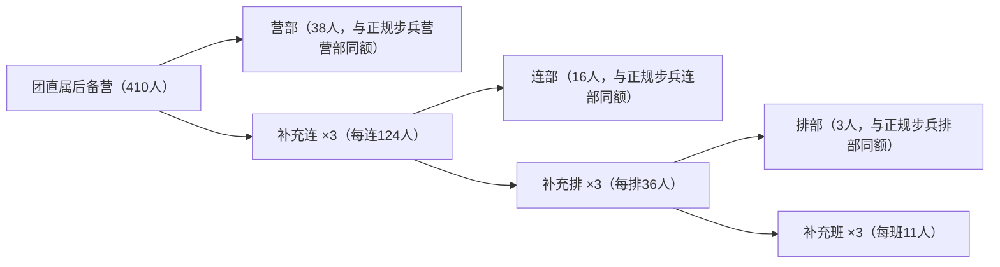

| 已知小计 | 核算 | 结果 |
|---|---|---|
| 补充班人数 | 11＋11＋11＋11＋11＋11＋11＋11＋11＋11＋11＋11＋11＋11＋11＋11＋11＋11＋11＋11＋11＋11＋11＋11＋11＋11＋11 | 297人 |
| 后备营完整常设人数 | 297＋27＋48＋38 | 410人 |
| 三个后备排临时申领 | 36＋36＋36 | 108人（已含于410） |

**边界与未定：**

- 三个补充连，每连3个36人补充排加16人连部；后备营营部38人。班、排部、连部、营部与同级正规步兵单位采用完全相同的员额。
- 后备营为新晋升而经验较少的指挥干部提供历练岗位，并承接一线干部轮休、轮换和后备接替；优先补充人员，其次协助专业单位普通勤务，最后团纵深警戒。
- 全营没有有机武器排、重武器连、运输连，也不因为营部同为38人便新增轻型汽车。
- 三个一线营各可临时申领36人后备排，共108人；同一批人员仍在410人中，不能重复计入全团。后备连日常各配用一辆团运输营卡车，不属于后备营有机车辆。

**依据：** [10号 · topic-01](10-二战陆军与空军编制.md#topic-01)。

</details>

<a id="ww2-transport-1938"></a>

<details>
<summary>ww2-transport-1938 · 团运输营与六资产连</summary>

**适用阶段：** 1938年基础团。**记录性质：** 已确认编制；缺项另标。

### 运输营

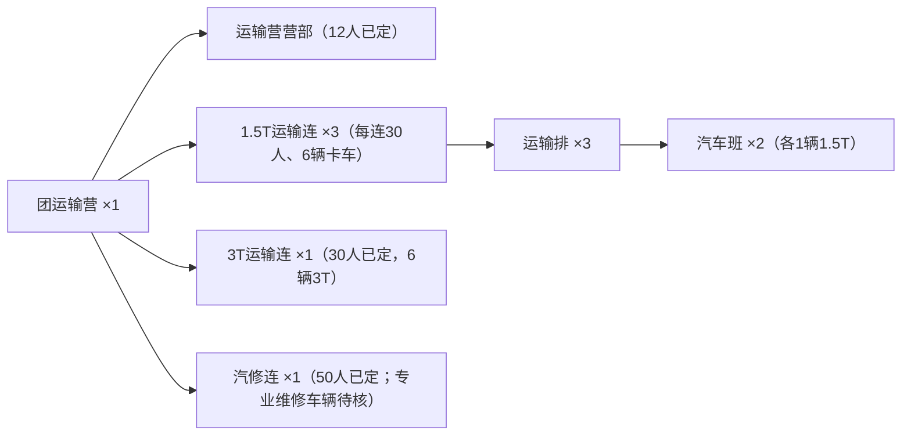

### 营属1.5T运输连（区别于团运输营所辖连）


| 已知小计 | 核算 | 结果 |
|---|---|---|
| 团运输营已明确载货车辆 | 18＋6 | 24辆 |
| 团运输营正式定额 | 12＋90＋30＋50 | 182人 |
| 营属六车运输连人员 | 6＋6＋18 | 30人 |

**边界与未定：**

- 团运输营正式增设第三个1.5T运输连，合计三个1.5T运输连（18辆车）和一个3T运输连（6辆车）。每个运输连沿用30人六车制。
- 团运输营营部12人、汽修连50人已定，营总人数182人，专业维修车辆与工具另待核。原先营属运输连仍为30人、不改变。
- 团和营的有机车辆优先运输转场重武器、装备和辎重；大宗弹药与额外人员的战役级运力由战役协调军按需提供。
- 后备营日常配用三辆1.5T卡车来自团运输营的18辆，不另算。全团已明确45辆机动车，尚不包括未确定的专业救护、抢修车辆。

**依据：** [10号 · topic-01](10-二战陆军与空军编制.md#topic-01)、[04号 · topic-02](04-二战陆军战术与保障.md#topic-02)。

</details>

<a id="ww2-medical-1938"></a>

<details>
<summary>ww2-medical-1938 · 团144人医疗连与下放营医疗排</summary>

**适用阶段：** 1938年基础团。**记录性质：** 已确认编制；缺项另标。

### 团直属医疗连架构

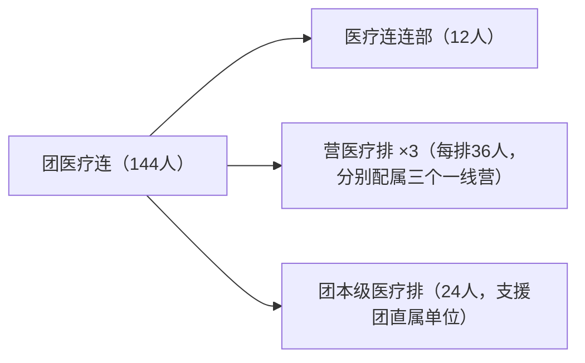

### 每个36人营医疗排

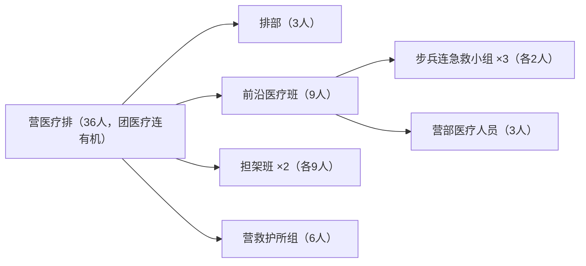

| 已知小计 | 核算 | 结果 |
|---|---|---|
| 营医疗排人员 | 3＋9＋18＋6 | 36人 |
| 团医疗连全部人员 | 12＋36＋36＋36＋24 | 144人 |

**边界与未定：**

- 团原医疗排升级为144人医疗连。原四个9人医疗班已包含在三个36人营医疗排与团本级24人医疗排内，不可另行重复计人数。
- 每个营医疗排36人：3人排部、9人原前沿医疗班、18人担架班、6人营救护所组。营前沿医疗班仍按三连各2人、营部3人配属。
- 团本级24人医疗排负责未附一线营的团直属专业连及后备营；其细分岗位暂待核定。
- 战役协调军接收伤员后负责远距离后送，医疗连不经营野战医院；专用救护车辆尚未定额。

**依据：** [10号 · topic-01](10-二战陆军与空军编制.md#topic-01)、[04号 · topic-02](04-二战陆军战术与保障.md#topic-02)。

</details>

<a id="ww2-tank-attachment"></a>

<details>
<summary>ww2-tank-attachment · 纵队装甲力量对步兵团的临时加强</summary>

**适用阶段：** 1942—1946年，纵队受领独立40式坦克营并按任务加强步兵团。**记录性质：** 任务加强示意；非永久团型。

### 纵队按任务受领装甲与步兵

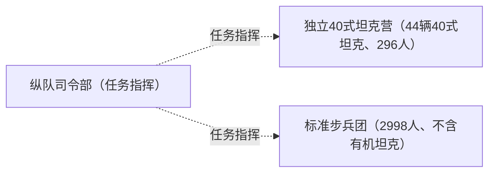

### 独立坦克营对团的临时加强

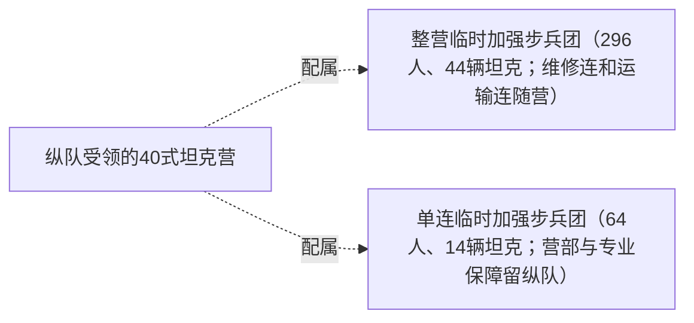

**下钻：** [ww2-rgt-1938 · 标准徒步步兵团](#ww2-rgt-1938)；[ww2-tank-bn-40 · 40式坦克营（44车296人）](#ww2-tank-bn-40)。

| 已知小计 | 核算 | 结果 |
|---|---|---|
| 整营加强时临时任务人员小计 | 2998＋296 | 3294人 |
| 单连加强时临时任务人员小计 | 2998＋64 | 3062人 |

**边界与未定：**

- 这两种临时人数小计均不改变标准步兵团2998人的永久定额，不得作为新团型或另设有机混成团。
- 坦克营保持上级独立装甲力量身份，纵队按任务分配、集中保留或向团下放；战役具体兵车数以实际配属为准。
- 1944年后期热点战区可能广泛实施步坦加强，但此前“超过50%的步兵团改为混成团”的编制比例不再有效。

**对照：** [ww2-tank-co-40](#ww2-tank-co-40)；[ww2-tank-bn-40](#ww2-tank-bn-40)。

**依据：** [03号 · topic-01](03-陆军军制.md#topic-01)、[10号 · topic-01](10-二战陆军与空军编制.md#topic-01)。

</details>

<a id="ww2-cavalry-46"></a>

<details>
<summary>ww2-cavalry-46 · 46辆混型装甲骑兵大队</summary>

**适用阶段：** 早期40式装甲骑兵组织；改编衔接未定。**记录性质：** 早期专业组织；非团属坦克营模板。

### 原装甲骑兵大队

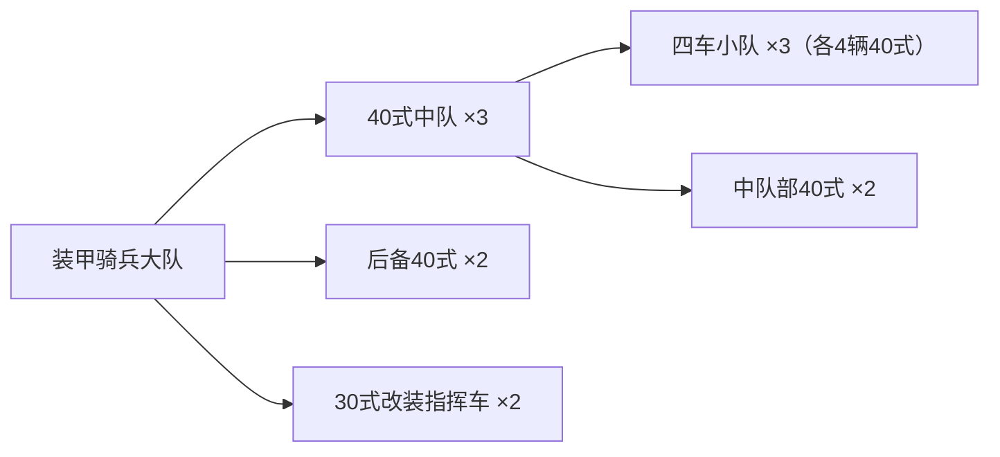

| 已知小计 | 核算 | 结果 |
|---|---|---|
| 履带车辆 | 42＋2＋2 | 46辆 |

**边界与未定：**

- 保留有效的早期组织记录；它不是团属44车坦克营，也不是在44车营外再加2辆指挥车的通用规则。

**依据：** [44号 · topic-03](44-早期陆军武器与车辆.md#topic-03)。

</details>

<a id="ww2-rocket-bn"></a>

<details>
<summary>ww2-rocket-bn · 43式250毫米自行火箭炮营</summary>

**适用阶段：** 1944年起优先战区列装。**记录性质：** 已确认编制；缺项另标。

### 营、连、火炮排与运输排

```mermaid
flowchart LR
    n0["43式火箭炮营"]
    n1["营部 ×1"]
    n2["通信排 ×1（车数及人员未定）"]
    n3["火箭炮连 ×4"]
    n4["连部FDC车 ×1（1.5T）"]
    n5["火炮排 ×2"]
    n6["12管发射车 ×2"]
    n7["运输排 ×2"]
    n8["整架自装卸运输车 ×4（每车12发模块）"]
    n1 --> n2
    n0 --> n1
    n3 --> n4
    n5 --> n6
    n3 --> n5
    n7 --> n8
    n3 --> n7
    n0 --> n3
```

| 已知小计 | 核算 | 结果 |
|---|---|---|
| 发射车 | 4＋4＋4＋4 | 16辆 |
| 整架运输车 | 8＋8＋8＋8 | 32辆 |
| 已明确机动车 | 16＋32＋4 | 52辆 |
| 携行弹量 | 192＋384 | 576发 |

**边界与未定：**

- 发射车和整架运输车分别由制式3T卡车改装；营不编有机炮兵侦察部队，情报来自战区。
- 运输排交替补充／待命；长期大宗弹药与整架装填由协调军承担。
- 576发是含两轮换装的库存量，不表示单位时间射速；营部通信及其他车辆未计入52辆。

**依据：** [10号 · topic-03](10-二战陆军与空军编制.md#topic-03)、[44号 · topic-06](44-早期陆军武器与车辆.md#topic-06)。

</details>

<a id="ww2-tank-co-40"></a>

<details>
<summary>ww2-tank-co-40 · 40式坦克连（14车64人）</summary>

**适用阶段：** 1942年以后40式坦克连成熟编制；各部队实到另核。**记录性质：** 已确认编制；专业岗位可细化。

### 坦克连至四车排

```mermaid
flowchart LR
    n0["40式坦克连（64人；14辆40式）"]
    n1["连部战车 ×2（8名乘员；指挥岗位在乘员内）"]
    n2["连部非车组人员（8人：士官、军需、通信、维护及炊事）"]
    n3["坦克排 ×3（每排4车、16人）"]
    n4["排长车（1辆、4人）"]
    n5["其他坦克 ×3（每车4人）"]
    n0 --> n1
    n0 --> n2
    n3 --> n4
    n3 --> n5
    n0 --> n3
```

| 已知小计 | 核算 | 结果 |
|---|---|---|
| 坦克连战斗车辆 | 2＋4＋4＋4 | 14辆 |
| 坦克连车组 | 8＋16＋16＋16 | 56人 |
| 坦克连全员 | 56＋8 | 64人 |

**边界与未定：**

- 四车排为1辆排长车＋3辆其他坦克，排长在车组内；连部2辆指挥坦克，连长、副连长也在车组内，指挥员额不得重复加人。
- 坦克连本体64人不包含来自坦克营的50人装甲维修连或30人运输连；受援团可提供基本维修，坦克专业维修由上级体系协调。
- 此人员定额只适用于二战40式4人车组，不将64人自动套入后来的FSV连。

**对照：** [ww2-tank-bn-40](#ww2-tank-bn-40)。

**依据：** [10号 · topic-01](10-二战陆军与空军编制.md#topic-01)、[44号 · topic-03](44-早期陆军武器与车辆.md#topic-03)。

</details>

<a id="ww2-tank-bn-40"></a>

<details>
<summary>ww2-tank-bn-40 · 40式坦克营（44车296人）</summary>

**适用阶段：** 1944年后期在热点战区广泛列装的40式坦克营。**记录性质：** 已确认编制；专用维护装备与装载细目另核。

### 坦克营完整有机编制

```mermaid
flowchart LR
    n0["40式坦克营（296人、44辆坦克、6辆3T卡车）"]
    n1["营部（24人、2辆40式坦克（8人车组含在内））"]
    n2["坦克连 ×3（每连64人、14辆坦克）"]
    n3["装甲维修连（50人；专业修理、抢修与回收）"]
    n4["营运输连（30人、6辆3T卡车）"]
    n5["运输连部（6人）"]
    n6["运输排 ×3（各排部2人）"]
    n7["汽车班 ×2（各3人、1辆3T卡车）"]
    n0 --> n1
    n0 --> n2
    n0 --> n3
    n4 --> n5
    n6 --> n7
    n4 --> n6
    n0 --> n4
```

### 整营加强团与单连下放的保障边界

```mermaid
flowchart LR
    n0["纵队装甲力量"]
    n1["坦克营整体加强某步兵团（296人，维修连及运输连随营进入团保障体系）"]
    n2["只下放一个坦克连（64人、14车进入受援团；营部、维修连与运输连留纵队）"]
    n0 -. 配属 .-> n1
    n0 -. 配属 .-> n2
```

**下钻：** [ww2-tank-co-40 · 40式坦克连（14车64人）](#ww2-tank-co-40)。

| 已知小计 | 核算 | 结果 |
|---|---|---|
| 坦克营战斗车辆 | 2＋14＋14＋14 | 44辆 |
| 坦克营3T卡车 | 6 | 6辆 |
| 坦克营完整定员 | 24＋64＋64＋64＋50＋30 | 296人 |

**边界与未定：**

- 营部通常与有机装甲维修连共同驻扎；维修连与运输连均为坦克营永久建制，不是营外另加的人员。
- 六辆3T卡车负责随营备用油料、车载之外一个弹药基数的补充弹药、部分备件及营部和维修连部分工具；18吨是标称载重，不等于储备载荷已经逐项配平。
- 仅一个坦克连下放步兵团时，营部、装甲维修连和运输连仍归纵队司令部保障体系；受援团原汽修力量可承担基础保养，专业装甲维修由纵队体系完成。
- 整个坦克营加入步兵团时，营部、三个坦克连、有机维修连和运输连全部随营进入团，维修连通常与营部同行。
- 独立坦克营由上级按任务交纵队使用，可整营或抽调坦克连加强步兵团；原“超过50%团改编混成团”的比例不再适用。
- 296人只属于二战40式坦克营，不能原样套用不同车组、不同保障结构的后续FSV营。

**对照：** [ww2-tank-co-40](#ww2-tank-co-40)。

**依据：** [10号 · topic-01](10-二战陆军与空军编制.md#topic-01)、[04号 · topic-01](04-二战陆军战术与保障.md#topic-01)、[44号 · topic-03](44-早期陆军武器与车辆.md#topic-03)。

</details>

<a id="era-armour"></a>

## 统一装甲营连定额

此处集中维护14车连、44车营，具体采用阶段由引用它的团／营模板限定。

<a id="armour-bn-44"></a>

<details>
<summary>armour-bn-44 · 44车坦克营／FSV营</summary>

**适用阶段：** 冷战独立FSV营与团属坦克营的后续统一组织定额。**记录性质：** 已确认编制；缺项另标。

### 同类战斗车辆集中成营

```mermaid
flowchart LR
    n0["坦克营或FSV营"]
    n1["营部战斗车辆 ×2"]
    n2["坦克连或FSV连 ×3"]
    n0 --> n1
    n0 --> n2
```

**下钻：** [armour-co-14 · 14车装甲连与四车排](#armour-co-14)。

| 已知小计 | 核算 | 结果 |
|---|---|---|
| 战斗车辆 | 2＋14＋14＋14 | 44辆 |

**边界与未定：**

- 全营为同一类战斗车辆；坦克和FSV不是混合凑满44辆。救援、维修、油弹及其他保障车辆另定。
- 早期实际兑现与独立FSV营分配与各团坦克营改编年份未定；不能向1938普通团、1965年前机械化团或未改编单位倒填。

**依据：** [19号 · topic-02](19-1970年代陆军野战体系与战区火力.md#topic-02)、[10号 · topic-01](10-二战陆军与空军编制.md#topic-01)。

</details>

<a id="armour-co-14"></a>

<details>
<summary>armour-co-14 · 14车装甲连与四车排</summary>

**适用阶段：** 统一连排定额；各阶段实到另核。**记录性质：** 已确认编制；缺项另标。

### 连至车辆排

```mermaid
flowchart LR
    n0["坦克连或FSV连"]
    n1["连部战斗车辆 ×2"]
    n2["车辆排 ×3"]
    n3["排长车 ×1"]
    n4["其他战斗车辆 ×3"]
    n0 --> n1
    n2 --> n3
    n2 --> n4
    n0 --> n2
```

| 已知小计 | 核算 | 结果 |
|---|---|---|
| 连战斗车辆 | 2＋4＋4＋4 | 14辆 |

**边界与未定：**

- 四车排与连部2车组成14车连；已明确的防空、通信、65E攻坚排等例外不套用四车制。

**依据：** [19号 · topic-02](19-1970年代陆军野战体系与战区火力.md#topic-02)。

</details>

<a id="era-coldwar"></a>

## 1950—1970年代：标准步兵与机械化步兵

1976年标准徒步团已定2630人；1976年机械化团三机步营、42辆坦克及团属保障骨架已有工作定额2626人。1960／1965年的早期机械化编制完整保留，未定的团级专业车辆、后备营换装人员仍留白。

<a id="task-forces-1970s"></a>

<details>
<summary>task-forces-1970s · 纵队—RTG—BTG—CTG战区任务指挥体系</summary>

**适用阶段：** 1970年代改革后；具体改革年份未定。**记录性质：** 战时TG身份与逐级资源分配；不另建永久机关。

### 常设基干转入战区任务身份

```mermaid
flowchart LR
    n0["纵队司令部"]
    n1["RTG团战术群（以常设合成团为基干）"]
    n2["BTG营战术群（以常设营为基干）"]
    n3["CTG连战术群（以常设连为基干；无加强也成立）"]
    n2 -. 任务指挥 .-> n3
    n1 -. 任务指挥 .-> n2
    n0 -. 任务指挥 .-> n1
```

### 逐级受领、集中保留与下放

```mermaid
flowchart LR
    n0["纵队／战区加强资产"]
    n1["RTG团级统筹"]
    n2["RTG集中保留资产"]
    n3["向BTG下放资产"]
    n4["BTG集中保留资产"]
    n5["向CTG下放资产"]
    n1 --> n2
    n3 --> n4
    n3 -. 任务指挥 .-> n5
    n1 -. 任务指挥 .-> n3
    n0 -. 配属 .-> n1
```

**边界与未定：**

- 团、营、连是常设行政建制；RTG、BTG、CTG是部队进入战区受领任务后的作战身份，通常依托原指挥机关迅速形成，协同关系具有一定稳定性。
- TG身份不要求原编制发生增减；原建制连即使暂未获得坦克、工兵或医疗加强，作为BTG下辖任务单位时仍称CTG。
- 各级指挥官逐级受领、集中保留和下放资产；炮兵火力支援不等于炮兵单位实体转隶。
- 一团一RTG、三营三BTG、每营三连三CTG是常见情形，不是所有任务必须保持的硬定额；任务图也不把TG数量重复算作常设建制。
- 本制度不倒套二战；现代44车坦克营能提供九个四车坦克排支持九个CTG，但不将其车型、定额倒套1970年代。

**对照：** [modern-btg](#modern-btg)；[modern-ctg](#modern-ctg)。

**依据：** [03号 · bct-doctrine](03-陆军军制.md#bct-doctrine)、[19号 · bct-reform](19-1970年代陆军野战体系与战区火力.md#bct-reform)。

</details>

<a id="cw-infantry-rgt"></a>

<details>
<summary>cw-infantry-rgt · 普通步兵团的已知骨架</summary>

**适用阶段：** 冷战初期普通／半摩托化团。**记录性质：** 已知骨架；团属机构未全定。

### 已确认的团营层级

```mermaid
flowchart LR
    n0["普通步兵团"]
    n1["团部 ×1（战后细编未定）"]
    n2["步兵营 ×3"]
    n3["团属后备营 ×1（战后员额未定）"]
    n4["其余团属单位未定"]
    n0 --> n1
    n0 --> n2
    n0 --> n3
    n0 -. 待定 .-> n4
```

**下钻：** [cw-infantry-bn · 战后步兵营的火力重组](#cw-infantry-bn)。

**边界与未定：**

- 后备营保留补充轮换职责，不把1938年的243名班员直接套到战后。
- 战后普通步兵与半摩托化早期阶段无永久有机FSV连；1970年代标准步兵另见新模板。

**依据：** [03号 · topic-01](03-陆军军制.md#topic-01)、[16号 · topic-02](16-冷战陆军步兵编制演变.md#topic-02)、[16号 · topic-03](16-冷战陆军步兵编制演变.md#topic-03)。

</details>

<a id="cw-infantry-bn"></a>

<details>
<summary>cw-infantry-bn · 战后步兵营的火力重组</summary>

**适用阶段：** 1950年代至1960年代普通／半摩托化营。**记录性质：** 已确认编制；缺项另标。

### 营直属火力专业化

```mermaid
flowchart LR
    n0["普通或半摩托化步兵营"]
    n1["营部 ×1（人装未定）"]
    n2["步兵连 ×3（连属37式2挺、90毫米炮2门）"]
    n3["120毫米迫击炮连 ×1"]
    n4["迫击炮排 ×3（每排2门）"]
    n5["防空排 ×1"]
    n6["机枪班 ×3（每班1挺15毫米）"]
    n7["营属保障细编未定"]
    n0 --> n1
    n0 --> n2
    n3 --> n4
    n0 --> n3
    n5 --> n6
    n0 --> n5
    n0 -. 待定 .-> n7
```

| 已知小计 | 核算 | 结果 |
|---|---|---|
| 营属120毫米迫击炮 | 2＋2＋2 | 6门 |
| 营属15毫米防空机枪 | 1＋1＋1 | 3挺 |

**边界与未定：**

- 二战混合重武器连已经撤销；人员补充统一归团直属后备营。
- 普通班已由9人压缩至7人；具体9人过渡岗位及变更年份未定。
- 半摩托化阶段步兵本体主要徒步，临时载员车辆来自协调军；有机载员车数未定。

**对照：** [cw-squad-7](#cw-squad-7)。

**依据：** [16号 · topic-03](16-冷战陆军步兵编制演变.md#topic-03)、[16号 · topic-04](16-冷战陆军步兵编制演变.md#topic-04)。

</details>

<a id="cw-squad-7"></a>

<details>
<summary>cw-squad-7 · 战后7人步兵班</summary>

**适用阶段：** 1950年代起，先于机械化步兵。**记录性质：** 已确认编制；缺项另标。

### 班内对称火力组

```mermaid
flowchart LR
    n0["步兵班"]
    n1["班长 ×1"]
    n2["三人火力组 ×2（每组3人）"]
    n0 --> n1
    n0 --> n2
```

| 已知小计 | 核算 | 结果 |
|---|---|---|
| 班员 | 1＋3＋3 | 7人 |

**边界与未定：**

- 已知结构为1＋3×2，1950年代组内全部岗位未单独锁定，不倒填2014年组长下挂榴弹发射器配置。
- 49式推进药筒由普通步兵携用，不额外设专职射手。

**依据：** [16号 · topic-03](16-冷战陆军步兵编制演变.md#topic-03)。

</details>

<a id="cw-mech-rgt-1960"></a>

<details>
<summary>cw-mech-rgt-1960 · 早期无坦克营机械化团</summary>

**适用阶段：** 1960年前后成熟机械化团；1965年前。**记录性质：** 已确认编制；缺项另标。

### 早期机械化团

```mermaid
flowchart LR
    n0["早期机械化团"]
    n1["团部 ×1（细编未定）"]
    n2["机械化步兵营 ×3"]
    n3["后备营 ×1（冷战定额未定）"]
    n4["其余直属及保障未定"]
    n0 --> n1
    n0 --> n2
    n0 --> n3
    n0 -. 待定 .-> n4
```

**下钻：** [cw-mech-bn-1960 · 47式机械化步兵营](#cw-mech-bn-1960)。

**边界与未定：**

- 1955年是实验营阶段，不能把1960年成熟编制和完成年份倒填到试验开始时。
- 此时机械化团尚未编入团属坦克营；有机FSV在机步排内，不另增团属FSV营。

**依据：** [16号 · topic-05](16-冷战陆军步兵编制演变.md#topic-05)、[19号 · topic-02](19-1970年代陆军野战体系与战区火力.md#topic-02)。

</details>

<a id="cw-mech-rgt-1965"></a>

<details>
<summary>cw-mech-rgt-1965 · 增设团属坦克营的机械化团</summary>

**适用阶段：** 1965年ZTZ-65服役后，逐团改编。**记录性质：** 已确认编制；缺项另标。

### 三机步营与团属坦克营

```mermaid
flowchart LR
    n0["改编后的机械化团"]
    n1["团部 ×1（细编未定）"]
    n2["机械化步兵营 ×3"]
    n3["团属T-65坦克营 ×1"]
    n0 --> n1
    n0 --> n2
    n0 --> n3
```

### 团直属支援与保障

```mermaid
flowchart LR
    n0["改编后的机械化团"]
    n1["机械化工兵连 ×1"]
    n2["通信连 ×1"]
    n3["防空连 ×1"]
    n4["155毫米炮兵连 ×1（6门）"]
    n0 --> n1
    n0 --> n2
    n0 --> n3
    n0 --> n4
```

### 团直属后备与运输

```mermaid
flowchart LR
    n0["改编后的机械化团"]
    n1["团直属后备营 ×1（乘坐ZS-47；数量未定）"]
    n2["团属运输营 ×1"]
    n3["3吨卡车运输连 ×2（每连6辆）"]
    n4["1.5吨卡车运输连 ×1（6辆）"]
    n5["汽修连 ×1（T-65底盘牵引车，数量未定）"]
    n6["其他直属机构细编未定"]
    n0 --> n1
    n2 --> n3
    n2 --> n4
    n2 --> n5
    n0 --> n2
    n0 -. 待定 .-> n6
```

**下钻：** [armour-bn-44 · 44车坦克营／FSV营](#armour-bn-44)；[cw-mech-bn-1960 · 47式机械化步兵营](#cw-mech-bn-1960)。

| 已知小计 | 核算 | 结果 |
|---|---|---|
| 已知核心战斗车辆 | 44＋44＋44＋44 | 176辆 |

**边界与未定：**

- 具体各团完成年份未定，不等于1965年全军同时配齐。
- 营内44辆APC／FSV为有机车辆，任务配属坦克不再与全团44辆坦克营重复累计。
- 坦克营加入后汽修连更新使用T-65底盘牵引车；后备营车辆数、炮兵牵引方式、防空武器及其余细编未定。
- 排级有机HZ-47 FSV用于火力、观察与指挥，团属T-65坦克营承担另一层级的装甲战斗任务；二者同时保留，不能相互取代。

**依据：** [16号 · topic-05](16-冷战陆军步兵编制演变.md#topic-05)、[19号 · topic-02](19-1970年代陆军野战体系与战区火力.md#topic-02)。

</details>

<a id="cw-mech-bn-1960"></a>

<details>
<summary>cw-mech-bn-1960 · 47式机械化步兵营</summary>

**适用阶段：** 1960年前后成熟；1970年代延用核心结构。**记录性质：** 已确认编制；缺项另标。

### 营骨架

```mermaid
flowchart LR
    n0["47式机械化步兵营"]
    n1["营部APC ×2"]
    n2["机械化步兵连 ×3"]
    n3["营属120毫米迫击炮 ×6（运载形式未定）"]
    n4["辎重维修保障细编未定"]
    n0 --> n1
    n0 --> n2
    n0 --> n3
    n0 -. 待定 .-> n4
```

**下钻：** [cw-mech-co-1960 · 47式机械化步兵连与排](#cw-mech-co-1960)。

| 已知小计 | 核算 | 结果 |
|---|---|---|
| 核心APC | 2＋10＋10＋10 | 32辆 |
| 核心FSV | 4＋4＋4 | 12辆 |
| 核心履带车辆 | 32＋12 | 44辆 |

**边界与未定：**

- 32辆APC＋12辆HZ-47只算核心履带车辆；不包含迫击炮运载、营辎重或保障车。
- APC车组3人、步兵班7人分列；这一时期排部人数不套用2014年的24人统一定额。

**依据：** [16号 · topic-05](16-冷战陆军步兵编制演变.md#topic-05)、[19号 · topic-02](19-1970年代陆军野战体系与战区火力.md#topic-02)。

</details>

<a id="cw-mech-co-1960"></a>

<details>
<summary>cw-mech-co-1960 · 47式机械化步兵连与排</summary>

**适用阶段：** 1960年前后成熟；1970年代延用。**记录性质：** 已确认编制；缺项另标。

### 连部与三个排

```mermaid
flowchart LR
    n0["机械化步兵连"]
    n1["连部 ×1"]
    n2["APC指挥车 ×1"]
    n3["2IC乘坐的HZ-47 ×1"]
    n4["机械化步兵排 ×3"]
    n5["ZS-47 APC ×3（各3名车组＋7人班）"]
    n6["HZ-47排长车 ×1"]
    n1 --> n2
    n1 --> n3
    n0 --> n1
    n4 --> n5
    n4 --> n6
    n0 --> n4
```

| 已知小计 | 核算 | 结果 |
|---|---|---|
| APC | 1＋3＋3＋3 | 10辆 |
| FSV | 1＋1＋1＋1 | 4辆 |

**边界与未定：**

- 连部HZ为前线指挥与火力节点，不是长期闲置备用车。
- 不另设传统连属机枪／无后坐力炮重武器分队。

**依据：** [16号 · topic-05](16-冷战陆军步兵编制演变.md#topic-05)。

</details>

<a id="cw-standard-rgt-1970s"></a>

<details>
<summary>cw-standard-rgt-1970s · 2630人标准步兵团与RTG(M)加强</summary>

**适用阶段：** 1976年后标准徒步步兵团。**记录性质：** 2630人及主要车辆火力已定，技术留白另记。

### 团部、三个营及直属作战分队

```mermaid
flowchart LR
    n0["标准步兵团（2630人）"]
    n1["团部 ×1（60人）"]
    n2["标准步兵营 ×3（每营498人）"]
    n3["团属后备营 ×1（302人）"]
    n4["侦察连 ×1（107人，轻型车由战区申领）"]
    n5["120毫米重迫击炮连 ×1（113人、9门炮、9辆有机牵引车）"]
    n6["团属防空排 ×1（20人，3发射车＋1弹药车）"]
    n0 --> n1
    n0 --> n2
    n0 --> n3
    n0 --> n4
    n0 --> n5
    n0 --> n6
```

### 团级专业保障

```mermaid
flowchart LR
    n0["标准步兵团团属保障"]
    n1["运输营 ×1（179人，27辆货运车）"]
    n2["工兵连 ×1（145人）"]
    n3["医疗连 ×1（144人）"]
    n4["通信连 ×1（66人）"]
    n0 --> n1
    n0 --> n2
    n0 --> n3
    n0 --> n4
```

### RTG(M)任务加强——非永久有机

```mermaid
flowchart LR
    n0["基础标准步兵团组成RTG(M)（2630人为常设基数）"]
    n1["战区分配MBT营 ×1（专业保障随营）"]
    n2["纵队155毫米榴弹炮力量（火力支援或按任务配属）"]
    n3["战区额外载员卡车（按任务配发，非团有机）"]
    n0 -. 配属 .-> n1
    n0 -. 支援 .-> n2
    n0 -. 配属 .-> n3
```

**下钻：** [cw-reg-ad-pl-1976 · 20人团属IRSAM防空排](#cw-reg-ad-pl-1976)；[cw-reg-engineer-co-1976 · 145人团属工兵连](#cw-reg-engineer-co-1976)；[cw-reg-hq-1976 · 60人团部](#cw-reg-hq-1976)；[cw-reg-medical-co-1976 · 144人团属医疗连](#cw-reg-medical-co-1976)；[cw-reg-mortar-co-1976 · 113人团属120毫米重迫击炮连](#cw-reg-mortar-co-1976)；[cw-reg-reserve-bn-1976 · 302人团属后备营](#cw-reg-reserve-bn-1976)；[cw-reg-scout-co-1976 · 107人团属侦察连](#cw-reg-scout-co-1976)；[cw-reg-signals-co-1976 · 66人团属通信连](#cw-reg-signals-co-1976)；[cw-reg-transport-bn-1976 · 179人团属运输营](#cw-reg-transport-bn-1976)；[cw-standard-bn-1976 · 498人标准步兵营、39人九车运输连](#cw-standard-bn-1976)。

| 已知小计 | 核算 | 结果 |
|---|---|---|
| 全团定员 | 60＋498＋498＋498＋179＋302＋145＋144＋66＋107＋20＋113 | 2630人 |
| 载货汽车 | 18＋9＋9＋18 | 54辆 |
| 明确有机汽车 | 54＋9＋4 | 67辆 |
| 全团迫击炮 | 18＋9 | 27门 |

**边界与未定：**

- 团部60＋3个498人营1494＋运输179＋后备302＋工兵145＋医疗144＋通信66＋侦察107＋防空20＋重迫击炮113＝2630人；借调与任务配属人员不重复计算。
- 团属有机载货汽车54辆（5T×27、2.5T×27），货运标称202.5吨；加9辆0.5T重迫击炮有机牵引车和4辆2.5T防空专用车，已明确67辆汽车。其余专用汽车和战区申领车另计。
- 团属间接火力9门120毫米迫击炮，三个营另有18门81毫米迫击炮；团不编有机155毫米榴弹炮。
- 普通4×4、0.5T轻型车通常向战区申领，侦察连不列有机车；迫击炮连9辆固定牵引车为例外。
- 1976年典型RTG(M)由战区MBT营、额外载员运力和纵队155毫米火力加强；FSV主要绑定机械化步兵，1950—1960年代独立FSV的早期史不追溯删除。

**对照：** [cw-standard-bn-1976](#cw-standard-bn-1976)；[task-forces-1970s](#task-forces-1970s)。

**依据：** [16号 · topic-06](16-冷战陆军步兵编制演变.md#topic-06)、[19号 · topic-03](19-1970年代陆军野战体系与战区火力.md#topic-03)。

</details>

<a id="cw-standard-bn-1976"></a>

<details>
<summary>cw-standard-bn-1976 · 498人标准步兵营、39人九车运输连</summary>

**适用阶段：** 1976年75式「剑」成熟后的标准步兵营。**记录性质：** 全营498人及专业分队定额已确定。

### 标准营永久有机编制

```mermaid
flowchart LR
    n0["标准步兵营"]
    n1["营部 ×1（38人：指挥8、通信18、勤务12；无有机0.5T车）"]
    n2["标准步兵连 ×3（每连107人）"]
    n3["重武器连 ×1（100人：连部16、防空12、ATGM33、迫击炮39）"]
    n4["运输连 ×1（39人：2.5T六辆、5T三辆）"]
    n0 --> n1
    n0 --> n2
    n0 --> n3
    n0 --> n4
```

### 战役汽车运输配属

```mermaid
flowchart LR
    n0["战役协调体系／上级运输单位"]
    n1["临时运输标准步兵营人员（不属于营有机载员车辆）"]
    n0 -. 配属 .-> n1
```

**下钻：** [cw-standard-co-1970s · 107人标准步兵连](#cw-standard-co-1970s)；[cw-standard-heavy-co-1976 · 100人重武器连：三个专业排](#cw-standard-heavy-co-1976)；[cw-standard-transport-1970s · 39人营属运输连、9辆卡车](#cw-standard-transport-1970s)。

| 已知小计 | 核算 | 结果 |
|---|---|---|
| 全营定员 | 38＋107＋107＋107＋100＋39 | 498人 |
| 三个步兵连人数 | 107＋107＋107 | 321人 |
| 三个步兵连37式重型机枪 | 3＋3＋3 | 9挺 |
| 三个步兵连班用37式自动步枪 | 18＋18＋18 | 54支 |
| 81毫米迫击炮 | 2＋2＋2 | 6门 |
| 运输连卡车 | 3＋3＋3 | 9辆 |

**边界与未定：**

- 营部38＋三个107人步兵连321＋重武器连100＋运输连39＝498人。团医疗连配属的36人医疗排以及后备营借调人员不重复列入营额。
- 重武器连12人单兵防空排、33人75式「剑」ATGM排、39人81毫米迫击炮排；营级6个ATGM发射组常按任务分散。
- 营运输连39人、九辆货车、标称30吨；没有有机普通0.5T轻型车和足以同时搭载全营的有机载员车辆。

**依据：** [16号 · topic-07](16-冷战陆军步兵编制演变.md#topic-07)。

</details>

<a id="cw-standard-co-1970s"></a>

<details>
<summary>cw-standard-co-1970s · 107人标准步兵连</summary>

**适用阶段：** 1970年代标准徒步步兵连。**记录性质：** 已确认编制；缺项另标。

### 连部、步兵排及机枪排

```mermaid
flowchart LR
    n0["标准步兵连"]
    n1["连部 ×1（16人，指挥3、行政军需3、通信5、炊事5）"]
    n2["步兵排 ×3（各24人）"]
    n3["机枪排 ×1（19人，3挺37式重机枪）"]
    n0 --> n1
    n0 --> n2
    n0 --> n3
```

**下钻：** [cw-standard-mg-platoon-1970s · 19人机枪排](#cw-standard-mg-platoon-1970s)；[cw-standard-platoon-1970s · 24人步兵排与7人班](#cw-standard-platoon-1970s)。

| 已知小计 | 核算 | 结果 |
|---|---|---|
| 全连人员 | 16＋24＋24＋24＋19 | 107人 |
| 连属重型通用机枪 | 1＋1＋1 | 3挺 |

**边界与未定：**

- 全连107人；没有连属60毫米迫击炮或90毫米无后坐力炮。
- 排无有机载员车，临时任务乘车的驾驶员不计入本连。

**依据：** [16号 · topic-07](16-冷战陆军步兵编制演变.md#topic-07)。

</details>

<a id="cw-standard-platoon-1970s"></a>

<details>
<summary>cw-standard-platoon-1970s · 24人步兵排与7人班</summary>

**适用阶段：** 1970年代标准步兵排。**记录性质：** 编制已确认，未定项另标。

### 步兵排与对称火力组

```mermaid
flowchart LR
    n0["步兵排"]
    n1["排部 ×1（3人：排长、排军士长、通信兵）"]
    n2["步兵班 ×3（每班7人）"]
    n3["班长 ×1"]
    n4["三人火力组 ×2（组长、37式自动步枪手和半自动步枪手各1）"]
    n0 --> n1
    n2 --> n3
    n2 --> n4
    n0 --> n2
```

| 已知小计 | 核算 | 结果 |
|---|---|---|
| 全排人员 | 3＋7＋7＋7 | 24人 |
| 班用37式自动步枪 | 2＋2＋2 | 6支 |

**边界与未定：**

- 每排24人＝3人排部＋3个7人班；取消副排长。
- 每班2支37式自动步枪、至少2具破甲型49式推进药筒，另可携不兼容手榴弹的专用高爆破片型；无专职火箭射手。
- 排不拥有有机载员卡车。

**依据：** [16号 · topic-07](16-冷战陆军步兵编制演变.md#topic-07)。

</details>

<a id="cw-standard-mg-platoon-1970s"></a>

<details>
<summary>cw-standard-mg-platoon-1970s · 19人机枪排</summary>

**适用阶段：** 1970年代连属机枪排。**记录性质：** 编制已确认，未定项另标。

### 排部与机枪班

```mermaid
flowchart LR
    n0["机枪排"]
    n1["排部 ×1（3人：排长、枪炮军士长、通信兵）"]
    n2["机枪班 ×1（16人）"]
    n3["军需军士 ×1（行政与弹药管理，不指挥作战）"]
    n4["机枪组 ×3（每组5人、1挺37式重型通用机枪）"]
    n0 --> n1
    n2 --> n3
    n2 --> n4
    n0 --> n2
```

| 已知小计 | 核算 | 结果 |
|---|---|---|
| 全排人员 | 3＋1＋5＋5＋5 | 19人 |
| 重型通用机枪 | 1＋1＋1 | 3挺 |

**边界与未定：**

- 机枪组接受连长或任务加强的受援步兵排排长的战术指挥；军需军士担任行政班长。

**依据：** [16号 · topic-07](16-冷战陆军步兵编制演变.md#topic-07)。

</details>

<a id="cw-standard-heavy-co-1976"></a>

<details>
<summary>cw-standard-heavy-co-1976 · 100人重武器连：三个专业排</summary>

**适用阶段：** 1976年后营属重武器连。**记录性质：** 编制已确认，未定项另标。

### 三个专业武器排

```mermaid
flowchart LR
    n0["重武器连"]
    n1["连部 ×1（16人）"]
    n2["防空排 ×1（12人，排部3＋3个3人导弹组）"]
    n3["单兵防空导弹组 ×3（每组3人）"]
    n4["75式剑反坦克导弹排 ×1（33人，排部3＋6个5人发射组）"]
    n5["ATGM组 ×6（每组5人，通常分散配属）"]
    n6["81毫米迫击炮排 ×1（39人，排部6＋3个11人双炮班）"]
    n7["迫击炮班 ×3（每班11人、2门81毫米炮）"]
    n0 --> n1
    n2 --> n3
    n0 --> n2
    n4 --> n5
    n0 --> n4
    n6 --> n7
    n0 --> n6
```

| 已知小计 | 核算 | 结果 |
|---|---|---|
| 重武器连人员 | 16＋12＋33＋39 | 100人 |
| 75式剑ATGM组 | 1＋1＋1＋1＋1＋1 | 6组 |
| 防空导弹组 | 1＋1＋1 | 3组 |
| 81毫米迫击炮 | 2＋2＋2 | 6门 |

**边界与未定：**

- 重武器连有机100人：16人连部＋12人单兵防空排＋33人ATGM排＋39人迫击炮排。
- 每营6个75式「剑」发射组与6门81毫米迫击炮，ATGM组惯常分散加强各步兵连；团属IRSAM车载防空排不属于本连。

**依据：** [16号 · topic-07](16-冷战陆军步兵编制演变.md#topic-07)。

</details>

<a id="cw-standard-transport-1970s"></a>

<details>
<summary>cw-standard-transport-1970s · 39人营属运输连、9辆卡车</summary>

**适用阶段：** 1970年代营属运输连。**记录性质：** 编制已确认，未定项另标。

### 三排九车

```mermaid
flowchart LR
    n0["营运输连"]
    n1["连部 ×1（6人）"]
    n2["第一运输排 ×1（11人：排部2＋三个3人汽车班）"]
    n3["2.5T卡车 ×3（6×4，三个步兵连辎重）"]
    n4["第二运输排 ×1（11人：排部2＋三个3人汽车班）"]
    n5["5T卡车 ×3（6×6，重武器连与弹药）"]
    n6["第三运输排 ×1（11人：排部2＋三个3人汽车班）"]
    n7["2.5T卡车 ×3（6×4，营部及综合运输）"]
    n0 --> n1
    n2 --> n3
    n0 --> n2
    n4 --> n5
    n0 --> n4
    n6 --> n7
    n0 --> n6
```

| 已知小计 | 核算 | 结果 |
|---|---|---|
| 运输连定员 | 6＋11＋11＋11 | 39人 |
| 运输连车辆 | 3＋3＋3 | 9辆 |

**边界与未定：**

- 连部6人＋三个11人运输排＝39人；每排三辆卡车、每汽车班三人。
- 卡车共9辆、标称30吨：2.5T六辆、5T三辆。专业车辆归运输连，按任务惯常保障其他单位不改变其有机归属。
- 普通步兵乘车转场由战区另行提供汽车及车组。

**依据：** [16号 · topic-07](16-冷战陆军步兵编制演变.md#topic-07)。

</details>

<a id="cw-armoured-cavalry"></a>

<details>
<summary>cw-armoured-cavalry · 装甲骑兵战斗群</summary>

**适用阶段：** 1970年代战区专业力量。**记录性质：** 已确认编制；缺项另标。

### 已定骨架

```mermaid
flowchart LR
    n0["装甲骑兵战斗群"]
    n1["T-65坦克连 ×2"]
    n2["HZ-47 FSV连 ×1"]
    n3["机械化步兵连 ×1"]
    n4["群级机关及保障未定"]
    n0 --> n1
    n0 --> n2
    n0 --> n3
    n0 -. 待定 .-> n4
```

**下钻：** [armour-co-14 · 14车装甲连与四车排](#armour-co-14)；[cw-mech-co-1960 · 47式机械化步兵连与排](#cw-mech-co-1960)。

| 已知小计 | 核算 | 结果 |
|---|---|---|
| 标准坦克 | 14＋14 | 28辆 |

**边界与未定：**

- FSV连可用三个4车排加强机步连三个排；机步连本有的有机HZ仍保留，不把加强当成额外固定排级建制。
- 全国数量另待分期确认，不能由专业战斗群数量反推普通团数。

**依据：** [19号 · topic-04](19-1970年代陆军野战体系与战区火力.md#topic-04)。

</details>

<a id="cw-reg-hq-1976"></a>

<details>
<summary>cw-reg-hq-1976 · 60人团部</summary>

**适用阶段：** 1976年后标准步兵团。**记录性质：** 正式定额；未定专业装备另标。

### 永久有机建制

```mermaid
flowchart LR
    n0["团部（60人）"]
    n1["指挥及团士官长 ×1（4人）"]
    n2["作战组 ×1（10人）"]
    n3["情报侦察组 ×1（8人）"]
    n4["后勤装备组 ×1（10人）"]
    n5["人事行政文书组 ×1（8人）"]
    n6["机关警卫炊事勤务组 ×1（20人）"]
    n0 --> n1
    n0 --> n2
    n0 --> n3
    n0 --> n4
    n0 --> n5
    n0 --> n6
```

| 已知小计 | 核算 | 结果 |
|---|---|---|
| 团部 | 4＋10＋8＋10＋8＋20 | 60人 |

**边界与未定：**

- 团部不固定列编通用4×4、0.5T轻型汽车，依任务向战区申领。

**依据：** [16号 · topic-06](16-冷战陆军步兵编制演变.md#topic-06)。

</details>

<a id="cw-reg-reserve-bn-1976"></a>

<details>
<summary>cw-reg-reserve-bn-1976 · 302人团属后备营</summary>

**适用阶段：** 1976年后标准步兵团。**记录性质：** 正式定额；未定专业装备另标。

### 永久有机建制

```mermaid
flowchart LR
    n0["团后备营（302人）"]
    n1["营部 ×1（38人）"]
    n2["补充连 ×3（各88人）"]
    n3["连部 ×1（16人）"]
    n4["补充排 ×3（每排24人：排部3＋三个7人班）"]
    n5["7人补充班 ×3（随一线补充、轮休）"]
    n0 --> n1
    n2 --> n3
    n4 --> n5
    n2 --> n4
    n0 --> n2
```

| 已知小计 | 核算 | 结果 |
|---|---|---|
| 团属后备营 | 38＋88＋88＋88 | 302人 |
| 单个补充连 | 16＋24＋24＋24 | 88人 |

**边界与未定：**

- 后备营训练补充、轮换和二线勤务，非第四个同等作战营；借调到前沿的后备人员不再计入受援营常设定员。

**依据：** [16号 · topic-06](16-冷战陆军步兵编制演变.md#topic-06)。

</details>

<a id="cw-reg-scout-co-1976"></a>

<details>
<summary>cw-reg-scout-co-1976 · 107人团属侦察连</summary>

**适用阶段：** 1976年后标准步兵团。**记录性质：** 正式定额；未定专业装备另标。

### 永久有机建制

```mermaid
flowchart LR
    n0["团侦察连（107人）"]
    n1["连部 ×1（16人）"]
    n2["侦察排 ×3（每排24人）"]
    n3["排部 ×1（3人）"]
    n4["侦察班 ×3（各7人）"]
    n5["侦察保障排 ×1（19人，观察、通信与测绘）"]
    n0 --> n1
    n2 --> n3
    n2 --> n4
    n0 --> n2
    n0 --> n5
```

| 已知小计 | 核算 | 结果 |
|---|---|---|
| 团侦察连 | 16＋24＋24＋24＋19 | 107人 |

**边界与未定：**

- 107人仅与普通步兵连人数相同，武器与侦察专业通信器材另定。
- 通用4×4、0.5T侦察卡车由战区按任务申领，非侦察连有机车辆。

**依据：** [16号 · topic-06](16-冷战陆军步兵编制演变.md#topic-06)。

</details>

<a id="cw-reg-mortar-co-1976"></a>

<details>
<summary>cw-reg-mortar-co-1976 · 113人团属120毫米重迫击炮连</summary>

**适用阶段：** 1976年后标准步兵团。**记录性质：** 正式定额；未定专业装备另标。

### 永久有机建制

```mermaid
flowchart LR
    n0["120毫米重迫击炮连（113人／9门／9辆0.5T牵引车）"]
    n1["连部 ×1（17人）"]
    n2["重迫击炮排 ×3（每排32人）"]
    n3["排部 ×1（5人）"]
    n4["120毫米炮班 ×3（各9人、1门炮＋1辆4×4 0.5T专用牵引车）"]
    n0 --> n1
    n2 --> n3
    n2 --> n4
    n0 --> n2
```

| 已知小计 | 核算 | 结果 |
|---|---|---|
| 迫击炮连人员 | 17＋32＋32＋32 | 113人 |
| 120毫米迫击炮 | 3＋3＋3 | 9门 |
| 有机0.5T牵引车 | 3＋3＋3 | 9辆 |

**边界与未定：**

- 每炮班9人包含专用牵引车驾驶员；炮弹大宗运输由团运输体系保障。
- 通用0.5T汽车通常按任务申领，炮连九辆一对一牵引车为明确有机例外。

**依据：** [16号 · topic-06](16-冷战陆军步兵编制演变.md#topic-06)。

</details>

<a id="cw-reg-ad-pl-1976"></a>

<details>
<summary>cw-reg-ad-pl-1976 · 20人团属IRSAM防空排</summary>

**适用阶段：** 1976年后标准步兵团。**记录性质：** 正式定额；未定专业装备另标。

### 永久有机建制

```mermaid
flowchart LR
    n0["团直属IRSAM防空排（20人、4辆2.5T专用车）"]
    n1["排部 ×1（4人）"]
    n2["双联装IRSAM发射车组 ×3（各4人、1辆6×4 2.5T底盘车、2枚待发弹）"]
    n3["弹药车组 ×1（4人、1辆6×4 2.5T专用弹药车）"]
    n0 --> n1
    n0 --> n2
    n0 --> n3
```

| 已知小计 | 核算 | 结果 |
|---|---|---|
| 团防空排人员 | 4＋4＋4＋4＋4 | 20人 |
| 专用防空车辆 | 3＋1 | 4辆 |
| 车载待发IRSAM | 2＋2＋2 | 6枚 |

**边界与未定：**

- 与三个步兵营各自的12人单兵防空排分属不同层级；备用导弹量、警戒/空情设备具体型号仍未定。

**依据：** [16号 · topic-06](16-冷战陆军步兵编制演变.md#topic-06)。

</details>

<a id="cw-reg-transport-bn-1976"></a>

<details>
<summary>cw-reg-transport-bn-1976 · 179人团属运输营</summary>

**适用阶段：** 1976年后标准步兵团。**记录性质：** 正式定额；未定专业装备另标。

### 永久有机建制

```mermaid
flowchart LR
    n0["团运输营（179人、27辆货运车）"]
    n1["营部 ×1（12人）"]
    n2["5T运输连 ×2（各39人、9辆5T）"]
    n3["连部 ×1（6人）"]
    n4["5T运输排 ×3（每排11人、3辆6×6 5T卡车）"]
    n5["2.5T运输连 ×1（39人、9辆2.5T）"]
    n6["连部 ×1（6人）"]
    n7["2.5T运输排 ×3（每排11人、3辆6×4 2.5T卡车）"]
    n8["汽修连 ×1（50人，专用抢修车辆未定）"]
    n0 --> n1
    n2 --> n3
    n2 --> n4
    n0 --> n2
    n5 --> n6
    n5 --> n7
    n0 --> n5
    n0 --> n8
```

| 已知小计 | 核算 | 结果 |
|---|---|---|
| 团运输营人员 | 12＋39＋39＋39＋50 | 179人 |
| 团运输营载货车 | 9＋9＋9 | 27辆 |

**边界与未定：**

- 三个运输连均为连部6人＋三个11人运输排；每排3个三人汽车班与2人排部。
- 5T运输连各9辆，2.5T运输连9辆；团运输营公共货运标称能力112.5吨。
- 汽修连50人对团营车辆实施专业维修，专业抢修车数量仍未定。

**依据：** [16号 · topic-06](16-冷战陆军步兵编制演变.md#topic-06)。

</details>

<a id="cw-reg-engineer-co-1976"></a>

<details>
<summary>cw-reg-engineer-co-1976 · 145人团属工兵连</summary>

**适用阶段：** 1976年后标准步兵团。**记录性质：** 正式定额；未定专业装备另标。

### 永久有机建制

```mermaid
flowchart LR
    n0["团工兵连（145人）"]
    n1["连部 ×1（16人）"]
    n2["工兵排 ×3（每排36人：3人排部＋3个11人工兵班）"]
    n3["专业器材排 ×1（21人：3人排部＋2个9人专业班）"]
    n0 --> n1
    n0 --> n2
    n0 --> n3
```

| 已知小计 | 核算 | 结果 |
|---|---|---|
| 工兵连人员 | 16＋36＋36＋36＋21 | 145人 |

**边界与未定：**

- 沿用二战成熟工程专业分工及人数，但设备、作业器材与专业车辆更新另定。

**依据：** [16号 · topic-06](16-冷战陆军步兵编制演变.md#topic-06)。

</details>

<a id="cw-reg-medical-co-1976"></a>

<details>
<summary>cw-reg-medical-co-1976 · 144人团属医疗连</summary>

**适用阶段：** 1976年后标准步兵团。**记录性质：** 正式定额；未定专业装备另标。

### 永久有机建制

```mermaid
flowchart LR
    n0["团医疗连（144人）"]
    n1["连部 ×1（12人）"]
    n2["营医疗排 ×3（各36人，惯常加强一线营）"]
    n3["团本级医疗排 ×1（24人，团直属部队和后备营）"]
    n0 --> n1
    n0 --> n2
    n0 --> n3
```

| 已知小计 | 核算 | 结果 |
|---|---|---|
| 团医疗连人数 | 12＋36＋36＋36＋24 | 144人 |

**边界与未定：**

- 三个36人营医疗排永久属团医疗连；不再计入498人营额。
- 救护专用车辆与后送技术细节未定；不能把所有普通轻型汽车列为医疗连有机车辆。

**依据：** [16号 · topic-06](16-冷战陆军步兵编制演变.md#topic-06)。

</details>

<a id="cw-reg-signals-co-1976"></a>

<details>
<summary>cw-reg-signals-co-1976 · 66人团属通信连</summary>

**适用阶段：** 1976年后标准步兵团。**记录性质：** 正式定额；未定专业装备另标。

### 永久有机建制

```mermaid
flowchart LR
    n0["团通信连（66人）"]
    n1["连部 ×1（12人）"]
    n2["无线通信排 ×1（18人）"]
    n3["有线通信排 ×1（18人）"]
    n4["通信保障排 ×1（18人）"]
    n0 --> n1
    n0 --> n2
    n0 --> n3
    n0 --> n4
```

| 已知小计 | 核算 | 结果 |
|---|---|---|
| 通信连人员 | 12＋18＋18＋18 | 66人 |

**边界与未定：**

- 团属通信人员不与营部和步兵连自身的通信岗位重复计人。

**依据：** [16号 · topic-06](16-冷战陆军步兵编制演变.md#topic-06)。

</details>

<a id="cw-mech-pl-1976"></a>

<details>
<summary>cw-mech-pl-1976 · 35人机械化步兵排与四车组</summary>

**适用阶段：** 1976年标准机步营。**记录性质：** 1976年新编制：明确项与暂定工作定额分别标注。

### 排内车组与步兵班

```mermaid
flowchart LR
    n0["机械化步兵排（35人、ZS-47×3、HZ-47×1）"]
    n1["ZS-47与7人步兵班 ×3（各3名车组＋7名下车步兵）"]
    n2["排部指挥人员 ×1（排长与通信兵2人，乘HZ-47）"]
    n3["HZ-47独立车组 ×1（3人；兼排级直射火力、指挥）"]
    n0 --> n1
    n0 --> n2
    n0 --> n3
```

| 已知小计 | 核算 | 结果 |
|---|---|---|
| 机步排人员 | 30＋2＋3 | 35人 |

**边界与未定：**

- 排军士长由三个步兵班长之一兼任，不另加人员；不设置独立副排长。
- ZS-47车长与下车步兵班长分列，不把车组算入7人步兵班。

**依据：** [16号 · 1976机步营](16-冷战陆军步兵编制演变.md#mech-bn-1976)。

</details>

<a id="cw-mech-co-1976"></a>

<details>
<summary>cw-mech-co-1976 · 129人机械化步兵连</summary>

**适用阶段：** 1976年标准机步营。**记录性质：** 1976年新编制：明确项与暂定工作定额分别标注。

### 连部、三机步排和勤务班

```mermaid
flowchart LR
    n0["机械化步兵连（129人；10辆ZS、4辆HZ、1辆1.5T卡车）"]
    n1["连部 ×1（15人、ZS-47×1与HZ-47×1）"]
    n2["机步排 ×3（每排35人）"]
    n3["勤务班 ×1（9人、1.5T卡车×1）"]
    n0 --> n1
    n0 --> n2
    n0 --> n3
```

| 已知小计 | 核算 | 结果 |
|---|---|---|
| 机械化步兵连人员 | 15＋35＋35＋35＋9 | 129人 |

**边界与未定：**

- 连部ZS-47：3名独立车组＋7名连部乘员；连部HZ-47：3名车组＋2名指挥乘员。
- 每个排另有3辆ZS-47与1辆HZ-47；一连合计10辆ZS、4辆HZ、1辆1.5T卡车。

**对照：** [cw-mech-pl-1976](#cw-mech-pl-1976)。

**依据：** [16号 · 1976机步营](16-冷战陆军步兵编制演变.md#mech-bn-1976)。

</details>

<a id="cw-mech-bn-ad-1976"></a>

<details>
<summary>cw-mech-bn-ad-1976 · 20人营属单兵防空排</summary>

**适用阶段：** 1976年标准机步营。**记录性质：** 1976年新编制：明确项与暂定工作定额分别标注。

### 营部直属防空排

```mermaid
flowchart LR
    n0["单兵防空排（20人、ZS-47×2）"]
    n1["排部 ×1（2人）"]
    n2["三人SAM小组 ×4（各3人）"]
    n3["ZS-47车组 ×2（每组3人）"]
    n0 --> n1
    n0 --> n2
    n0 --> n3
```

| 已知小计 | 核算 | 结果 |
|---|---|---|
| 营防空排人员 | 2＋12＋6 | 20人 |

**边界与未定：**

- 每辆ZS-47搭载两组三人SAM小组与一名排部人员；车组3人与搭乘7人分列。

**依据：** [16号 · 1976机步营](16-冷战陆军步兵编制演变.md#mech-bn-1976)。

</details>

<a id="cw-mech-bn-mortar-1976"></a>

<details>
<summary>cw-mech-bn-mortar-1976 · 42人ZS-47底盘自行120毫米迫击炮连</summary>

**适用阶段：** 1976年标准机步营。**记录性质：** 1976年新编制：明确项与暂定工作定额分别标注。

### 自行迫击炮连

```mermaid
flowchart LR
    n0["自行120毫米重迫击炮连（42人、六辆ZS-47底盘迫击炮车）"]
    n1["连部 ×1（9人）"]
    n2["迫击炮排 ×3（每排11人、120毫米自行迫击炮×2）"]
    n3["排部 ×1（3人）"]
    n4["自行迫击炮车组 ×2（各4人）"]
    n0 --> n1
    n2 --> n3
    n2 --> n4
    n0 --> n2
```

| 已知小计 | 核算 | 结果 |
|---|---|---|
| 迫击炮连人员 | 9＋11＋11＋11 | 42人 |
| 自行120毫米迫击炮 | 2＋2＋2 | 6辆 |

**边界与未定：**

- 炮车由ZS-47改开顶射击舱口并装120毫米迫击炮，不是独立开发重炮底盘。
- 每车车长兼炮长、驾驶员、炮手、装填手各1；连排非车组18人由营运输连的人员机动排保障。
- 车内炮座加固、备弹与射界尚待技术确认。

**依据：** [16号 · 1976机步营](16-冷战陆军步兵编制演变.md#mech-bn-1976)。

</details>

<a id="cw-mech-bn-transport-1976"></a>

<details>
<summary>cw-mech-bn-transport-1976 · 39人九车营运输连</summary>

**适用阶段：** 1976年标准机步营。**记录性质：** 1976年新编制：明确项与暂定工作定额分别标注。

### 三排九车制

```mermaid
flowchart LR
    n0["营运输连（39人、9辆卡车）"]
    n1["连部 ×1（6人）"]
    n2["2.5T普通运输排 ×1（11人、普通货车3辆）"]
    n3["5T专用运输排 ×1（11人、油／水／弹药车各1辆）"]
    n4["2.5T人员机动排 ×1（11人、货车3辆，重武器非车组人员机动）"]
    n0 --> n1
    n0 --> n2
    n0 --> n3
    n0 --> n4
```

| 已知小计 | 核算 | 结果 |
|---|---|---|
| 营运输连人员 | 6＋11＋11＋11 | 39人 |
| 营运输连卡车 | 3＋3＋3 | 9辆 |

**边界与未定：**

- 每个排两人排部＋三组3人汽车班。
- 车辆永久属运输连，支援重迫击炮连不改变编制归属。

**依据：** [16号 · 1976机步营](16-冷战陆军步兵编制演变.md#mech-bn-1976)。

</details>

<a id="cw-mech-bn-hq-1976"></a>

<details>
<summary>cw-mech-bn-hq-1976 · 60人机械化营部（含维修与防空）</summary>

**适用阶段：** 1976年标准机步营。**记录性质：** 1976年新编制：明确项与暂定工作定额分别标注。

### 营部直接下辖

```mermaid
flowchart LR
    n0["机械化营部（60人；无专门火力支援车与坦克）"]
    n1["营指挥部 ×1（20人、ZS-47×2）"]
    n2["维修排 ×1（20人、QX-47×2＋2.5T备件卡车×1）"]
    n3["防空排 ×1（20人、ZS-47×2）"]
    n0 --> n1
    n0 --> n2
    n0 --> n3
```

**下钻：** [cw-mech-bn-ad-1976 · 20人营属单兵防空排](#cw-mech-bn-ad-1976)。

| 已知小计 | 核算 | 结果 |
|---|---|---|
| 营部人员 | 20＋20＋20 | 60人 |

**边界与未定：**

- 撤销中间勤务连；维修排只负责保养、故障牵引与简单修理，复杂维修交团级。

**依据：** [16号 · 1976机步营](16-冷战陆军步兵编制演变.md#mech-bn-1976)。

</details>

<a id="cw-mech-bn-1976"></a>

<details>
<summary>cw-mech-bn-1976 · 528人标准机械化步兵营</summary>

**适用阶段：** 1976年标准机步营。**记录性质：** 1976年新编制：明确项与暂定工作定额分别标注。

### 营级常设编成

```mermaid
flowchart LR
    n0["机械化步兵营（528人、54辆履带车＋13辆卡车）"]
    n1["营部 ×1（60人）"]
    n2["机械化步兵连 ×3（每连129人）"]
    n3["运输连 ×1（39人）"]
    n4["自行120毫米迫击炮连 ×1（42人、六炮）"]
    n0 --> n1
    n0 --> n2
    n0 --> n3
    n0 --> n4
```

**下钻：** [cw-mech-bn-hq-1976 · 60人机械化营部（含维修与防空）](#cw-mech-bn-hq-1976)；[cw-mech-bn-mortar-1976 · 42人ZS-47底盘自行120毫米迫击炮连](#cw-mech-bn-mortar-1976)；[cw-mech-bn-transport-1976 · 39人九车营运输连](#cw-mech-bn-transport-1976)；[cw-mech-co-1976 · 129人机械化步兵连](#cw-mech-co-1976)。

| 已知小计 | 核算 | 结果 |
|---|---|---|
| 营人员 | 60＋129＋129＋129＋39＋42 | 528人 |
| 履带车 | 34＋12＋2＋6 | 54辆 |
| 轮式卡车 | 3＋7＋3 | 13辆 |

**边界与未定：**

- ZS-47标准APC 34辆、HZ-47 12辆、QX-47 2辆、ZS-47迫击炮型6辆。
- 营属维修排和防空排直接归营部。
- 团属医疗排和任务配属坦克分队均不并入营的528人重复计算。

**依据：** [16号 · 1976机步营](16-冷战陆军步兵编制演变.md#mech-bn-1976)。

</details>

<a id="cw-mech-tank-bn-1976"></a>

<details>
<summary>cw-mech-tank-bn-1976 · 208人42坦克营与T-65F维修排</summary>

**适用阶段：** 1976年标准重型机械化团。**记录性质：** 1976年新编制：明确项与暂定工作定额分别标注。

### 三连42坦克及直属维修排

```mermaid
flowchart LR
    n0["团属T-65坦克营（208人工作定额、42辆T-65）"]
    n1["营部 ×1（20人；无坦克，另拟ZS-47指挥车×2）"]
    n2["T-65坦克连 ×3（每连56名车组、14辆坦克）"]
    n3["连部坦克 ×2（每车4人）"]
    n4["坦克排 ×3（每排4辆，每车4人）"]
    n5["营维修排 ×1（20人、T-65F去炮塔抢修车×2，车组各2人）"]
    n0 --> n1
    n2 --> n3
    n2 --> n4
    n0 --> n2
    n0 --> n5
```

| 已知小计 | 核算 | 结果 |
|---|---|---|
| 坦克营人员 | 20＋56＋56＋56＋20 | 208人 |
| 坦克 | 14＋14＋14 | 42辆 |
| T-65F抢修车 | 2 | 2辆 |

**边界与未定：**

- 每排4辆（3＋1排长车）；连部2辆；营部没有坦克，故本阶段坦克营是42辆、不同于早期44辆制。
- T-65车组4人；两辆T-65F各2人车组，属于营维修排的20人之内。
- 营维修排永久归坦克营，日常通常被统合入团维修连的专业作业体系；不设坦克营独立运输单位。
- 营部拟用2辆ZS-47指挥车、以及非车组人员的载运属于尚待核定装备建议。

**依据：** [19号 · 1976机步团](19-1970年代陆军野战体系与战区火力.md#mech-rgt-1976)。

</details>

<a id="cw-mech-engineer-co-1976"></a>

<details>
<summary>cw-mech-engineer-co-1976 · 125人13辆ZS-47机械化工兵连</summary>

**适用阶段：** 1976年标准重型机械化团。**记录性质：** 1976年新编制：明确项与暂定工作定额分别标注。

### 无专用工程车的机动工兵连

```mermaid
flowchart LR
    n0["机械化工兵连（125人工作定额、ZS-47×13）"]
    n1["连部 ×1（15人、ZS-47×2）"]
    n2["机械化工兵排 ×3（每排30人、ZS-47×3）"]
    n3["工兵支援排 ×1（20人、ZS-47×2）"]
    n0 --> n1
    n0 --> n2
    n0 --> n3
```

| 已知小计 | 核算 | 结果 |
|---|---|---|
| 机械化工兵连人员 | 15＋30＋30＋30＋20 | 125人 |
| 工兵连ZS-47 | 2＋3＋3＋3＋2 | 13辆 |

**边界与未定：**

- 按每辆ZS-47三个独立车组＋七名乘员统一核算，现阶段没有专用工程车辆。
- 工兵排、工兵支援排具体携行器材及工程作业分工待定。

**依据：** [19号 · 1976机步团](19-1970年代陆军野战体系与战区火力.md#mech-rgt-1976)。

</details>

<a id="cw-mech-rgt-maint-co-1976"></a>

<details>
<summary>cw-mech-rgt-maint-co-1976 · 60人团级专业维修连</summary>

**适用阶段：** 1976年标准重型机械化团。**记录性质：** 1976年新编制：明确项与暂定工作定额分别标注。

### 团级专业维修

```mermaid
flowchart LR
    n0["团维修连（60人工作定额）"]
    n1["连部 ×1（8人）"]
    n2["47式车族维修排 ×1（22人）"]
    n3["T-65专业维修排 ×1（20人）"]
    n4["武器、电气维修排 ×1（10人）"]
    n0 --> n1
    n0 --> n2
    n0 --> n3
    n0 --> n4
```

| 已知小计 | 核算 | 结果 |
|---|---|---|
| 团维修连人员 | 8＋22＋20＋10 | 60人 |

**边界与未定：**

- 团维修连60人不包含坦克营维修排20人，也不包含三个机步营原有维修排各20人。
- 团维修连专业车辆及大型抢修工具尚未定，团级负责复杂维修，深度大修再上送。

**依据：** [19号 · 1976机步团](19-1970年代陆军野战体系与战区火力.md#mech-rgt-1976)。

</details>

<a id="cw-mech-rgt-transport-co-1976"></a>

<details>
<summary>cw-mech-rgt-transport-co-1976 · 61人15车团运输连</summary>

**适用阶段：** 1976年标准重型机械化团。**记录性质：** 1976年新编制：明确项与暂定工作定额分别标注。

### 接收上级补给与团内二次配送

```mermaid
flowchart LR
    n0["团运输连（61人、15辆卡车）"]
    n1["连部 ×1（6人）"]
    n2["5T普通运输排 ×2（每排11人、5T卡车3辆）"]
    n3["5T油料运输排 ×1（11人、5T油罐车3辆）"]
    n4["2.5T运输排 ×2（每排11人、2.5T卡车3辆）"]
    n0 --> n1
    n0 --> n2
    n0 --> n3
    n0 --> n4
```

| 已知小计 | 核算 | 结果 |
|---|---|---|
| 团运输连人员 | 6＋11＋11＋11＋11＋11 | 61人 |
| 团运输连车辆 | 9＋6 | 15辆 |

**边界与未定：**

- 油料排专用5T油罐车3辆；三个机步营各有5T油车1辆，合计全团已定6辆油车。
- 主要承担战役协调军物资接收与团内二次分发，机步营运输连负责本营和受配属坦克分队日常补给。

**依据：** [19号 · 1976机步团](19-1970年代陆军野战体系与战区火力.md#mech-rgt-1976)。

</details>

<a id="cw-mech-rgt-ad-pl-1976"></a>

<details>
<summary>cw-mech-rgt-ad-pl-1976 · 16人三车团防空排</summary>

**适用阶段：** 1976年标准重型机械化团。**记录性质：** 1976年新编制：明确项与暂定工作定额分别标注。

### 团近程自行防空

```mermaid
flowchart LR
    n0["团防空排（16人暂定、ZS-47底盘「小谢树」×3）"]
    n1["排部 ×1（4人）"]
    n2["自行防空车组 ×3（每车4人、1辆「小谢树」）"]
    n0 --> n1
    n0 --> n2
```

| 已知小计 | 核算 | 结果 |
|---|---|---|
| 团防空排人员 | 4＋4＋4＋4 | 16人 |

**边界与未定：**

- 三辆ZS-47底盘「小谢树」已明确；16人、各车4名车组只是工作定额。
- 武器、火控、弹药车和准确车组人数待定，不等同于其他时期的自行防空型号。

**依据：** [19号 · 1976机步团](19-1970年代陆军野战体系与战区火力.md#mech-rgt-1976)。

</details>

<a id="cw-mech-rgt-1976"></a>

<details>
<summary>cw-mech-rgt-1976 · 2626人工作定额重型机械化步兵团</summary>

**适用阶段：** 1976年标准重型机械化团。**记录性质：** 1976年新编制：明确项与暂定工作定额分别标注。

### 团级主要常设建制

```mermaid
flowchart LR
    n0["重型机械化步兵团（2626人工作预案、三机步营＋42辆T-65）"]
    n1["团部 ×1（60人工作定额）"]
    n2["机械化步兵营 ×3（各528人）"]
    n3["团属T-65坦克营 ×1（208人、42辆T-65）"]
    n4["团直属后备营 ×1（302人基础员额；后期装甲化另核车组）"]
    n5["机械化工兵连 ×1（125人、拟配ZS-47×13）"]
    n6["团维修连 ×1（60人工作定额）"]
    n7["团运输连 ×1（61人、15辆卡车）"]
    n0 --> n1
    n0 --> n2
    n0 --> n3
    n0 --> n4
    n0 --> n5
    n0 --> n6
    n0 --> n7
```

### 团级指挥、专业支援和火力关系

```mermaid
flowchart LR
    n0["同一机械化团：机关与火力接口（与主战图同一建制、不重复计员）"]
    n1["团部 ×1（60人；含与FO协调岗位）"]
    n2["团通信连 ×1（66人）"]
    n3["团医疗连 ×1（144人）"]
    n4["团防空排 ×1（16人、小谢树×3）"]
    n5["机步营有机自行120毫米迫击炮 ×3（各6辆、合计18辆）"]
    n6["纵队155毫米炮兵及前出FO ×1（非本团有机装备，FO可下放RTG）"]
    n0 --> n1
    n0 --> n2
    n0 --> n3
    n0 --> n4
    n0 -. 支援 .-> n5
    n0 -. 支援 .-> n6
```

**下钻：** [cw-mech-bn-1976 · 528人标准机械化步兵营](#cw-mech-bn-1976)；[cw-mech-bn-mortar-1976 · 42人ZS-47底盘自行120毫米迫击炮连](#cw-mech-bn-mortar-1976)；[cw-mech-engineer-co-1976 · 125人13辆ZS-47机械化工兵连](#cw-mech-engineer-co-1976)；[cw-mech-rgt-ad-pl-1976 · 16人三车团防空排](#cw-mech-rgt-ad-pl-1976)；[cw-mech-rgt-maint-co-1976 · 60人团级专业维修连](#cw-mech-rgt-maint-co-1976)；[cw-mech-rgt-transport-co-1976 · 61人15车团运输连](#cw-mech-rgt-transport-co-1976)；[cw-mech-tank-bn-1976 · 208人42坦克营与T-65F维修排](#cw-mech-tank-bn-1976)；[cw-reg-medical-co-1976 · 144人团属医疗连](#cw-reg-medical-co-1976)；[cw-reg-reserve-bn-1976 · 302人团属后备营](#cw-reg-reserve-bn-1976)；[cw-reg-signals-co-1976 · 66人团属通信连](#cw-reg-signals-co-1976)。

| 已知小计 | 核算 | 结果 |
|---|---|---|
| 机械化团工作员额 | 60＋1584＋208＋302＋125＋60＋61＋16＋66＋144 | 2626人 |
| 三个机步营履带车 | 54＋54＋54 | 162辆 |
| 当前已明确核心履带车辆 | 162＋42＋2＋3 | 209辆 |
| 已定轮式卡车（不含后备及专业待定） | 39＋15 | 54辆 |

**边界与未定：**

- 不设团直属侦察连；侦察任务由机步营连或临时分队承担。
- 不设团属155毫米榴弹炮，重型曲射火力由纵队155毫米炮兵支援；FO前出并下放RTG不是射击分队转隶。
- 工作定额2626人中坦克营208、工兵连125、维修连60、防空排16及团部60部分结构仍属建议细化；后备营后期ZS-47车组与车辆另核。
- 209辆明确履带车＋拟议工兵连13辆ZS-47＋拟议坦克营部2辆ZS-47＝224辆工作总量，不含后备营后期装甲化及其他专业车辆。
- 团通信连、医疗连沿用1976年标准团同规模组织；救护、通信及工程维修专车仍待定。

**对照：** [cw-mech-bn-1976](#cw-mech-bn-1976)；[cw-mech-tank-bn-1976](#cw-mech-tank-bn-1976)。

**依据：** [19号 · 1976机步团](19-1970年代陆军野战体系与战区火力.md#mech-rgt-1976)。

</details>

<a id="era-postcoldwar"></a>

## 1990年代：专业装甲骑兵

保留当时有效的团级专业组织，2003年军改中撤编不追溯抹去其历史阶段。

<a id="late-cavalry-regiment"></a>

<details>
<summary>late-cavalry-regiment · 装甲骑兵团</summary>

**适用阶段：** 1990年代至2003年军改撤编前。**记录性质：** 已确认编制；缺项另标。

### 行政编成

```mermaid
flowchart LR
    n0["装甲骑兵团"]
    n1["坦克连 ×3"]
    n2["机械化步兵连 ×3"]
    n3["团属FSV连 ×1"]
    n4["团部与保障细编未定"]
    n0 --> n1
    n0 --> n2
    n0 --> n3
    n0 -. 待定 .-> n4
```

**下钻：** [armour-co-14 · 14车装甲连与四车排](#armour-co-14)；[cw-mech-co-1960 · 47式机械化步兵连与排](#cw-mech-co-1960)。

| 已知小计 | 核算 | 结果 |
|---|---|---|
| 坦克 | 14＋14＋14 | 42辆 |
| APC | 10＋10＋10 | 30辆 |
| 全团FSV | 4＋4＋4＋14 | 26辆 |

**边界与未定：**

- 行政树显示机步连本有4辆FSV；团属14辆FSV中9辆战时前推各机步排，余5辆仍由团掌握。
- 加强后每机步连10 APC＋7 FSV，其中新增3辆来自团属FSV连，不能再另加14辆。
- 1999—2003年军改撤编：军方判断轮式95式摩步／骑兵化战斗群更适于海外公路机动、侦察警戒与节点夺控；原履带骑兵团不再常设，重型装甲任务仍由独立装甲团、机步团承担。

**对照：** [mission-fast-group-1998](#mission-fast-group-1998)。

**依据：** [23号 · topic-03](23-陆军裁军与数字化转型.md#topic-03)、[19号 · topic-09](19-1970年代陆军野战体系与战区火力.md#topic-09)。

</details>

<a id="era-modern"></a>

## 1999—2003年军改至2020年后：现代团营、合成编组与专业营

2003年军改后摩步团取消有机坦克营，建立三摩步营＋独立番号工兵营＋勤务营和远征EMI-BTG配套；机步团仍按本型有机坦克营维护。基本班排、营属备损与专业保障区别常设／任务配属；2015年战史实到数另记。 2003年军改后纵队取消常设司令部，战区可直接指挥EMI-BTG或派出临时纵队；2020年前后普通工兵排由四辆ZS-47逐步换装四辆ZS-95。 现行规模为10普通步兵、8摩步、5机步、3轻步、1特战及3独立装甲团，共30团；普通步兵重武器和辎重卡车到战区后按编制表申领，详细编制待议。 95式8×8车族自2000年开始服役并由试点摩步换装，初代已有15毫米无人武器站；单兵氮气2008年开始铺开，不能倒填到2003年所有班。2003年军改基本完成时已形成30个常设团，后续逐团换装和人员部署仍按实际年代登记。 现代通用汽车按国家统一详细标准分为以人员勤务为主的1T 4×4、5T 6×6与10T 8×8；允许多供应商公开招标、连内同级同型，战区运输力量由综合保障部队组织使用，按任务可向RTG／BTG加强整建制10T运输连。

<a id="modern-foot-rgt"></a>

<details>
<summary>modern-foot-rgt · 现代普通步兵团的已知任务与运输边界</summary>

**适用阶段：** 2003年后；普通步兵团的定稿原则，内部编制待续议。**记录性质：** 任务与车辆归属原则已定；营连与装备数量未定。

### 固定团建制：人员与武器、专业保障细编待定

```mermaid
flowchart LR
    n0["现代普通步兵团"]
    n1["团部及步兵营（确切营数、员额与下级编制待续议）"]
    n2["重武器与辎重分队（常设组织与车辆定额待续议）"]
    n0 -. 待定 .-> n1
    n0 -. 待定 .-> n2
```

### 进入战区后：卡车按正式编制表由战区配发

```mermaid
flowchart LR
    n0["战区车辆资源"]
    n1["普通步兵团按表领取卡车（重武器、辎重车辆化；数量与型号未定）"]
    n2["临时步兵转场运输（如有需要由战区另组织，不是团有机载员车）"]
    n0 -. 配属 .-> n1
    n0 -. 支援 .-> n2
```

**边界与未定：**

- 普通步兵团作为冷战传统步兵团在21世纪的延续，负责国内关键节点军事确保，以及海外已夺控机场、港口和枢纽的接续占领、长期驻守。
- 重武器与辎重高度车辆化，卡车在进入战区后由战区按照正式编制表配发；车辆配发定额不能当作团在国内永久有机持有的车辆。
- 步兵本身没有成体系的有机载员车辆；不因此理解为全团无卡车、重武器只能人力搬运，也不意味着抵达战区后不能按任务临时调用人员运输车辆。
- 典型情况下轻步兵营先遣夺控节点，普通步兵快速跟进接替，摩步EMI-BTG继续执行道路机动和平叛；不规定所有战役必须固定按此序列发生。
- 团营连实际人装、专业火力、勤务汽车吨级／数量、团内运输分队组织仍未确认；禁止未经确认直接移植1976年2630人传统步兵团。

**对照：** [cw-infantry-rgt](#cw-infantry-rgt)；[modern-theater-replacements](#modern-theater-replacements)；[modern-force-baseline](#modern-force-baseline)。

**依据：** [23号 · topic-10](23-陆军裁军与数字化转型.md#topic-10)、[42号 · modern-roster](42-陆军团番号与沿革台账.md#modern-roster)。

</details>

<a id="modern-armored-pl"></a>

<details>
<summary>modern-armored-pl · 现代装甲排四车制</summary>

**适用阶段：** 2003年军改后。**记录性质：** 已确认团营连排核心，其他编制和人装待定。

### 现代装甲排四车制

```mermaid
flowchart LR
    n0["装甲排"]
    n1["坦克 ×4（具体车型、车组待定）"]
    n0 --> n1
```

| 已知小计 | 核算 | 结果 |
|---|---|---|
| 排属坦克 | 4 | 4辆 |

**边界与未定：**

- 每排四辆坦克，排长车和另外三车；精确车组与备车数量未定。

**对照：** [modern-armored-co](#modern-armored-co)。

**依据：** [23号 · topic-10](23-陆军裁军与数字化转型.md#topic-10)、[40号 · topic-02](40-2015年叙利亚反恐战争与多国军事干预.md#topic-02)。

</details>

<a id="modern-armored-co"></a>

<details>
<summary>modern-armored-co · 现代装甲连三排制</summary>

**适用阶段：** 2003年军改后。**记录性质：** 已确认团营连排核心，其他编制和人装待定。

### 现代装甲连三排制

```mermaid
flowchart LR
    n0["装甲连"]
    n1["连部（人员与车辆待定）"]
    n2["装甲排 ×3"]
    n0 --> n1
    n0 --> n2
```

**下钻：** [modern-armored-pl · 现代装甲排四车制](#modern-armored-pl)。

| 已知小计 | 核算 | 结果 |
|---|---|---|
| 连属三个排 | 4＋4＋4 | 12辆（仅排属） |

**边界与未定：**

- 三个四车排共12辆排属坦克，连部车辆尚未确定。

**对照：** [modern-armored-pl](#modern-armored-pl)。

**依据：** [23号 · topic-10](23-陆军裁军与数字化转型.md#topic-10)、[40号 · topic-02](40-2015年叙利亚反恐战争与多国军事干预.md#topic-02)。

</details>

<a id="modern-armored-bn"></a>

<details>
<summary>modern-armored-bn · 现代装甲营三连制</summary>

**适用阶段：** 2003年军改后。**记录性质：** 已确认团营连排核心，其他编制和人装待定。

### 现代装甲营三连制

```mermaid
flowchart LR
    n0["装甲营"]
    n1["营部（人车未定）"]
    n2["装甲连 ×3"]
    n3["营属保障"]
    n0 --> n1
    n0 --> n2
    n0 -. 待定 .-> n3
```

**下钻：** [modern-armored-co · 现代装甲连三排制](#modern-armored-co)。

| 已知小计 | 核算 | 结果 |
|---|---|---|
| 营属三个连的排属坦克 | 12＋12＋12 | 36辆（仅排属） |

**边界与未定：**

- 每营三个装甲连，每连三个四车排，共36辆排属坦克。
- 不能把历史44车坦克营的连／营部车辆定额直接套入2003年军改后独立装甲团。

**对照：** [modern-armored-co](#modern-armored-co)。

**依据：** [23号 · topic-10](23-陆军裁军与数字化转型.md#topic-10)、[40号 · topic-02](40-2015年叙利亚反恐战争与多国军事干预.md#topic-02)。

</details>

<a id="modern-armored-rgt"></a>

<details>
<summary>modern-armored-rgt · 2003年军改后独立装甲团</summary>

**适用阶段：** 2003年军改后。**记录性质：** 已确认团营连排核心，其他编制和人装待定。

### 2003年后独立装甲团

```mermaid
flowchart LR
    n0["独立装甲团"]
    n1["团部（人车未定）"]
    n2["装甲营 ×3"]
    n3["其他团属专业保障"]
    n0 --> n1
    n0 --> n2
    n0 -. 待定 .-> n3
```

**下钻：** [modern-armored-bn · 现代装甲营三连制](#modern-armored-bn)。

| 已知小计 | 核算 | 结果 |
|---|---|---|
| 装甲团排属坦克 | 36＋36＋36 | 108辆（仅排属） |

**边界与未定：**

- 2003年军改后全国保留3个独立装甲团；区别于已经撤编的装甲骑兵团。
- 各装甲团三营，合计108辆排属坦克；不含团营连部车辆及专业保障。
- 2015年第36装甲团团部与第2、第3营组成36th Armored RTG（-）赴霍姆斯，第1营未出征，编制中的第1营未被删除。
- 团部、通信、维修、运输、防空、人员接收与训练衔接，以及实际到位数待后续定额；现代不再设团属后备营。

**对照：** [modern-armored-bn](#modern-armored-bn)；[modern-theater-replacements](#modern-theater-replacements)；[modern-theater-replacements](#modern-theater-replacements)。

**依据：** [23号 · topic-10](23-陆军裁军与数字化转型.md#topic-10)、[40号 · topic-02](40-2015年叙利亚反恐战争与多国军事干预.md#topic-02)。

</details>

<a id="modern-force-baseline"></a>

<details>
<summary>modern-force-baseline · 现代30团六类型规模清单</summary>

**适用阶段：** 2003年第四次军改完成时即有30个常设团；后续装备逐年升级。**记录性质：** 作者确认的2003年30团基准；战区与战史后续整理。

### 团型数量清单

```mermaid
flowchart LR
    n0["现代常设团规模"]
    n1["普通步兵团 ×10"]
    n2["摩托化步兵团 ×8"]
    n3["机械化步兵团 ×5"]
    n4["轻步兵团 ×3"]
    n5["特战第56团 ×1"]
    n6["独立装甲团 ×3"]
    n0 --> n1
    n0 --> n2
    n0 --> n3
    n0 --> n4
    n0 --> n5
    n0 --> n6
```

**下钻：** [light-rgts-current · 第118、第187、第234轻步兵团](#light-rgts-current)；[modern-armored-rgt · 2003年军改后独立装甲团](#modern-armored-rgt)；[modern-foot-rgt · 现代普通步兵团的已知任务与运输边界](#modern-foot-rgt)；[modern-mech-rgt · 现代机械化团](#modern-mech-rgt)；[modern-motor-rgt · 现代摩托化团](#modern-motor-rgt)；[special-rgt-56 · 特战第56团](#special-rgt-56)。

| 已知小计 | 核算 | 结果 |
|---|---|---|
| 五类步兵／特战团小计 | 10＋8＋5＋3＋1 | 27团 |
| 独立装甲团 | 3 | 3团 |
| 六类团合计 | 10＋8＋5＋3＋1＋3 | 30团 |

**边界与未定：**

- 2003年第四次军改基本完成时，六类常设团即共30个；不能将装备换装成熟日期混同于团数形成日期。
- 2003年军改完成时六类型共30团：10普步＋8摩步＋5机步＋3轻步＋1特战＋3装甲团；此前27团口径仅统计五类步兵／特战团。
- 已落实第6、第7、第12摩步团、第20普通步兵团、第36装甲团及原4机步团、3轻步团和特战第56团，其他17个具体番号／类型待落实。
- 独立装甲团与1999—2003年军改撤编的专业装甲骑兵团不同；不能追溯删除旧装甲骑兵团的历史沿革。
- 现代各团不再常设直属后备营，由国内驻地所在战区统筹第二年征召兵专业培养与兵员补充；普通步兵团按编制表向战区领取卡车，摩步RTG／BTG可按任务申请由综合保障部队掌握的1—3个整建制10T主力卡车连，必要时更多。
- 当前30团数与历史最多300团、150条历史团号记录分别管理；第187轻步团改编年份与其他逐年团号状态仍待细化。

**依据：** [23号 · topic-10](23-陆军裁军与数字化转型.md#topic-10)、[42号 · modern-roster](42-陆军团番号与沿革台账.md#modern-roster)。

</details>

<a id="modern-command-2014"></a>

<details>
<summary>modern-command-2014 · 现代战区直辖BTG／RTG与临时纵队指挥</summary>

**适用阶段：** 2003年后：战区直属BTG与临时派出纵队。**记录性质：** 确认的现代任务指挥关系；机关员额待定。

### 小规模远征：战区直辖EMI-BTG

```mermaid
flowchart LR
    n0["战区司令部"]
    n1["EMI-BTG"]
    n2["155毫米FO／JTAC（火力协调，上级仍掌握火炮／航空兵）"]
    n3["综合保障部队"]
    n0 -. 任务指挥 .-> n1
    n0 -. 支援 .-> n2
    n0 -. 支援 .-> n3
```

### 整团远征：RTG机关兼临时纵队职务

```mermaid
flowchart LR
    n0["战区司令部"]
    n1["摩步RTG／临时纵队指挥（团长可兼纵队司令，指挥机关合一）"]
    n2["EMI-BTG ×3"]
    n3["战区独立坦克营 ×1（通常额外加强）"]
    n1 -. 任务指挥 .-> n2
    n1 -. 配属 .-> n3
    n0 -. 任务指挥 .-> n1
```

### 较大规模重型作战：战区派出纵队

```mermaid
flowchart LR
    n0["战区司令部"]
    n1["临时纵队司令机构"]
    n2["BTG／RTG（按战役需要受领，数量未定）"]
    n3["炮兵、侦察和专业保障（资源由上级分配）"]
    n1 -. 任务指挥 .-> n2
    n1 -. 支援 .-> n3
    n0 -. 任务指挥 .-> n1
```

**下钻：** [modern-emi-btg · EMI-BTG标准远征摩步营战术群](#modern-emi-btg)。

**边界与未定：**

- 2003年军改取消纵队司令部的常设地位；历史约20个常设纵队的番号档案不等于2003年后的常设机关清单。
- 单个EMI-BTG可直接归战区指挥；团在国内维持整编、训练、装备和补充职能；单营一般不配坦克。
- 三个EMI-BTG及战区额外配属的一个独立坦克营组成典型整团远征力量时，团长可兼任临时纵队司令，团机关承担前沿指挥核心，不重复增设机关。
- 2015年霍姆斯第37纵队及韩维钧双重岗位仍按战史保留，不能由此认定旧常设第37纵队机关在军改后继续存在。
- FO／JTAC前出不等于155毫米炮兵和航空兵转隶；临时纵队参谋来源、员额与历史番号沿用程序尚待确定。
- 本设定1938年从师团制直接改成纵队—团制，未经历独立营制历史阶段；现代营级重心回归不得倒填已废止草案。

**对照：** [modern-motor-rgt](#modern-motor-rgt)；[modern-emi-btg](#modern-emi-btg)；[task-forces-1970s](#task-forces-1970s)。

**依据：** [03号 · topic-08](03-陆军军制.md#topic-08)、[41号 · topic-02](41-2014年摩托化BTG与CTG编制战术.md#topic-02)。

</details>

<a id="modern-theater-replacements"></a>
<a id="modern-reserve-bn"></a>

<details>
<summary>modern-theater-replacements · 国内战区野战军训练与兵员补充（旧团后备营索引兼容）</summary>

**适用阶段：** 现代职业化成熟阶段（具体改革落实年月待定）。**记录性质：** 团直属后备营撤销，改由国内战区组织第二年专业训练及合格兵员补充；战区训练单位细编、年度录用比例待按需求确定。

### 培养与补充关系

```mermaid
flowchart LR
    n0["边防军一年级征召兵（以机动部队为主要战斗序列来源）"]
    n1["国内驻地战区野战军训练部门：第二年训练与专业资格"]
    n2["战区兵员池：区分在训、已合格与可部署人员"]
    n3["普通野战军团：依专业缺额补入"]
    n4["轻步兵团：优秀二年级生自愿选拔"]
    n2 -. 按岗位需求 .-> n3
    n2 -. 独立选拔 .-> n4
    n1 --> n2
    n0 -. 自愿、择优 .-> n1
```

**边界与未定：**

- 边防军消防、勘探等专业方向以边防军内部职业发展或期满退役为主；机动部队人员较适合进入野战战斗序列，但转入仍须本人自愿、接受选拔。边防军有独立的职业录用与任务体系。
- 战区训练部门按照各团预测专业空缺，组织二年级征召兵约一年专业训练、演习和军内军事资格考核，专业院校承担相应课程；民间已有国家统一标准的资格按[34号](34-国防军军士职业教育与专业资格.md)办理。
- 二年级生可退役、竞争普通野战军职业岗位，或专攻步兵战斗后竞争轻步兵团。轻步兵团约70%的新录用人员来自优秀二年级生，职业野战军士兵亦可申请转入；特战第56团原则上从轻步兵团招募。
- 50%留任率仅为曾讨论的参考目标，**不设置全军统一强制淘汰配额**；按本人意愿、专业资格、团的实际空缺与年度供需调整录用人数。原先四／六／八连制团后备营不再属于现代常设编制。
- 战区兵员池管理在训候选人和已合格、可调用的补充人员，但两者不可混同；海外部署前或期间，由团向**国内驻地所属战区**申请合格人员，战区按要求调拨。团的行政归属与历史传统不因集中训练而取消。
- 摩步营仍保留**三辆ZS-95＋一辆HZ-95**的备损后备车辆排，可缺编、非第四个主战排，**无有机步兵与永久车组岗位**；可临时配置合格职业车组，并在保证备损能力的前提下带教新车组。该排与战区集中兵员池不是同一单位。
- 轻步兵团与特战第56团也不设置现代常设团直属后备营；其作战营、团部及专业保障仍按各自专题维护。

**依据：** [03号](03-陆军军制.md#topic-05)、[33号](33-现代国防军职业体系与人员流动.md#topic-02a)、[41号](41-2014年摩托化BTG与CTG编制战术.md#topic-03)、[57号](57-特战第56团与特种作战部队编制沿革.md#topic-03)。

</details>

<a id="modern-personnel"></a>

<details>
<summary>modern-personnel · 统一7人班与24人排</summary>

**适用阶段：** 2003年军改后7人班、24人排组织；2014年成熟单兵装备状态。**记录性质：** 已确认编制；缺项另标。

### 排、班、火力组与岗位

```mermaid
flowchart LR
    n0["摩步排排属人员"]
    n1["排部 ×1"]
    n2["排长 ×1"]
    n3["排军士长 ×1"]
    n4["通信兼医疗兵 ×1"]
    n5["七人班 ×3"]
    n6["班长 ×1"]
    n7["三人火力组 ×2"]
    n8["组长兼40毫米下挂榴弹手 ×1"]
    n9["重管10式自动步枪手 ×1"]
    n10["反坦克弹药主要携行者 ×1"]
    n1 --> n2
    n1 --> n3
    n1 --> n4
    n0 --> n1
    n5 --> n6
    n7 --> n8
    n7 --> n9
    n7 --> n10
    n5 --> n7
    n0 --> n5
```

| 已知小计 | 核算 | 结果 |
|---|---|---|
| 班人员 | 1＋3＋3 | 7人 |
| 排人员 | 3＋7＋7＋7 | 24人 |

**边界与未定：**

- 24名排属人员不含9名装甲车辆车组；排部没有副排长，通信兵兼具排级战斗救护资质。
- 每班另有一名战斗救护资质人员，班长配氮气I，七人各配氮气信号发射器；具体信号业务待定。
- 2014年摩步班97式一次性推进发射器14具（10标准HEAT＋4串联破甲），按任务下车携0—7具，余留车内；工兵专业班的具体携行基数另定。
- 现代机步、摩步及工兵采用通用七人班基础，战斗工兵另按专业规定覆盖爆破与排障资质；车载组织另看车型。
- 单兵氮气2008年开始铺开；原有“班长氮气I、七人信号发射器”是2014年成熟状态，不能反推2003年已全面配装。

**依据：** [41号 · topic-06](41-2014年摩托化BTG与CTG编制战术.md#topic-06)。

</details>

<a id="modern-motor-hq"></a>

<details>
<summary>modern-motor-hq · 摩步营部指挥通信与物资运输</summary>

**适用阶段：** 2003年军改后。**记录性质：** 已确认编制；缺项另标。

### 常设组成

```mermaid
flowchart LR
    n0["营部"]
    n1["ZH-95专用指挥通信车 ×2（营长／副营长各1辆）"]
    n2["营部5T物资卡车 ×3（1个三车运输排）"]
    n3["营部指挥与专业人员（完整员额待定）"]
    n0 --> n1
    n0 --> n2
    n0 -. 待定 .-> n3
```

| 已知小计 | 核算 | 结果 |
|---|---|---|
| 营部已知有机车辆 | 2＋3 | 5辆 |

**边界与未定：**

- 营部不设旧式普通装甲战斗指挥车；ZH-95可与专业通信单位布设的LAN对接作为高优先级信标和中继，具体电子设备及车组待定。
- 营部三辆5T有机物资卡车不等于额外的营运输连；战役大宗补给由上级保障体系提供。

**依据：** [41号 · topic-03](41-2014年摩托化BTG与CTG编制战术.md#topic-03)。

</details>

<a id="modern-motor-spare-pl"></a>

<details>
<summary>modern-motor-spare-pl · 摩步营备损后备排</summary>

**适用阶段：** 2003年军改后。**记录性质：** 已确认编制；缺项另标。

### 常设组成

```mermaid
flowchart LR
    n0["营后备排"]
    n1["ZS-95备损车 ×3"]
    n2["HZ-95备损车 ×1"]
    n3["出征时临时合格职业车组（最多9人，由国内战区兵员池／现有人员补入；非永久编制）"]
    n0 --> n1
    n0 --> n2
    n0 -. 配属 .-> n3
```

| 已知小计 | 核算 | 结果 |
|---|---|---|
| 后备排满额备损车辆 | 3＋1 | 4辆 |
| 四车满额临时车组需求 | 2＋2＋2＋3 | 9人（非有机员额） |

**边界与未定：**

- 四车为可缺编装备基数，不设额外步兵班、固定车组岗位或第四个作战排。
- 车辆损失但原车组存活则补车不补人；有车组战损才派临时后备车组，未使用者可留营部或回国。

**依据：** [41号 · topic-03](41-2014年摩托化BTG与CTG编制战术.md#topic-03)。

</details>

<a id="modern-motor-ad-squad"></a>

<details>
<summary>modern-motor-ad-squad · 营属双组单兵防空班</summary>

**适用阶段：** 2003年军改后。**记录性质：** 已确认编制；缺项另标。

### 常设组成

```mermaid
flowchart LR
    n0["营防空班"]
    n1["ZS-95载车 ×1"]
    n2["单兵防空小组 ×2（人数、武器待定）"]
    n0 --> n1
    n0 --> n2
```

| 已知小计 | 核算 | 结果 |
|---|---|---|
| 有机防空班车辆 | 1 | 1辆 |

**边界与未定：**

- 2003年军改后摩步营不再有机编两辆自行防空车构成的旧防空排，连内也没有常设防空小组。

**依据：** [41号 · topic-03](41-2014年摩托化BTG与CTG编制战术.md#topic-03)。

</details>

<a id="modern-motor-mortar-co"></a>

<details>
<summary>modern-motor-mortar-co · 营属九车120毫米自行迫击炮连</summary>

**适用阶段：** 2003年军改后。**记录性质：** 已确认编制；缺项另标。

### 常设组成

```mermaid
flowchart LR
    n0["营属迫击炮连"]
    n1["120毫米自行迫击炮排 ×3"]
    n0 --> n1
```

**下钻：** [modern-motor-mortar-pl · 三车迫击炮排及独立FDC](#modern-motor-mortar-pl)。

| 已知小计 | 核算 | 结果 |
|---|---|---|
| 营迫击炮车 | 3＋3＋3 | 9辆（不含FDC借车） |

**边界与未定：**

- 2003年军改后摩步营以三个排各三辆95式120毫米自行迫击炮为编制目标（实到与换装批次另记），另各有FDC；FDC 1T 4×4车辆来自综合保障部队临时调拨且驾驶员自理。
- 炮连部、炮车车组、FDC人员与弹药、排内详细火控仍待定；历史六车制不追溯抹去。

**依据：** [41号 · topic-03](41-2014年摩托化BTG与CTG编制战术.md#topic-03)。

</details>

<a id="modern-motor-mortar-pl"></a>

<details>
<summary>modern-motor-mortar-pl · 三车迫击炮排及独立FDC</summary>

**适用阶段：** 2003年军改后。**记录性质：** 已确认编制；缺项另标。

### 常设组成

```mermaid
flowchart LR
    n0["120毫米自行迫击炮排"]
    n1["95式120毫米自行迫击炮车 ×3"]
    n2["FDC火力指挥中心 ×1（使用申请1T 4×4；司机由本单位提供）"]
    n0 --> n1
    n0 -. 支援 .-> n2
```

| 已知小计 | 核算 | 结果 |
|---|---|---|
| 迫击炮车辆 | 3 | 3辆 |

**边界与未定：**

- FDC本身属于排的火控组织，临时调拨的4×4车不列入该排永久有机车数。

**依据：** [41号 · topic-03](41-2014年摩托化BTG与CTG编制战术.md#topic-03)。

</details>

<a id="modern-motor-service-bn"></a>

<details>
<summary>modern-motor-service-bn · 摩步团勤务营（固定BTG保障模块）</summary>

**适用阶段：** 2003年军改后。**记录性质：** 已确认编制；缺项另标。

### 常设组成

```mermaid
flowchart LR
    n0["团勤务营"]
    n1["维修连 ×1"]
    n2["保障连 ×4"]
    n3["医疗连 ×1"]
    n4["勤务营部（员额与车辆未定）"]
    n0 --> n1
    n0 --> n2
    n0 --> n3
    n0 -. 待定 .-> n4
```

**下钻：** [modern-motor-maint-co · 团勤务营维修连](#modern-motor-maint-co)；[modern-motor-med-co · 团勤务营医疗连](#modern-motor-med-co)；[modern-motor-supply-co · BTG固定配对的团属保障连](#modern-motor-supply-co)。

| 已知小计 | 核算 | 结果 |
|---|---|---|
| 勤务营各专业连排已知车辆 | 36＋18＋6＋6 | 66辆 |

**边界与未定：**

- 四个保障连各固定匹配一个潜在BTG；前三个与三个摩步营一一对应，第四个具体作战基干留白。
- 维修与医疗排随标准EMI-BTG任务配属；深度维修、大宗货物、后方医疗和跨地域运输由综合保障部队组织战区运输力量实施，不另计算平行的战区运输单位。

**依据：** [41号 · topic-03](41-2014年摩托化BTG与CTG编制战术.md#topic-03)。

</details>

<a id="modern-motor-maint-co"></a>

<details>
<summary>modern-motor-maint-co · 团勤务营维修连</summary>

**适用阶段：** 2003年军改后。**记录性质：** 已确认编制；缺项另标。

### 常设组成

```mermaid
flowchart LR
    n0["维修连"]
    n1["维修排 ×3"]
    n0 --> n1
```

**下钻：** [modern-motor-maint-pl · 三车制前沿维修排](#modern-motor-maint-pl)。

| 已知小计 | 核算 | 结果 |
|---|---|---|
| 维修连已知车辆 | 3＋3＋3 | 9辆 |

**边界与未定：**

- 每排工作定额12人仍待核定，连部另计。

**依据：** [41号 · topic-03](41-2014年摩托化BTG与CTG编制战术.md#topic-03)。

</details>

<a id="modern-motor-maint-pl"></a>

<details>
<summary>modern-motor-maint-pl · 三车制前沿维修排</summary>

**适用阶段：** 2003年后；12人仅为待核工作定额。**记录性质：** 已确认编制；缺项另标。

### 常设组成

```mermaid
flowchart LR
    n0["维修排"]
    n1["QX-95装甲抢修车 ×2"]
    n2["5T专业维修卡车 ×1"]
    n3["维修排人员（12人工作定额，未最终核定）"]
    n0 --> n1
    n0 --> n2
    n0 -. 待定 .-> n3
```

| 已知小计 | 核算 | 结果 |
|---|---|---|
| 维修排三车 | 2＋1 | 3辆 |

**边界与未定：**

- 建议2人排部＋两组三人抢修车组＋四人维修保障组，整备人员座位、工具与专业车辆细节有待确认。
- 可随BTG承担现场拖救、有限修复和后送交接；深度维修不在排内完成。

**依据：** [41号 · topic-03](41-2014年摩托化BTG与CTG编制战术.md#topic-03)。

</details>

<a id="modern-motor-supply-co"></a>

<details>
<summary>modern-motor-supply-co · BTG固定配对的团属保障连</summary>

**适用阶段：** 2003年军改后。**记录性质：** 已确认编制；缺项另标。

### 常设组成

```mermaid
flowchart LR
    n0["保障连"]
    n1["10T卡车排 ×3"]
    n2["5T卡车排 ×1"]
    n0 --> n1
    n0 --> n2
```

**下钻：** [modern-motor-transport-pl-10t · 三车制10T运输排](#modern-motor-transport-pl-10t)；[modern-motor-transport-pl-5t · 三车制5T运输排](#modern-motor-transport-pl-5t)。

| 已知小计 | 核算 | 结果 |
|---|---|---|
| 保障连运输车辆 | 9＋3 | 12辆 |

**边界与未定：**

- 每保障连12辆固定编制卡车，四连固定配对潜在BTG，不是任意拆散的运输资源。
- 三个10T 8×8三车排与一个5T 6×6三车排，单次额定载重9×10＋3×5＝105吨，不等于每日保障量；同一连内同等级卡车保持同型，不同连或战区可使用不同中标厂商的合格型号。
- 主要负责从综合保障部队交付点受领物资后分发、短途前送；不代替上级大宗远程运输。
- 司机／连部人数未定，不因三车制预估车组人数。

**依据：** [41号 · topic-03](41-2014年摩托化BTG与CTG编制战术.md#topic-03)。

</details>

<a id="modern-motor-transport-pl-10t"></a>

<details>
<summary>modern-motor-transport-pl-10t · 三车制10T运输排</summary>

**适用阶段：** 2003年军改后。**记录性质：** 已确认编制；缺项另标。

### 常设组成

```mermaid
flowchart LR
    n0["10T运输排"]
    n1["10T卡车 ×3"]
    n0 --> n1
```

| 已知小计 | 核算 | 结果 |
|---|---|---|
| 车辆 | 3 | 3辆 |

**边界与未定：**

- 车组及排部员额待定。
- 21世纪国家三级详细采购标准中的8×8、10T主力重型运输等级；具体厂商不同不改变连排编制。

**依据：** [41号 · topic-03](41-2014年摩托化BTG与CTG编制战术.md#topic-03)。

</details>

<a id="modern-motor-transport-pl-5t"></a>

<details>
<summary>modern-motor-transport-pl-5t · 三车制5T运输排</summary>

**适用阶段：** 2003年军改后。**记录性质：** 已确认编制；缺项另标。

### 常设组成

```mermaid
flowchart LR
    n0["5T运输排"]
    n1["5T卡车 ×3"]
    n0 --> n1
```

| 已知小计 | 核算 | 结果 |
|---|---|---|
| 车辆 | 3 | 3辆 |

**边界与未定：**

- 车组及排部员额待定。
- 21世纪国家三级详细采购标准中的6×6、5T中型战术运输等级；主要接续历史1.5T卡车的组织生态。

**依据：** [41号 · topic-03](41-2014年摩托化BTG与CTG编制战术.md#topic-03)。

</details>

<a id="modern-motor-med-co"></a>

<details>
<summary>modern-motor-med-co · 团勤务营医疗连</summary>

**适用阶段：** 2003年军改后。**记录性质：** 已确认编制；缺项另标。

### 常设组成

```mermaid
flowchart LR
    n0["医疗连"]
    n1["医疗排 ×3"]
    n0 --> n1
```

**下钻：** [modern-motor-med-pl · 三车制前沿医疗排](#modern-motor-med-pl)。

| 已知小计 | 核算 | 结果 |
|---|---|---|
| 医疗连已知车辆 | 3＋3＋3 | 9辆 |

**边界与未定：**

- 医疗排12人建议员额待核；医疗连部与专业后送接口人员未定。

**依据：** [41号 · topic-03](41-2014年摩托化BTG与CTG编制战术.md#topic-03)。

</details>

<a id="modern-motor-med-pl"></a>

<details>
<summary>modern-motor-med-pl · 三车制前沿医疗排</summary>

**适用阶段：** 2003年后；12人仅为待核工作定额。**记录性质：** 已确认编制；缺项另标。

### 常设组成

```mermaid
flowchart LR
    n0["医疗排"]
    n1["ZS-95装甲救护改型 ×2"]
    n2["5T医疗保障车 ×1"]
    n3["医疗排人员（12人工作定额，未最终核定）"]
    n0 --> n1
    n0 --> n2
    n0 -. 待定 .-> n3
```

| 已知小计 | 核算 | 结果 |
|---|---|---|
| 医疗排三车 | 2＋1 | 3辆 |

**边界与未定：**

- 建议2人排部＋两组各3人装甲救护组＋4人医疗保障组。
- 提供伤员接收、初步处置、稳定与交由综合保障部队继续后送；不虚构具备完整野战医院手术能力。
- 救护车载伤能力、车载设备、分诊操作与随队乘员空间待工程核定。

**依据：** [41号 · topic-03](41-2014年摩托化BTG与CTG编制战术.md#topic-03)。

</details>

<a id="modern-emi-btg"></a>

<details>
<summary>modern-emi-btg · EMI-BTG标准远征摩步营战术群</summary>

**适用阶段：** 2003年后；海外部署时任务配属。**记录性质：** 已确认编制；缺项另标。

### 常设组成

```mermaid
flowchart LR
    n0["EMI-BTG（远征摩步营战术群）"]
    n1["摩步营基干 ×1"]
    n2["常规战斗工兵连 ×1"]
    n3["固定配对保障连 ×1"]
    n4["维修排 ×1"]
    n5["医疗排 ×1"]
    n0 -. 任务指挥 .-> n1
    n0 -. 配属 .-> n2
    n0 -. 配属 .-> n3
    n0 -. 配属 .-> n4
    n0 -. 配属 .-> n5
```

**下钻：** [modern-ce-co · 普通战斗工兵连（2003年起四车制、2020年前后轮式换装）](#modern-ce-co)；[modern-motor-bn · 现代摩步营有机编制](#modern-motor-bn)；[modern-motor-maint-pl · 三车制前沿维修排](#modern-motor-maint-pl)；[modern-motor-med-pl · 三车制前沿医疗排](#modern-motor-med-pl)；[modern-motor-supply-co · BTG固定配对的团属保障连](#modern-motor-supply-co)。

| 已知小计 | 核算 | 结果 |
|---|---|---|
| 满额已知基干与三类保障车辆 | 61＋12＋3＋3 | 79辆（不含工兵和借调车） |

**边界与未定：**

- EMI-BTG为标准远征任务编组，不是另造永久营；行政归属仍分别属于原摩步营、团独立番号战斗工兵营和勤务营。
- 团勤务营四个保障连固定配对四个潜在BTG；第4个潜在BTG的基干目前未确定。
- 79辆仅含满额摩步营61辆＋保障连12辆＋维修排3辆＋医疗排3辆，不含工兵连、FDC申领4×4、坦克和其他上级加强。
- 摩步营四车备损后备排可能缺编，不能将名义79辆自动当作出动实数。
- 2003年改革后的标准加强工兵连三个CE排合计12辆ZS-47；2020年前后逐步换装12辆ZS-95，不改变79辆不含工兵车辆的既有核算范围。
- 单营远征通常不配坦克，可直接归战区指挥，并接受上级155毫米FO、JTAC等专业火力协调支援；炮兵与航空兵不变为营有机部队。
- 以道路快速机动、夺控交通节点及短期控制关键区域为主要任务，战术运用高度骑兵化。
- 有机保障连额定载重105吨，持续高强度任务可向战区申请1—3个整建制10T主力运输连或更多；常态由综合保障部队统筹运输，额外连属于战区力量、并非EMI-BTG固定有机车辆，79辆标准基数不因此增计。

**依据：** [41号 · topic-03](41-2014年摩托化BTG与CTG编制战术.md#topic-03)。

</details>

<a id="modern-motor-rgt"></a>

<details>
<summary>modern-motor-rgt · 现代摩托化团</summary>

**适用阶段：** 2003年军改后；95式轮式体系自2000年开始试点换装。**记录性质：** 已确认编制；缺项另标。

### 团级常设建制

```mermaid
flowchart LR
    n0["2003年军改后摩托化步兵团"]
    n1["团指挥部 ×1（人员车辆待定）"]
    n2["摩托化步兵营 ×3"]
    n3["独立番号战斗工兵营 ×1"]
    n4["勤务营 ×1"]
    n0 --> n1
    n0 --> n2
    n0 --> n3
    n0 --> n4
```

**下钻：** [modern-ce-bn · 四连制战斗工兵营](#modern-ce-bn)；[modern-motor-bn · 现代摩步营有机编制](#modern-motor-bn)；[modern-motor-service-bn · 摩步团勤务营（固定BTG保障模块）](#modern-motor-service-bn)。

| 已知小计 | 核算 | 结果 |
|---|---|---|
| 三个基干营满额已知车辆 | 61＋61＋61 | 183辆（不含FDC借车） |
| 团勤务营各专业连排已知车辆 | 36＋18＋6＋6 | 66辆 |

**边界与未定：**

- 2003年军改后摩步团不设有机坦克营；上级可按任务加强BTG或RTG，不影响履带机步团仍有团属坦克营。
- 每个摩步营有三连、营部两辆ZH-95及三辆5T、单车防空班、九车120毫米迫击炮连、四车备损后备排（可缺编）。
- 四个保障连固定对应四个潜在BTG，其中三个摩步营各可领一个工兵连、保障连、维修排、医疗排形成EMI-BTG；第四个BTG作战基干未定。
- 三摩步营及团勤务营车辆明细分层核算，工兵营车辆尚未完整核定，不能由现有小计冒充全团装备总数。
- 团在国内承担整编、岗位训练、装备管理与补员接收；训练第二年候选人及可补入的合格人员由国内驻地所属战区集中管理。海外EMI-BTG可直接受领战区任务。整团RTG远征时通常获得战区独立坦克营加强，团长可兼任临时纵队司令，团并不因此拥有有机坦克营。

**依据：** [41号 · topic-03](41-2014年摩托化BTG与CTG编制战术.md#topic-03)、[23号 · topic-10](23-陆军裁军与数字化转型.md#topic-10)。

</details>

<a id="modern-motor-bn"></a>

<details>
<summary>modern-motor-bn · 现代摩步营有机编制</summary>

**适用阶段：** 2003年改革后摩步营组织基准；2000年95式初代已用无人站，2015年B型为后续完善。**记录性质：** 已确认编制；缺项另标。

### 营有机编制及备损

```mermaid
flowchart LR
    n0["摩托化步兵营"]
    n1["营部 ×1"]
    n2["摩托化步兵连 ×3"]
    n3["防空班 ×1"]
    n4["120毫米自行迫击炮连 ×1"]
    n5["后备排 ×1"]
    n0 --> n1
    n0 --> n2
    n0 --> n3
    n0 --> n4
    n0 --> n5
```

**下钻：** [modern-motor-ad-squad · 营属双组单兵防空班](#modern-motor-ad-squad)；[modern-motor-co · 95式摩步连](#modern-motor-co)；[modern-motor-hq · 摩步营部指挥通信与物资运输](#modern-motor-hq)；[modern-motor-mortar-co · 营属九车120毫米自行迫击炮连](#modern-motor-mortar-co)；[modern-motor-spare-pl · 摩步营备损后备排](#modern-motor-spare-pl)。

| 已知小计 | 核算 | 结果 |
|---|---|---|
| 摩步连装甲车 | 14＋14＋14 | 42辆 |
| 摩步营满额已知车辆 | 42＋1＋9＋4＋2＋3 | 61辆 |

**边界与未定：**

- 营部两辆ZH-95是专用指挥通信改型，不是HZ-95火支战斗车辆；营直属5T运输排仅供营部物资。
- 后备排3辆ZS-95＋1辆HZ-95为备损，允许缺编；出征时可从国内驻地战区合格职业兵员池及现有单位临时调配最多9名车组，不设营后备排永久车组岗位，也不承担有机步兵排的职能。
- 迫击炮连九辆95式120毫米迫击炮车，三个排各有FDC且申领4×4车由单位自配司机；营不设有机运输连／维修连。
- 名义61辆包括3辆5T与4辆后备车辆，不含FDC借调通用车、工兵配属与其他战役加强；营部人数待定。

**依据：** [41号 · topic-03](41-2014年摩托化BTG与CTG编制战术.md#topic-03)、[27号 · topic-08](27-05式轮式车族与HZ-00采购转型.md#topic-08)。

</details>

<a id="modern-motor-co"></a>

<details>
<summary>modern-motor-co · 95式摩步连</summary>

**适用阶段：** 2003年后。**记录性质：** 已确认编制；缺项另标。

### 三排与两车连部

```mermaid
flowchart LR
    n0["摩托化步兵连"]
    n1["摩托化步兵排 ×3"]
    n2["连部ZS-95指挥车 ×1（连长及连部；预留任务席位）"]
    n3["连部HZ-95火力支援车 ×1（副连长及连部）"]
    n0 --> n1
    n0 --> n2
    n0 --> n3
```

**下钻：** [modern-wheel-platoon · 轮式摩步排的人员与车辆](#modern-wheel-platoon)。

| 已知小计 | 核算 | 结果 |
|---|---|---|
| 连已知装甲车辆 | 12＋1＋1 | 14辆 |
| 三个排含车组人员 | 33＋33＋33 | 99人（不含连部） |

**边界与未定：**

- 每连三排各四车，连部另2车；ZS-95×10＋HZ-95×4＝14辆。
- 连部可由HZ-95搭3名连部人员，ZS-95安排3名并留4席接收医疗、FO、JTAC等任务配属；最终连部岗位和正式人数尚未核定。
- 旧版两个连属防空小组取消；后方后勤军士不要求随战斗车辆前推。
- 110人仅为三个33人排、两车5名专业车组、6名连部人员的工作算例，非最终定额。

**依据：** [41号 · topic-03](41-2014年摩托化BTG与CTG编制战术.md#topic-03)、[41号 · topic-06](41-2014年摩托化BTG与CTG编制战术.md#topic-06)。

</details>

<a id="modern-wheel-platoon"></a>

<details>
<summary>modern-wheel-platoon · 轮式摩步排的人员与车辆</summary>

**适用阶段：** 2003年后95式摩步排。**记录性质：** 已确认编制；缺项另标。

### 三班车和排级FSV

```mermaid
flowchart LR
    n0["轮式摩步排"]
    n1["ZS-95 APC ×3（各2名车组＋7人班）"]
    n2["HZ-95 FSV ×1（3名车组＋3个排部席位）"]
    n3["排属人员（24人，车组另计）"]
    n0 --> n1
    n0 --> n2
    n0 --> n3
```

**下钻：** [modern-personnel · 统一7人班与24人排](#modern-personnel)。

| 已知小计 | 核算 | 结果 |
|---|---|---|
| 排有机战斗车辆 | 3＋1 | 4辆 |

**边界与未定：**

- 排部由排长、排军士长、通信兼医疗兵三人组成；HZ-95原副排长席位改由通信兵使用。
- 每辆ZS-95专业车组2人且另载一班7人；HZ-95专业车组3人、排部3人，故24名排属人员＋9名车组＝33人。
- 任务配属的坦克或其他力量不改变排内3辆ZS-95＋1辆HZ-95的常设编制。

**依据：** [41号 · topic-03](41-2014年摩托化BTG与CTG编制战术.md#topic-03)、[27号 · topic-03](27-05式轮式车族与HZ-00采购转型.md#topic-03)。

</details>

<a id="modern-mech-rgt"></a>

<details>
<summary>modern-mech-rgt · 现代机械化团</summary>

**适用阶段：** 2003年后；2020年起13式逐步换装。**记录性质：** 已确认编制；缺项另标。

### 已知固定核心

```mermaid
flowchart LR
    n0["现代机械化团"]
    n1["团部 ×1（员额未定）"]
    n2["机械化步兵营 ×3（团内第1至第3营）"]
    n3["团属坦克营 ×1"]
    n4["其余直属及保障未定"]
    n0 --> n1
    n0 --> n2
    n0 --> n3
    n0 -. 待定 .-> n4
```

**下钻：** [armour-bn-44 · 44车坦克营／FSV营](#armour-bn-44)；[modern-mech-bn · 现代履带机步营已知骨架](#modern-mech-bn)。

**边界与未定：**

- 固定核心为三机步营＋团属坦克营；2020年开始换装，不等于所有营在当年完成13式化。
- 三个机步营各44辆核心装甲车与44辆团属坦克；连营部车型与支援车辆总数未定。
- 现代不设团属后备营；团在部署前及期间可按需求从国内驻地战区兵员池调入经过训练与资格核验的补充人员，该池不属于团随行作战编制。
- 团属44辆坦克营的九个四车坦克排可分别加强九个基础连级CTG，营／连部另有8辆；实际由团、营逐级集中保留和下放，不要求每个CTG必获坦克排。

**依据：** [28号 · topic-02](28-13式履带步兵战车族.md#topic-02)、[23号 · topic-10](23-陆军裁军与数字化转型.md#topic-10)。

</details>

<a id="modern-mech-bn"></a>

<details>
<summary>modern-mech-bn · 现代履带机步营已知骨架</summary>

**适用阶段：** 2003年后；2020年起前沿排渐换13式。**记录性质：** 已确认编制；缺项另标。

### 已确认部分

```mermaid
flowchart LR
    n0["现代机械化步兵营"]
    n1["营部 ×1（2辆营部装甲车；车型与人员未定）"]
    n2["机械化步兵连 ×3"]
    n3["营属120毫米自行迫击炮连 ×1（6车，底盘按换装阶段）"]
    n4["近程自行防空排 ×1（标准2车，常缺编）"]
    n5["保障及支援车辆未定"]
    n0 --> n1
    n0 --> n2
    n0 --> n3
    n0 --> n4
    n0 -. 待定 .-> n5
```

**下钻：** [modern-ifv-co · 13式机步连已知部分](#modern-ifv-co)。

**边界与未定：**

- 13式下钻为2020年开始列装的新排型；换装前仍有3 APC＋1 HZ-00的旧排，不能一图抹掉过渡期。
- 支援任务能用95式轮式底盘优先用95式，不因机步营换13式就全员保障履带化。
- 三个14车连加营部2车，共44辆核心装甲车；连营部车型和其他保障车辆未定。

**依据：** [28号 · topic-02](28-13式履带步兵战车族.md#topic-02)、[41号 · topic-06](41-2014年摩托化BTG与CTG编制战术.md#topic-06)、[41号 · topic-07](41-2014年摩托化BTG与CTG编制战术.md#topic-07)。

</details>

<a id="modern-ifv-co"></a>

<details>
<summary>modern-ifv-co · 13式机步连已知部分</summary>

**适用阶段：** 2020年起13式列装单位。**记录性质：** 已确认编制；缺项另标。

### 连部两车与三个排

```mermaid
flowchart LR
    n0["13式机械化步兵连"]
    n1["连部 ×1（2辆连部装甲车；车型与人员未定）"]
    n2["机步排 ×3"]
    n3["连属防空小组 ×2（通常兼修医护，人数未定）"]
    n0 --> n1
    n0 --> n2
    n0 --> n3
```

**下钻：** [modern-ifv-platoon · 四车13式机步排](#modern-ifv-platoon)。

| 已知小计 | 核算 | 结果 |
|---|---|---|
| 三个排车辆 | 4＋4＋4 | 12辆 |
| 连核心装甲车 | 12＋2 | 14辆（连部车型未定） |

**边界与未定：**

- 三个四车排12辆，加连部2辆，共14辆；连部车型未定。

**依据：** [28号 · topic-02](28-13式履带步兵战车族.md#topic-02)、[41号 · topic-06](41-2014年摩托化BTG与CTG编制战术.md#topic-06)。

</details>

<a id="modern-ifv-platoon"></a>

<details>
<summary>modern-ifv-platoon · 四车13式机步排</summary>

**适用阶段：** 2020年开始列装；未定义全军换装完成年。**记录性质：** 已确认编制；缺项另标。

### 三辆班车与一辆排部车

```mermaid
flowchart LR
    n0["13式机步排"]
    n1["BZ-13班车 ×3（各3名车组＋7人班）"]
    n2["BZ-13排长车 ×1（专业车组完整；后部排部席位）"]
    n3["排属人员（24人，车组另计）"]
    n0 --> n1
    n0 --> n2
    n0 --> n3
```

**下钻：** [modern-personnel · 统一7人班与24人排](#modern-personnel)。

| 已知小计 | 核算 | 结果 |
|---|---|---|
| 每排IFV | 3＋1 | 4辆 |

**边界与未定：**

- 第四辆是排长／排部IFV，不是第四个7人步兵班；观察、火力协调或空军联络等按任务取舍，不增常设岗位。
- IFV已承担原FSV作用，不另加一辆HZ-00。

**依据：** [28号 · topic-02](28-13式履带步兵战车族.md#topic-02)、[41号 · topic-06](41-2014年摩托化BTG与CTG编制战术.md#topic-06)。

</details>

<a id="modern-btg"></a>

<details>
<summary>modern-btg · 现代摩步BTG的一般任务编组</summary>

**适用阶段：** 2003年后；按具体任务临时组成。**记录性质：** 临时战术编组；非永久建制。

### 以完整摩步营为基干

```mermaid
flowchart LR
    n0["任务BTG"]
    n1["摩步营基干 ×1"]
    n2["上级坦克分队（可无，依任务配属）"]
    n3["工兵及勤务保障（按任务配置；EMI-BTG另有固定方案）"]
    n4["其他专业任务分队（可无，依战役需要）"]
    n0 -. 任务指挥 .-> n1
    n0 -. 配属 .-> n2
    n0 -. 配属 .-> n3
    n0 -. 配属 .-> n4
```

**下钻：** [modern-motor-bn · 现代摩步营有机编制](#modern-motor-bn)。

**边界与未定：**

- BTG任务身份不以得到加强为必要条件。摩步团本身没有有机坦克营，临时坦克由上级装甲部队提供。
- 2003年改革后摩步营满额纸面基干61辆，含可缺编的后备排4车；上级配属、FDC用4×4与工兵车辆另外列算。
- 单营海外部署的常用模块另见modern-emi-btg；2015年霍姆斯实到及工兵整营加强另按战史。
- 独立出征EMI-BTG通常无坦克，战区可直接支援FO、JTAC等联络人员，不等于上级火炮、航空兵永久转隶。

**对照：** [modern-emi-btg](#modern-emi-btg)；[modern-ctg](#modern-ctg)；[task-forces-1970s](#task-forces-1970s)。

**依据：** [41号 · topic-03](41-2014年摩托化BTG与CTG编制战术.md#topic-03)。

</details>

<a id="modern-ctg"></a>

<details>
<summary>modern-ctg · 现代CTG整连基干加强示例</summary>

**适用阶段：** 2003年后；条件性合成加强。**记录性质：** 临时战术编组；加强量按任务。

### BTG重排形成CTG的一个整连示例

```mermaid
flowchart LR
    n0["临时CTG"]
    n1["作为基干的摩步连 ×1"]
    n2["坦克排（获配属时1排）"]
    n3["ZTZ-90坦克 ×4"]
    n4["战斗工兵连或排（按任务可无或多排）"]
    n0 -. 任务指挥 .-> n1
    n2 --> n3
    n0 -. 配属 .-> n2
    n0 -. 配属 .-> n4
```

**下钻：** [modern-motor-co · 95式摩步连](#modern-motor-co)。

| 已知小计 | 核算 | 结果 |
|---|---|---|
| 获一个完整坦克排后的已知车 | 12＋4 | 16辆 |

**边界与未定：**

- CTG身份来自任务指挥关系，即使没有获坦克或CE排仍成立。
- 全连常设14辆（12辆排属车＋2辆连部车）；此处12／16辆只核算三个原排及条件性4辆上级坦克排，连部2车不包含在该局部算式。
- 摩步团取消有机坦克营，上级装甲单位的配属不因进入CTG而变更其永久建制。

**对照：** [task-forces-1970s](#task-forces-1970s)。

**依据：** [41号 · topic-04](41-2014年摩托化BTG与CTG编制战术.md#topic-04)。

</details>

<a id="modern-ce-bn"></a>

<details>
<summary>modern-ce-bn · 四连制战斗工兵营</summary>

**适用阶段：** 2003—2015年及后续专业CE基准。**记录性质：** 已确认编制；缺项另标。

### 专业营的常设结构

```mermaid
flowchart LR
    n0["战斗工兵营"]
    n1["营部 ×1（人装未定）"]
    n2["普通CEC ×3"]
    n3["重装工兵连 ×1"]
    n4["其余保障细编未定"]
    n0 --> n1
    n0 --> n2
    n0 --> n3
    n0 -. 待定 .-> n4
```

**下钻：** [modern-ce-co · 普通战斗工兵连（2003年起四车制、2020年前后轮式换装）](#modern-ce-co)；[modern-ce-heavy-co · 三排制重装工兵连](#modern-ce-heavy-co)。

| 已知小计 | 核算 | 结果 |
|---|---|---|
| 九个普通CE排人员 | 72＋72＋72 | 216人（机关、车组、专业组另计） |

**边界与未定：**

- 2003年改革后的标准摩步团将有独立番号的该型战斗工兵营列作团内有机单位。
- 三个普通CEC可分别配属三个EMI-BTG，重装连任务集中使用或另行加强；不把战役实到整营CE加强倒改成常设编制。
- 其余专业车辆、营部、保障细编留白，综合排障由综合保障部队承担。

**依据：** [47号 · topic-01](47-现代战斗工兵营与专业车辆.md#topic-01)。

</details>

<a id="modern-ce-co"></a>

<details>
<summary>modern-ce-co · 普通战斗工兵连（2003年起四车制、2020年前后轮式换装）</summary>

**适用阶段：** 2003年后。**记录性质：** 已确认编制；缺项另标。

### CEC连属重火力

```mermaid
flowchart LR
    n0["普通战斗工兵连"]
    n1["连部 ×1（员额未定）"]
    n2["CE排 ×3"]
    n3["37式重型机枪组 ×2"]
    n4["无后坐力炮组 ×2"]
    n0 --> n1
    n0 --> n2
    n0 --> n3
    n0 --> n4
```

**下钻：** [modern-ce-platoon · 战斗工兵排](#modern-ce-platoon)。

**边界与未定：**

- 连为72＋连部x＋专业组y；不将机枪与无后坐力炮组直接归入每个CE排。
- 无后坐力炮的现代具体型号未确认，不用1950年代90毫米型号直接倒填。
- 三个常规CE排2003年军改后共配12辆ZS-47；2020年前后逐步换装同数ZS-95，连部车辆及重武器组车辆另计。

**依据：** [47号 · topic-01](47-现代战斗工兵营与专业车辆.md#topic-01)、[41号 · topic-06](41-2014年摩托化BTG与CTG编制战术.md#topic-06)。

</details>

<a id="modern-ce-platoon"></a>

<details>
<summary>modern-ce-platoon · 战斗工兵排</summary>

**适用阶段：** 2003年军改后四辆ZS-47；2020年前后逐步换四辆ZS-95。**记录性质：** 已确认编制；缺项另标。

### 2003年：四辆ZS-47履带APC

```mermaid
flowchart LR
    n0["普通CE排"]
    n1["排属人员（24人；车组另计）"]
    n2["ZS-47 APC ×4（运载工兵及额外炸药、破拆器材）"]
    n0 --> n1
    n0 --> n2
```

### 2020年前后：逐步换装四辆ZS-95轮式APC

```mermaid
flowchart LR
    n0["普通CE排（95式换装）"]
    n1["排属人员（3个7人班＋3人排部＝24人；车组另计）"]
    n2["ZS-95轮式APC ×4（多余空间仍用于专业工程器材）"]
    n0 --> n1
    n0 --> n2
```

**下钻：** [modern-personnel · 统一7人班与24人排](#modern-personnel)。

**边界与未定：**

- 2003年军改后常规CE排三个7人班及三人排部，共24名排属人员，车组另计；四辆ZS-47有额外炸药、工程破拆器材储位。
- 2020年前后开始逐步换为四辆ZS-95；两个时代视图互为换装，不能将车辆相加，也不认为2020年所有单位已完成换装。
- CE排不有机编HZ，外围掩护由受援合成部队提供；其核心任务是集中攻坚而非高速道路巡控。

**依据：** [47号 · topic-01](47-现代战斗工兵营与专业车辆.md#topic-01)、[41号 · topic-06](41-2014年摩托化BTG与CTG编制战术.md#topic-06)。

</details>

<a id="modern-ce-heavy-co"></a>

<details>
<summary>modern-ce-heavy-co · 三排制重装工兵连</summary>

**适用阶段：** 2003—2015年专业编制；少数攻坚排实装。**记录性质：** 已确认编制；缺项另标。

### 三个专业排与车辆例外

```mermaid
flowchart LR
    n0["重装工兵连"]
    n1["连部 ×1（人车未定）"]
    n2["防化喷火排 ×1"]
    n3["FH-47 ×4"]
    n4["机械排雷排 ×1"]
    n5["PL-47 ×4"]
    n6["特殊攻坚排 ×1（仅少数营实装）"]
    n7["ZTZ-65E ×2"]
    n0 --> n1
    n2 --> n3
    n0 --> n2
    n4 --> n5
    n0 --> n4
    n6 --> n7
    n0 --> n6
```

| 已知小计 | 核算 | 结果 |
|---|---|---|
| 三排全实装的专业车 | 4＋4＋2 | 10辆 |
| 仅前两排实装的典型专业车 | 4＋4 | 8辆 |

**边界与未定：**

- 65E排法定2车，不套四车通则；2015年751营确有两辆E2，不能由此推为所有营普及。
- PL-47排不另设旧两班扫雷突击工兵，下车工程人员由普通CEC提供。

**依据：** [47号 · topic-02](47-现代战斗工兵营与专业车辆.md#topic-02)。

</details>

<a id="modern-signal-bn"></a>

<details>
<summary>modern-signal-bn · 专业通信营通用模板</summary>

**适用阶段：** 2015年前后战区集中掌握。**记录性质：** 已确认编制；缺项另标。

### 营、连与双车排

```mermaid
flowchart LR
    n0["专业通信营"]
    n1["营部 ×1（员额及车数未定）"]
    n2["通信连 ×1—3"]
    n3["通信排 ×3"]
    n4["地面中继通信车 ×1"]
    n5["卫星通信车 ×1"]
    n6["维修保障编制未定"]
    n0 --> n1
    n3 --> n4
    n3 --> n5
    n2 --> n3
    n0 --> n2
    n0 -. 待定 .-> n6
```

**边界与未定：**

- 营连数随战区／任务决定，不将霍姆斯双连制当成所有营固定两连。
- 两车展开后有线连接，不是两个独立排；通信网络拓扑不改变部队指挥链。

**对照：** [mission-signal-homs](#mission-signal-homs)。

**依据：** [43号 · topic-04](43-2015年空气战术互联网与战区通信营.md#topic-04)。

</details>

<a id="air-cavalry-regiment"></a>

<details>
<summary>air-cavalry-regiment · 空中骑兵团</summary>

**适用阶段：** 冷战后期至1998年等已定阶段。**记录性质：** 已确认编制；缺项另标。

### 侦察、打击和有限机降

```mermaid
flowchart LR
    n0["空中骑兵团"]
    n1["侦察直升机连 ×1（ZZ-79麻雀；架数未定）"]
    n2["武装直升机连 ×3（鱼鹰；架数未定）"]
    n3["机降连 ×1"]
    n4["运输直升机排 ×1（YZ-70白鹭；架数未定）"]
    n5["团部及保障细编未定"]
    n0 --> n1
    n0 --> n2
    n0 --> n3
    n0 --> n4
    n0 -. 待定 .-> n5
```

**边界与未定：**

- 它是既有专业团，图形集中管理不把团改名为团。
- 原第6团改成特种作战直属航空队后，不能将本模板直接套为改编后的航空队定额。
- 大宗战役航空运输主要由战役协调军掌握。

**依据：** [24号 · topic-07](24-陆军航空兵与直升机平台.md#topic-07)。

</details>

<a id="era-special"></a>

## 空降、特战与三个轻步兵团的分期编制

第56团、第118和第234团的既有历史阶段分别登记，第187团此前沿革待定；特种作战司令部四个团下辖十二个作战营，各营经所属团管理。

<a id="special-command"></a>

<details>
<summary>special-command · 特种作战司令部四个团</summary>

**适用阶段：** 当前已确认组织；转隶年份各自待定。**记录性质：** 已确认编制；缺项另标。

### 四个团及直属航空队

```mermaid
flowchart LR
    n0["特种作战司令部"]
    n1["特战第56团 ×1"]
    n2["第118轻步兵团 ×1"]
    n3["第187轻步兵团 ×1"]
    n4["第234轻步兵团 ×1"]
    n5["直属航空队 ×1（原第6空骑团；机队未定）"]
    n6["司令部机关及保障员额未定"]
    n0 --> n1
    n0 --> n2
    n0 --> n3
    n0 --> n4
    n0 --> n5
    n0 -. 待定 .-> n6
```

**下钻：** [light-rgts-current · 第118、第187、第234轻步兵团](#light-rgts-current)；[special-rgt-56 · 特战第56团](#special-rgt-56)。

**边界与未定：**

- 十二个作战营分别经四个团管理；不将它们还原为十二个平行直属营。
- 航空队直属司令部；某团获得其支援不改变建制归属。
- 现代四个团共十二个作战营，**不另设四个团直属后备营**；团部、专业保障和直属航空队仍按各自编制登记。

**依据：** [57号 · topic-04](57-特战第56团与特种作战部队编制沿革.md#topic-04)。

</details>

<a id="special-56-airborne"></a>

<details>
<summary>special-56-airborne · 第56空降团</summary>

**适用阶段：** 1960年代，具体改编年未定。**记录性质：** 已知团营骨架；下级未全定。

### 已知团营层级

```mermaid
flowchart LR
    n0["第56空降团"]
    n1["团部 ×1（细编未定）"]
    n2["空降营 ×3"]
    n3["保障编成未定"]
    n0 --> n1
    n0 --> n2
    n0 -. 待定 .-> n3
```

**边界与未定：**

- 三个营的专业化节点沿既有历史承接；营以下连排编制未确认，不套用普通机摩步营。
- 团部和保障全额未定，不按1938年普通团自动补齐火力或运输。

**依据：** [57号 · topic-01](57-特战第56团与特种作战部队编制沿革.md#topic-01)。

</details>

<a id="special-56-1973"></a>

<details>
<summary>special-56-1973 · 第56特种空降团</summary>

**适用阶段：** 1973年起。**记录性质：** 已知团营骨架；下级未全定。

### 已知团营层级

```mermaid
flowchart LR
    n0["第56特种空降团"]
    n1["团部 ×1（细编未定）"]
    n2["特种空降营 ×3"]
    n3["保障编成未定"]
    n0 --> n1
    n0 --> n2
    n0 -. 待定 .-> n3
```

**边界与未定：**

- 三个营的专业化节点沿既有历史承接；营以下连排编制未确认，不套用普通机摩步营。
- 团部和保障全额未定，不按1938年普通团自动补齐火力或运输。

**依据：** [57号 · topic-01](57-特战第56团与特种作战部队编制沿革.md#topic-01)。

</details>

<a id="special-rgt-56"></a>

<details>
<summary>special-rgt-56 · 特战第56团</summary>

**适用阶段：** 至1983年前后完成专业化；现代职业化阶段不设团直属后备营。**记录性质：** 已确认编制；缺项另标。

### 三个专业营

```mermaid
flowchart LR
    n0["特战第56团"]
    n1["第1特种空中突击营 ×1（白虎；1983年改现名）"]
    n2["第2特种空降营 ×1（云豹）"]
    n3["第3特种空降营 ×1（雪狼）"]
    n4["团部 ×1（编制未定）"]
    n0 --> n1
    n0 --> n2
    n0 --> n3
    n0 --> n4
```

### 现代直属后备与其余保障边界

```mermaid
flowchart LR
    n0["同一特战第56团"]
    n1["其余专业保障编成未定"]
    n0 -. 待定 .-> n1
```

**边界与未定：**

- 特战营以下连排与小组人装尚未确认，以排及更小分队行动不等于已定24人普通步兵排。
- 团部、专业保障、人员补充与适应训练的具体细编待定；不套用普通团坦克营和人车，也不反推1983年已经采用同一现代补充流程。

**依据：** [57号 · topic-02](57-特战第56团与特种作战部队编制沿革.md#topic-02)。

</details>

<a id="light-rgts-1940s"></a>

<details>
<summary>light-rgts-1940s · 两个海军陆战团</summary>

**适用阶段：** 1940年代，日本投降前改编；精确年份未定。**记录性质：** 团营隶属已定；详细编制留白。

### 第118海军陆战团

```mermaid
flowchart LR
    n0["第118海军陆战团"]
    n1["团部 ×1（细编未定）"]
    n2["第118海军陆战队营 ×1"]
    n3["第309海军陆战队营 ×1"]
    n4["第584海军陆战队营 ×1"]
    n5["团属保障编成未定"]
    n0 --> n1
    n0 --> n2
    n0 --> n3
    n0 --> n4
    n0 -. 待定 .-> n5
```

### 第234海军陆战团

```mermaid
flowchart LR
    n0["第234海军陆战团"]
    n1["团部 ×1（细编未定）"]
    n2["第693海军陆战队营 ×1"]
    n3["第759海军陆战队营 ×1"]
    n4["第794海军陆战队营 ×1"]
    n5["团属保障编成未定"]
    n0 --> n1
    n0 --> n2
    n0 --> n3
    n0 --> n4
    n0 -. 待定 .-> n5
```

**边界与未定：**

- 两张图是两个团，每团三个作战营；团号来自原150条台账，不新增至152团。
- 海军陆战、滨海战斗至轻步兵路线按团承接；现行轻步兵称谓与特战司令部隶属不倒填到早期。
- 所属营的专业徒步战斗、林地、水域与机降／空降能力已定，营内连排和团属保障尚未定；不据普通团模板凑编。

**依据：** [57号 · topic-03](57-特战第56团与特种作战部队编制沿革.md#topic-03)。

</details>

<a id="light-rgts-1960s"></a>

<details>
<summary>light-rgts-1960s · 两个滨海战斗团</summary>

**适用阶段：** 1960年代改称；具体年份未定。**记录性质：** 团营隶属已定；详细编制留白。

### 第118滨海战斗团

```mermaid
flowchart LR
    n0["第118滨海战斗团"]
    n1["团部 ×1（细编未定）"]
    n2["第118滨海战斗营 ×1"]
    n3["第309滨海战斗营 ×1"]
    n4["第584滨海战斗营 ×1"]
    n5["团属保障编成未定"]
    n0 --> n1
    n0 --> n2
    n0 --> n3
    n0 --> n4
    n0 -. 待定 .-> n5
```

### 第234滨海战斗团

```mermaid
flowchart LR
    n0["第234滨海战斗团"]
    n1["团部 ×1（细编未定）"]
    n2["第693滨海战斗营 ×1"]
    n3["第759滨海战斗营 ×1"]
    n4["第794滨海战斗营 ×1"]
    n5["团属保障编成未定"]
    n0 --> n1
    n0 --> n2
    n0 --> n3
    n0 --> n4
    n0 -. 待定 .-> n5
```

**边界与未定：**

- 两张图是两个团，每团三个作战营；团号来自原150条台账，不新增至152团。
- 海军陆战、滨海战斗至轻步兵路线按团承接；现行轻步兵称谓与特战司令部隶属不倒填到早期。
- 所属营的专业徒步战斗、林地、水域与机降／空降能力已定，营内连排和团属保障尚未定；不据普通团模板凑编。

**依据：** [57号 · topic-03](57-特战第56团与特种作战部队编制沿革.md#topic-03)。

</details>

<a id="light-rgts-current"></a>

<details>
<summary>light-rgts-current · 第118、第187、第234轻步兵团</summary>

**适用阶段：** 三个轻步兵团现行编制；第187团改编与转隶年份待定。**记录性质：** 团营隶属已定；详细编制留白。

### 第118轻步兵团

```mermaid
flowchart LR
    n0["第118轻步兵团"]
    n1["团部 ×1（细编未定）"]
    n2["第1轻步兵营 ×1（第118团内序号）"]
    n3["第2轻步兵营 ×1（第118团内序号）"]
    n4["第3轻步兵营 ×1（第118团内序号）"]
    n0 --> n1
    n0 --> n2
    n0 --> n3
    n0 --> n4
```

### 第187轻步兵团

```mermaid
flowchart LR
    n0["第187轻步兵团"]
    n1["团部 ×1（细编未定）"]
    n2["第1轻步兵营 ×1（第187团内序号）"]
    n3["第2轻步兵营 ×1（第187团内序号）"]
    n4["第3轻步兵营 ×1（第187团内序号）"]
    n0 --> n1
    n0 --> n2
    n0 --> n3
    n0 --> n4
```

### 第234轻步兵团

```mermaid
flowchart LR
    n0["第234轻步兵团"]
    n1["团部 ×1（细编未定）"]
    n2["第1轻步兵营 ×1（第234团内序号）"]
    n3["第2轻步兵营 ×1（第234团内序号）"]
    n4["第3轻步兵营 ×1（第234团内序号）"]
    n0 --> n1
    n0 --> n2
    n0 --> n3
    n0 --> n4
```

**边界与未定：**

- 三图为三个轻步兵团，每团三个作战营，**现代不设团直属后备营**；团部、专业机构与保障人装仍待定，人员通过战区二年级生择优选拔及现役职业人员招募补充。
- 第118、第234团沿海军陆战、滨海战斗至轻步兵路线发展；第187团早期沿革、改编及转隶年份未定，不套用前两团的历史。
- 旧118、309、584营依次对应第118团第1至第3营；旧693、759、794营依次对应第234团第1至第3营；第187团三个营的早期番号未定。早期模板保留原历史营号，营内连排人装未定。

**依据：** [57号 · topic-03](57-特战第56团与特种作战部队编制沿革.md#topic-03)。

</details>

<a id="era-missions"></a>

## 战役附录：1998年与2015年任务编组

只登记已确认的常设团营基干、TG任务身份和专业配属；不把纸面满编误认为实际战场人车。

<a id="mission-fast-group-1998"></a>

<details>
<summary>mission-fast-group-1998 · 装甲骑兵快速集群</summary>

**适用阶段：** 1998年沙漠军刀；任务编组。**记录性质：** 战役任务编组；非永久团营。

### 一坦克连与一加强机步连

```mermaid
flowchart LR
    n0["快速集群"]
    n1["坦克连 ×1（T-65系列14辆）"]
    n2["加强机步连 ×1"]
    n3["机步排 ×3"]
    n4["APC ×3"]
    n5["FSV ×2"]
    n6["连部 ×1"]
    n7["APC ×1"]
    n8["FSV ×1"]
    n0 -. 任务指挥 .-> n1
    n3 --> n4
    n3 --> n5
    n2 --> n3
    n6 --> n7
    n6 --> n8
    n2 --> n6
    n0 -. 任务指挥 .-> n2
```

| 已知小计 | 核算 | 结果 |
|---|---|---|
| 已知核心车辆 | 14＋10＋7 | 31辆 |

**边界与未定：**

- 每骑兵团形成3群，两团共6群；各团仍掌握5辆团级FSV，不在每群中重复计入。
- 10 APC＋7 FSV含3辆来自团属FSV连的任务加强；不是机步连永久多出3辆。
- 1998年海外坦克为T-65系列，无ZTZ-90。

**依据：** [25号 · topic-04](25-1998科威特战争与中国中东战区.md#topic-04)。

</details>

<a id="mission-logistics-bn-1998"></a>

<details>
<summary>mission-logistics-bn-1998 · 海湾战争额外加强后勤营</summary>

**适用阶段：** 1998年科威特战争（海湾战争）。**记录性质：** 战役配属比例已定；内部编制与实际团数待核。

### 配属营的已知组织

```mermaid
flowchart LR
    n0["后勤营"]
    n1["营部及内部连排人装待定"]
    n0 -. 待定 .-> n1
```

**边界与未定：**

- 每个参战团额外配属一个，组织该团远征中的随队运输、物资集散及油弹前送，承接战役协调军交付。
- 这是此次战役加强，不是团永久有机单位，不自动改变原行政归属；原属、番号、归建时间和内部人装另定。
- 参战团数和名单尚未确认，不计算全国或全战区后勤营总数；人员包含在6万余人级CMEF远征总额中。
- 不把这个配属比例自动套用2015年或其他战争。

**依据：** [25号 · topic-04](25-1998科威特战争与中国中东战区.md#topic-04)。

</details>

<a id="mission-cmef-1998"></a>

<details>
<summary>mission-cmef-1998 · CMEF团级接口与专业任务力量</summary>

**适用阶段：** 1998年增援完成后的阶段性战役序列。**记录性质：** 保留已定战役节点；常规团级序列待核。

### 地面机动力量

```mermaid
flowchart LR
    n0["1998年中国中东战区"]
    n1["重型纵队 ×3"]
    n2["受领团重排的RTG及轮替任务力量（团号、RTG数及任务关系待核）"]
    n3["装甲骑兵团 ×2"]
    n4["独立坦克营 ×1（专业资产池；实到车数待核）"]
    n1 -. 待定 .-> n2
    n0 -. 任务指挥 .-> n1
    n0 -. 任务指挥 .-> n3
    n0 -. 任务指挥 .-> n4
```

### 专业加强与保障

```mermaid
flowchart LR
    n0["同一远征战区"]
    n1["空中骑兵团 ×1"]
    n2["J-59F中队 ×2（非团营有机）"]
    n3["战区直属155毫米炮营 ×1（2月增援）"]
    n4["配属各纵队155毫米炮营 ×3（每纵队1营；2月增援）"]
    n5["战役协调军及远征保障"]
    n0 -. 任务指挥 .-> n1
    n0 -. 任务指挥 .-> n2
    n0 -. 任务指挥 .-> n3
    n0 -. 任务指挥 .-> n4
    n0 -. 支援 .-> n5
```

### 单个参战团的额外后勤加强

```mermaid
flowchart LR
    n0["每个参战团"]
    n1["后勤营 ×1"]
    n2["既有团属部队（参战团号和内部序列后续整理）"]
    n0 -. 配属 .-> n1
    n0 -. 待定 .-> n2
```

**下钻：** [air-cavalry-regiment · 空中骑兵团](#air-cavalry-regiment)；[late-cavalry-regiment · 装甲骑兵团](#late-cavalry-regiment)；[mission-logistics-bn-1998 · 海湾战争额外加强后勤营](#mission-logistics-bn-1998)。

**边界与未定：**

- 1998年按纵队—RTG—BTG—CTG通则理解任务组织；原团营来源、实际RTG数、辖队和轮替保障接口，留待与作者逐场核定。
- 西侧OG由梁光烈兼任指挥，具体所辖纵队待定。
- 旧营数和坦克乘算原文已转入维护记录，标准定额不等于战场实到。
- 6万余人为整个远征战区口径，含协调、航空与保障。
- 每个参战团额外加强一个后勤营；原属与实际团数待核，此项不改变普通团永久编制，也不自动套用其他战役。

**依据：** [25号 · topic-04](25-1998科威特战争与中国中东战区.md#topic-04)。

</details>

<a id="mission-homs-2015"></a>

<details>
<summary>mission-homs-2015 · 霍姆斯纵队的8个主战营基干</summary>

**适用阶段：** 2015年霍姆斯战役：战区三BTG＋国内第6摩步RTG、第36装甲RTG（-）。**记录性质：** 战时兵力与番号已定；员额、后勤和车辆实到待核。

### 战区派出的霍姆斯纵队指挥

```mermaid
flowchart LR
    n0["中东战区司令部"]
    n1["霍姆斯纵队／第37纵队（韩维钧，战区派出机构）"]
    n2["2/12th EMI-BTG（原驻外）"]
    n3["1/7th EMI-BTG（原驻外）"]
    n4["3/20th Infantry BTG（原驻外）"]
    n5["6th EMI-RTG（国内增援）"]
    n6["36th Armored RTG（-）（国内增援，欠第1营）"]
    n1 -. 任务指挥 .-> n2
    n1 -. 任务指挥 .-> n3
    n1 -. 任务指挥 .-> n4
    n1 -. 任务指挥 .-> n5
    n1 -. 任务指挥 .-> n6
    n0 -. 任务指挥 .-> n1
```

### 第6摩步RTG：团有机751工兵营

```mermaid
flowchart LR
    n0["6th EMI-RTG"]
    n1["第6团团部"]
    n2["1/6th EMI-BTG（中央机动／工兵攻坚）"]
    n3["2/6th EMI-BTG（1/2/6th CTG参与红丘村）"]
    n4["3/6th EMI-BTG"]
    n5["第751 CE营 ×1（团永久有机，整营任务加强1/6th）"]
    n6["团勤务营"]
    n0 --> n1
    n0 -. 任务指挥 .-> n2
    n0 -. 任务指挥 .-> n3
    n0 -. 任务指挥 .-> n4
    n0 --> n5
    n0 --> n6
```

### 第36装甲RTG（-）：团部与两营

```mermaid
flowchart LR
    n0["36th Armored RTG（-）"]
    n1["第36装甲团团部（随队出征）"]
    n2["2/36th装甲营"]
    n3["3/36th装甲营"]
    n4["团属保障（随行定额待定）"]
    n0 --> n1
    n0 --> n2
    n0 --> n3
    n0 -. 待定 .-> n4
```

### 团属第751 CE营战时任务下放

```mermaid
flowchart LR
    n0["第6 EMI-RTG"]
    n1["1/6th EMI-BTG"]
    n2["第751 CE营（团内整营下放；两辆65E2实际参战）"]
    n3["2/6th EMI-BTG（1/2/6th CTG红丘村时未获得坦克或工兵排）"]
    n1 -. 配属 .-> n2
    n0 -. 任务指挥 .-> n1
    n0 -. 任务指挥 .-> n3
```

### 纵队受领专业支援

```mermaid
flowchart LR
    n0["霍姆斯纵队／OG"]
    n1["双连制通信营"]
    n2["J-59K中队"]
    n3["综合保障部队执行战区运输，可申请标准10T运输连（具体实到待定）"]
    n0 -. 配属 .-> n1
    n0 -. 配属 .-> n2
    n0 -. 支援 .-> n3
```

**下钻：** [mission-signal-homs · 霍姆斯专业通信营](#mission-signal-homs)；[modern-armored-bn · 现代装甲营三连制](#modern-armored-bn)；[modern-ce-bn · 四连制战斗工兵营](#modern-ce-bn)；[modern-motor-bn · 现代摩步营有机编制](#modern-motor-bn)；[modern-motor-service-bn · 摩步团勤务营（固定BTG保障模块）](#modern-motor-service-bn)。

**边界与未定：**

- 原驻外三个BTG为2/12th、1/7th EMI-BTG和3/20th普通步兵BTG；不推断三个团部均驻中东。
- 国内增援第6摩步RTG和团部率第2、第3营出征的第36装甲RTG（-），第36团第1营未参战。
- 主要基干合计5摩步BTG、1普通步兵BTG、2装甲营共8个；第751是团属专业工兵营，不另计为主战步兵／装甲营。
- 第36团出征两营共72辆排属坦克是标准纸面配置，团营连部和战役实际车辆另计。
- 第751 CE营永久隶属第6团，任务上整营加强1/6th；1/2/6th CTG的红丘村既有事件不变。
- 2003年后纵队由战区按任务派出，霍姆斯纵队沿用第37纵队编号，不是继续驻外的常设第37纵队司令部。
- 约一万人部署估计、实际装甲兵到位、国内战区调入的补充人员数量、其他保障单位与火力支援细节尚待复核。

**对照：** [modern-force-baseline](#modern-force-baseline)；[modern-armored-rgt](#modern-armored-rgt)；[modern-ce-bn](#modern-ce-bn)。

**依据：** [40号 · topic-02](40-2015年叙利亚反恐战争与多国军事干预.md#topic-02)。

</details>

<a id="mission-signal-homs"></a>

<details>
<summary>mission-signal-homs · 霍姆斯专业通信营</summary>

**适用阶段：** 2015年霍姆斯OG受领的双连制。**记录性质：** 该战役已定双连制；非全军统一连数。

### 营、连与双车排

```mermaid
flowchart LR
    n0["专业通信营"]
    n1["营部 ×1（员额及车数未定）"]
    n2["通信连 ×2"]
    n3["通信排 ×3"]
    n4["地面中继通信车 ×1"]
    n5["卫星通信车 ×1"]
    n6["维修保障编制未定"]
    n0 --> n1
    n3 --> n4
    n3 --> n5
    n2 --> n3
    n0 --> n2
    n0 -. 待定 .-> n6
```

| 已知小计 | 核算 | 结果 |
|---|---|---|
| 主要通信车辆 | 6＋6 | 12辆 |

**边界与未定：**

- 2个通信连、6个通信排、12辆主要专业通信车辆；营部及保障车未计入。
- 战区行政隶属保留，OG按任务统筹；不平均给六个BTG各一个通信排。

**依据：** [43号 · topic-04](43-2015年空气战术互联网与战区通信营.md#topic-04)、[40号 · topic-04](40-2015年叙利亚反恐战争与多国军事干预.md#topic-04)。

</details>

<a id="gaps"></a>

## 尚不能画成完整编制树的部分

| 阶段／单位 | 已知与缺项 | 详细依据 |
|---|---|---|
| 师团制及1938年改编衔接 | 1938年由师团制直接改为纵队—团制；原各师团的具体编制、撤并及团史承接尚待细化，本页不补造改制前的完整编制树。 | [03号](03-陆军军制.md#topic-01) |
| 1955年实验机械化营 | 实验存在已定，精确试验编制未定；不直接套1960年成熟32 APC＋12 FSV。 | [16号](16-冷战陆军步兵编制演变.md#topic-05) |
| 1950年代9人班过渡 | 9→7的过程已定，9人阶段具体岗位和11→9的年份未定。 | [16号](16-冷战陆军步兵编制演变.md#topic-12) |
| 1976年标准团与机械化团编制后续细化 | 标准徒步团2630人仍已正式核定；1976年机械化团形成三528人机步营、42辆坦克及2626人工作预案，尚待后备营装甲化车组、团级专业车辆、团防空型号与团部乘车细化。1960／1965年历史编制保留。 | [16、19号](16-冷战陆军步兵编制演变.md#topic-12) |
| 105／155／180毫米专业炮兵营 | 任务、配属边界及部分火炮特征已定；完整营连排、每营炮数或发射器数未定。43式250毫米营则已有可画模板。 | [10、19号](19-1970年代陆军野战体系与战区火力.md#topic-10) |
| 特战、海军陆战／滨海与轻步兵营以下 | 当前四团各三个作战营；现代取消团属后备营，采用集中培养与严格招录；第187团的早期沿革与改编年份待定；作战连排、小组员额及团部保障未全定，历史阶段不倒套现代机构。 | [57号](57-特战第56团与特种作战部队编制沿革.md#topic-05) |
| 13式连营全车数 | 每排4辆、每连3排加连部2辆为14辆；每营3连加营部2辆为44辆核心装甲车。连营部车型及其余支援车辆未定。 | [28号](28-13式履带步兵战车族.md#topic-05) |
| 各时期全国团数与类型比例 | 2003年军改完成时30团六类型：10普通步兵、8摩步、5机步、3轻步、1特战、3独立装甲团；已确定第6、第7、第12摩步团、第20普通步兵团、第36装甲团及其他原已确认专业番号，剩余17个待落实，驻地与逐年改型仍待补。 | [23号](23-陆军裁军与数字化转型.md#topic-10) |
| 现代普通步兵团完整编制与战区卡车定额 | 已确认10个普通步兵团是冷战徒步团现代延续，重武器与辎重高度车辆化、卡车进入战区后按编制表由战区配发，步兵没有有机载员车。团内营连数量、兵员、专业火力、汽车吨级与具体配额、申领归还和战役临时载员运力安排尚未确定，不直接移植1976年2630人完整编制。 | [23号](23-陆军裁军与数字化转型.md#topic-10) |
| 2003年军改后摩步团、EMI-BTG人装待定部分 | 摩步团基本建制及三摩步营61车名义基数、团勤务营66车、标准EMI-BTG79辆已知车辆（不含工兵／借用4×4）已定；连营部完整人数、ZH-95与专业车辆具体内部布局、迫击炮FDC、防空班、第四保障连配对的作战基干未定。维修排与医疗排各12人仅为工作定额。 | [41号](41-2014年摩托化BTG与CTG编制战术.md#topic-10) |
| 现代独立装甲团的完整人装 | 全国3个独立装甲团，各3营、营3连、连3排、排4车；团排属坦克108辆、2015年第36团2个出征营72辆均为纸面定额，团营连部、装备实到、员额和专业保障及另外2团番号待定。 | [23号](23-陆军裁军与数字化转型.md#topic-10) |
| 霍姆斯增援与驻外兵力实到 | 中东战区原有2/12th、1/7th与3/20th BTG，国内第6 EMI-RTG、第36装甲RTG（-）增援；第751是第6团有机CE营并任务加强1/6th。人数、运输、各BTG位置、国内战区补充兵员实到及坦克实到仍待复核。 | [40号](40-2015年叙利亚反恐战争与多国军事干预.md#topic-02) |

<a id="maintenance"></a>

## 统一维护方法

1. 在所属专题确认设定与年代边界；在[编制数据](编制树/编制数据.json)更新对应模板，新增年代另建模板，保留有效历史版本。
2. 下级编制用`ref`引用已有模板；常设隶属、临时配属、支援和任务指挥用不同`relation`记录。多张视图不重复增加单位，四个改编类型列仍只由42号维护。
3. 运行`python 编制树/生成编制树.py`生成本页；运行`python 编制树/生成编制树.py --check`核对数据、引用、算式及生成内容一致。无需第三方Python依赖。
4. 回补受影响的时代专题和05号问题清单；图不替代战役证据，也不自动填补全军团数、比例、车辆实到或人员总额。
