# 58 · 陆军历代团营编制树

> 职责：集中管理已确认的团、营及其下级编制树，按年代区分常设建制、纸面定额和战役任务编组。装备原理、战术解释、战史与团号仍由所属专题维护。

本页由[统一编制数据](编制树/编制数据.json)生成。同类下级单位共用固定模板编号；树下的“下钻”链接进入相应营、连、排模板，数量按当前父单位理解，不把多张视图相加。

**图例**：实线为建制隶属或组成；虚线标明“配属”“支援”“任务指挥”或“待定”。“×3”表示三个同类单位；下级数量均为每个上级单位的数量。“待定”节点只是缺项提示，不等于已经成立该单位。

**战时TG身份**：1970年代改革后，团营连进入战区通常迅速组织为RTG／BTG／CTG，并逐级受领、保留和下放任务资产；即使尚未得到额外加强，也不影响TG身份。团营连的永久行政建制另记。

**年代与总量**：不得把后期装备、班排人数、坦克或FSV下放关系倒套早期；150条团史及历史300团峰值不进入本页的单团编制算式。缺少依据的团部、保障、车型与人员留空，已知车辆小计不表示全团／营完整总额。

## 按年代与类型进入

| 模板 | 年代／适用阶段 | 团／营及下级模板 | 状态 |
|---|---|---|---|
| [command-1938](#command-1938) | 1938年团制至1970年代改革前的任务示意；常设基层关系后续延续 | 团营建制与纵队任务指挥 | 已确认编制；缺项另标 |
| [ww2-rgt-1938](#ww2-rgt-1938) | 1938年基础；1942年以后另有改进 | 标准徒步步兵团 | 已确认编制；缺项另标 |
| [ww2-hq-1938](#ww2-hq-1938) | 1938年基础团 | 团部指挥、通信与医疗 | 已确认编制；缺项另标 |
| [ww2-bn-1938](#ww2-bn-1938) | 1938年后营骨架；1942年成熟连排及营级员额 | 一线步兵营 | 已确认编制；缺项另标 |
| [ww2-co-1942](#ww2-co-1942) | 1942年班排岗位基准 | 步兵连、排与11人班 | 已确认编制；缺项另标 |
| [ww2-reserve-1938](#ww2-reserve-1938) | 1938年基础团 | 团属后备营 | 已确认编制；缺项另标 |
| [ww2-transport-1938](#ww2-transport-1938) | 1938年基础团 | 团运输营与六资产连 | 已确认编制；缺项另标 |
| [ww2-medical-1938](#ww2-medical-1938) | 1938年基础团 | 团医疗排与下放医疗班 | 已确认编制；缺项另标 |
| [ww2-mixed-1942](#ww2-mixed-1942) | 1942年起，部分团 | 坦克连阶段的混成团 | 已确认编制；缺项另标 |
| [ww2-mixed-1944](#ww2-mixed-1944) | 1944年起部分扩营；1944末—1946年逐步普及 | 坦克营阶段的混成团 | 已确认编制；缺项另标 |
| [ww2-cavalry-46](#ww2-cavalry-46) | 早期40式装甲骑兵组织；改编衔接未定 | 46辆混型装甲骑兵大队 | 早期专业组织；非团属坦克营模板 |
| [ww2-rocket-bn](#ww2-rocket-bn) | 1944年起优先战区列装 | 43式250毫米自行火箭炮营 | 已确认编制；缺项另标 |
| [armour-bn-44](#armour-bn-44) | 团属坦克／FSV营的后续统一组织定额 | 44车坦克营／FSV营 | 已确认编制；缺项另标 |
| [armour-co-14](#armour-co-14) | 统一连排定额；各阶段实到另核 | 14车装甲连与四车排 | 已确认编制；缺项另标 |
| [task-forces-1970s](#task-forces-1970s) | 1970年代改革后；具体改革年份未定 | 纵队—RTG—BTG—CTG战区任务指挥体系 | 战时TG身份与逐级资源分配；不另建永久机关 |
| [cw-infantry-rgt](#cw-infantry-rgt) | 冷战初期普通／半摩托化团 | 普通步兵团的已知骨架 | 已知骨架；团属机构未全定 |
| [cw-mixed-rgt](#cw-mixed-rgt) | 冷战初期，继承二战混成团路线 | 团属HZ-47 FSV营的混成团 | 已确认编制；缺项另标 |
| [cw-infantry-bn](#cw-infantry-bn) | 1950年代至1960年代普通／半摩托化营 | 战后步兵营的火力重组 | 已确认编制；缺项另标 |
| [cw-squad-7](#cw-squad-7) | 1950年代起，先于机械化步兵 | 战后7人步兵班 | 已确认编制；缺项另标 |
| [cw-mech-rgt-1960](#cw-mech-rgt-1960) | 1960年前后成熟机械化团；1965年前 | 早期无坦克营机械化团 | 已确认编制；缺项另标 |
| [cw-mech-rgt-1965](#cw-mech-rgt-1965) | 1965年ZTZ-65服役后，逐团改编 | 增设团属坦克营的机械化团 | 已确认编制；缺项另标 |
| [cw-mech-bn-1960](#cw-mech-bn-1960) | 1960年前后成熟；1970年代延用核心结构 | 47式机械化步兵营 | 已确认编制；缺项另标 |
| [cw-mech-co-1960](#cw-mech-co-1960) | 1960年前后成熟；1970年代延用 | 47式机械化步兵连与排 | 已确认编制；缺项另标 |
| [cw-motor-rgt](#cw-motor-rgt) | 1960年代后期全摩托化后；逐团改编进度未定 | 冷战摩托化团 | 已确认编制；缺项另标 |
| [cw-motor-bn-late1960s](#cw-motor-bn-late1960s) | 1960年代后期起 | 卡车全摩托化步兵营 | 已确认编制；缺项另标 |
| [cw-motor-bn-1976](#cw-motor-bn-1976) | 1976年剑导弹成熟后 | 增设营属ATGM排的摩步营 | 已确认编制；缺项另标 |
| [cw-motor-co](#cw-motor-co) | 1960年代后期全摩托化基准 | 卡车摩步连 | 已确认编制；缺项另标 |
| [cw-armoured-cavalry](#cw-armoured-cavalry) | 1970年代战区专业力量 | 装甲骑兵战斗群 | 已确认编制；缺项另标 |
| [late-cavalry-regiment](#late-cavalry-regiment) | 1990年代至2014年撤编前 | 装甲骑兵团 | 已确认编制；缺项另标 |
| [modern-force-baseline](#modern-force-baseline) | 2014年改革后的现代初步基准 | 现代17团规模清单 | 作者确认的现代初步规模；战区与战史后续整理 |
| [modern-reserve-bn](#modern-reserve-bn) | 2014年改革后的现代基准 | 现代团直属后备营 | 营级设置与团直属关系已定；内部人装留白 |
| [modern-personnel](#modern-personnel) | 2014年后机步、摩步、战斗工兵 | 统一7人班与24人排 | 已确认编制；缺项另标 |
| [modern-motor-rgt](#modern-motor-rgt) | 2014年后，05式体系 | 现代摩托化团 | 已确认编制；缺项另标 |
| [modern-motor-bn](#modern-motor-bn) | 2014—2015年基准；05式B型2015年成熟 | 现代摩步营有机编制 | 已确认编制；缺项另标 |
| [modern-motor-co](#modern-motor-co) | 2014年后 | 05式摩步连 | 已确认编制；缺项另标 |
| [modern-wheel-platoon](#modern-wheel-platoon) | 2014年后05式摩步排 | 轮式摩步排的人员与车辆 | 已确认编制；缺项另标 |
| [modern-mech-rgt](#modern-mech-rgt) | 2014年后；2020年起13式逐步换装 | 现代机械化团 | 已确认编制；缺项另标 |
| [modern-mech-bn](#modern-mech-bn) | 2014年后；2020年起前沿排渐换13式 | 现代履带机步营已知骨架 | 已确认编制；缺项另标 |
| [modern-ifv-co](#modern-ifv-co) | 2020年起13式列装单位 | 13式机步连已知部分 | 已确认编制；缺项另标 |
| [modern-ifv-platoon](#modern-ifv-platoon) | 2020年开始列装；未定义全军换装完成年 | 四车13式机步排 | 已确认编制；缺项另标 |
| [modern-btg](#modern-btg) | 2014年后；按具体任务临时组成 | 现代BTG整营基干加强示例 | 临时战术编组；非永久建制 |
| [modern-ctg](#modern-ctg) | 2014年后；条件性合成加强 | 现代CTG整连基干加强示例 | 临时战术编组；加强量按任务 |
| [modern-ce-bn](#modern-ce-bn) | 2014—2015年及后续专业CE基准 | 四连制战斗工兵营 | 已确认编制；缺项另标 |
| [modern-ce-co](#modern-ce-co) | 2014年后 | 普通战斗工兵连与旧ZS-47排 | 已确认编制；缺项另标 |
| [modern-ce-platoon](#modern-ce-platoon) | 2014年人员基准；既有ZS-47配车阶段 | 战斗工兵排 | 已确认编制；缺项另标 |
| [modern-ce-heavy-co](#modern-ce-heavy-co) | 2014—2015年专业编制；少数攻坚排实装 | 三排制重装工兵连 | 已确认编制；缺项另标 |
| [modern-signal-bn](#modern-signal-bn) | 2015年前后战区集中掌握 | 专业通信营通用模板 | 已确认编制；缺项另标 |
| [air-cavalry-regiment](#air-cavalry-regiment) | 冷战后期至1998年等已定阶段 | 空中骑兵团 | 已确认编制；缺项另标 |
| [special-command](#special-command) | 当前已确认组织；转隶年份各自待定 | 特种作战司令部三个团 | 已确认编制；缺项另标 |
| [special-56-airborne](#special-56-airborne) | 1960年代，具体改编年未定 | 第56空降团 | 已知团营骨架；下级未全定 |
| [special-56-1973](#special-56-1973) | 1973年起 | 第56特种空降团 | 已知团营骨架；下级未全定 |
| [special-rgt-56](#special-rgt-56) | 至1983年前后完成专业化；直属后备营按现代基准登记 | 特战第56团 | 已确认编制；缺项另标 |
| [light-rgts-1940s](#light-rgts-1940s) | 1940年代，日本投降前改编；精确年份未定 | 两个海军陆战团 | 团营隶属已定；详细编制留白 |
| [light-rgts-1960s](#light-rgts-1960s) | 1960年代改称；具体年份未定 | 两个滨海战斗团 | 团营隶属已定；详细编制留白 |
| [light-rgts-current](#light-rgts-current) | 最终改名与转隶年份未定；当前轻步兵建制 | 第118、第234轻步兵团 | 团营隶属已定；详细编制留白 |
| [mission-fast-group-1998](#mission-fast-group-1998) | 1998年沙漠军刀；任务编组 | 装甲骑兵快速集群 | 战役任务编组；非永久团营 |
| [mission-logistics-bn-1998](#mission-logistics-bn-1998) | 1998年科威特战争（海湾战争） | 海湾战争额外加强后勤营 | 战役配属比例已定；内部编制与实际团数待核 |
| [mission-cmef-1998](#mission-cmef-1998) | 1998年增援完成后的阶段性战役序列 | CMEF团级接口与专业任务力量 | 保留已定战役节点；常规团级序列待核 |
| [mission-homs-2015](#mission-homs-2015) | 2015年霍姆斯战役；第6、第12摩步团整建制参战 | 霍姆斯两个RTG与六个BTG现行任务序列 | 已确认团营基干、任务与专业加强；实到待核 |
| [mission-signal-homs](#mission-signal-homs) | 2015年霍姆斯OG受领的双连制 | 霍姆斯专业通信营 | 该战役已定双连制；非全军统一连数 |

各模板的详细树如下。折叠标题可展开；同一单位的多张图分别展示其主战、直属火力或保障，不新增中间建制。

<a id="era-ww2"></a>

## 1938—1946年：基础团、混成团及专业营

以1938年团制为基础，1942年连级无线电与团属坦克连、1944年部分坦克扩营分别登记。

<a id="command-1938"></a>

<details>
<summary>command-1938 · 团营建制与纵队任务指挥</summary>

**适用阶段：** 1938年团制至1970年代改革前的任务示意；常设基层关系后续延续。**记录性质：** 已确认编制；缺项另标。

### 战区直接指挥纵队的方向

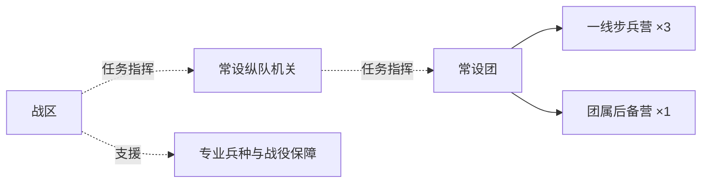

### 需要OG统筹的大型方向

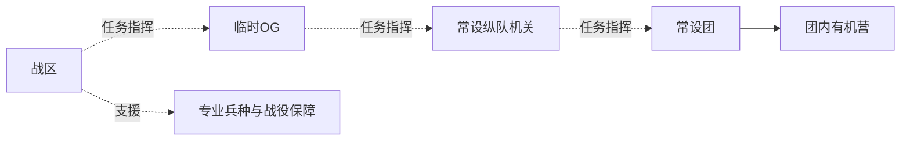

**边界与未定：**

- 纵队与OG不是永久辖团的建制上级；树中任务指挥边不表示固定隶属。OG按方向需要设置，可省略。
- 三个一线营与后备营是普通团的基础；特战和轻步兵团按各自专题，不套用完整普通团定额。
- 1970年代以后纵队—RTG—BTG—CTG任务链另见task-forces-1970s；此处不把临时战斗队倒填二战。

**对照：** [task-forces-1970s](#task-forces-1970s)。

**依据：** [03号 · topic-02](03-陆军军制.md#topic-02)。

</details>

<a id="ww2-rgt-1938"></a>

<details>
<summary>ww2-rgt-1938 · 标准徒步步兵团</summary>

**适用阶段：** 1938年基础；1942年以后另有改进。**记录性质：** 已确认编制；缺项另标。

### 主战、后备及工兵

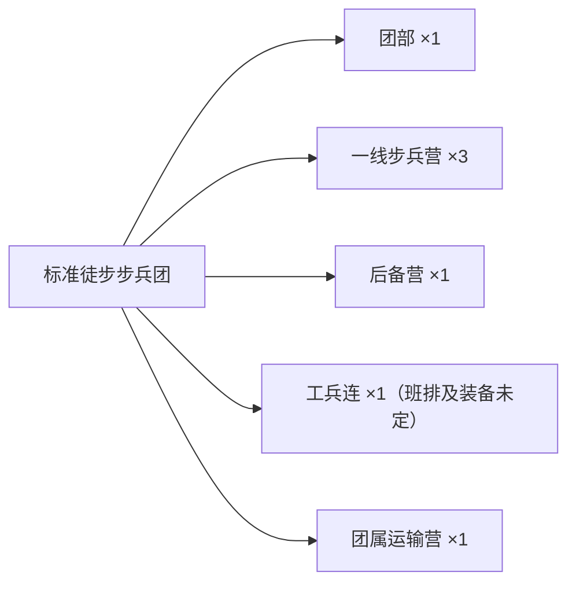

### 团直属火力

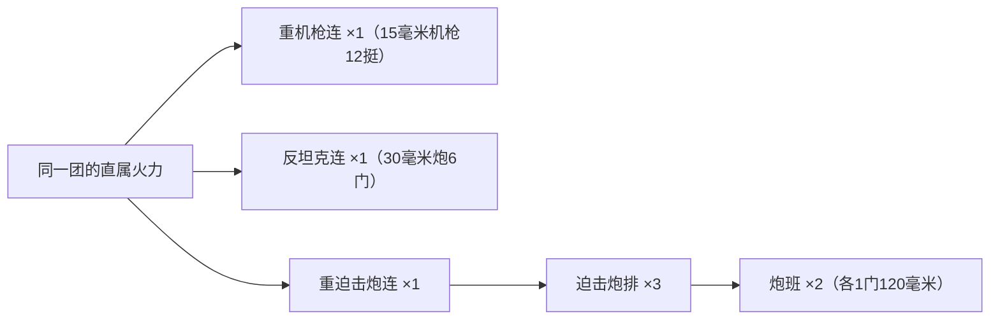

**下钻：** [ww2-bn-1938 · 一线步兵营](#ww2-bn-1938)；[ww2-hq-1938 · 团部指挥、通信与医疗](#ww2-hq-1938)；[ww2-reserve-1938 · 团属后备营](#ww2-reserve-1938)；[ww2-transport-1938 · 团运输营与六资产连](#ww2-transport-1938)。

| 已知小计 | 核算 | 结果 |
|---|---|---|
| 全团已明确机动车 | 18＋12＋6＋3 | 39辆 |
| 名义标称载重 | 45＋18＋1.5 | 64.5吨 |

**边界与未定：**

- 两张图是同一团的不同部分，不是两个团或额外的直属火力指挥部。
- 一线营不再有永久15毫米机枪和30毫米炮；补充轮换由团直属后备营组织，火力可获团按任务加强。
- 标准团没有有机坦克；1938年不默认已配齐1940年才服役的37式机枪。
- 后备营惯常配用的3辆1.5T车出自团运输营，不能重复加车；额外第3个1.5T运输连未定，不列编。

**对照：** [ww2-mixed-1942](#ww2-mixed-1942)；[ww2-mixed-1944](#ww2-mixed-1944)。

**依据：** [10号 · topic-01](10-二战陆军与空军编制.md#topic-01)、[04号 · topic-02](04-二战陆军战术与保障.md#topic-02)。

</details>

<a id="ww2-hq-1938"></a>

<details>
<summary>ww2-hq-1938 · 团部指挥、通信与医疗</summary>

**适用阶段：** 1938年基础团。**记录性质：** 已确认编制；缺项另标。

### 团部已知组织

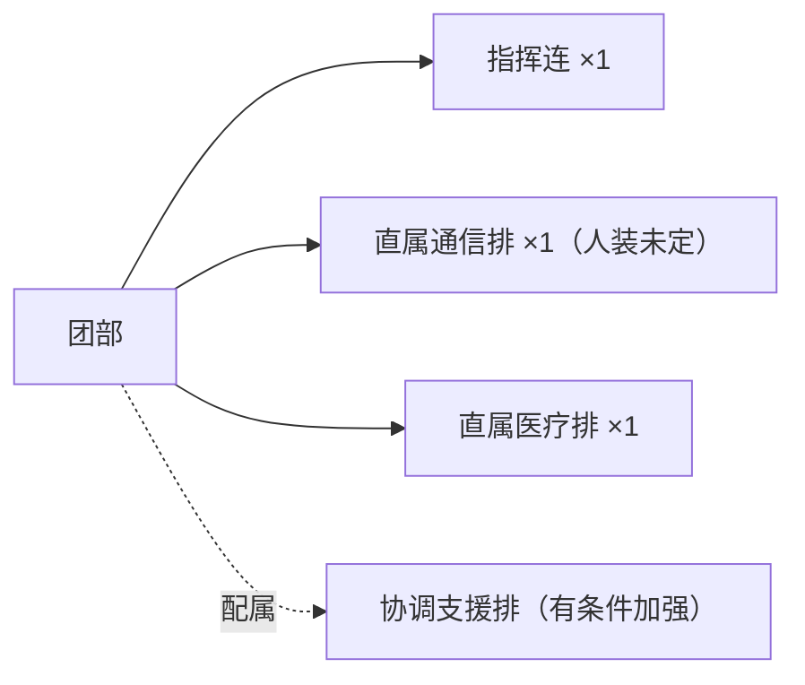

**下钻：** [ww2-medical-1938 · 团医疗排与下放医疗班](#ww2-medical-1938)。

**边界与未定：**

- 指挥连承载团长、参谋长和参谋机关；协调支援排不是永久有机单位。

**依据：** [10号 · topic-01](10-二战陆军与空军编制.md#topic-01)。

</details>

<a id="ww2-bn-1938"></a>

<details>
<summary>ww2-bn-1938 · 一线步兵营</summary>

**适用阶段：** 1938年后营骨架；1942年成熟连排及营级员额。**记录性质：** 已确认编制；缺项另标。

### 营有机单位

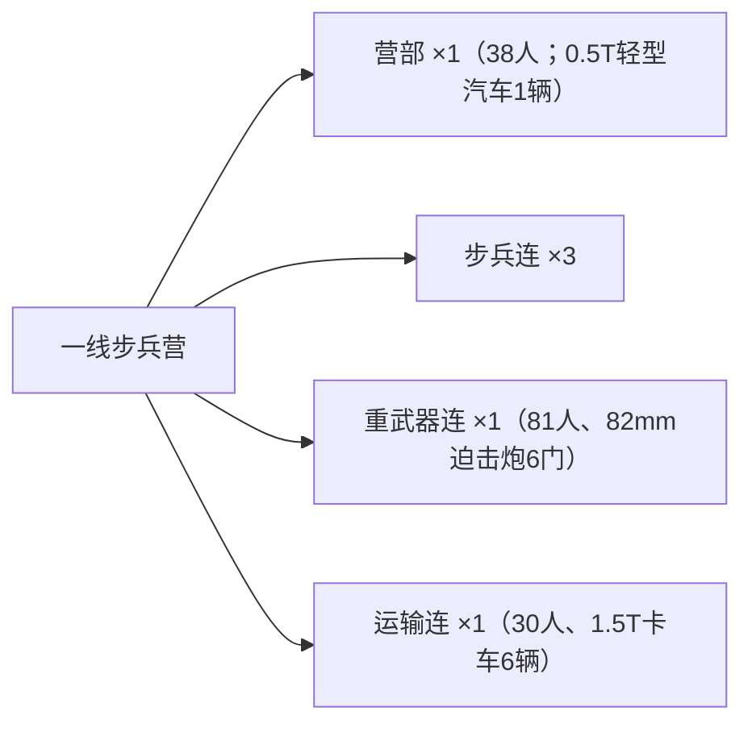

### 营部38人常设人员

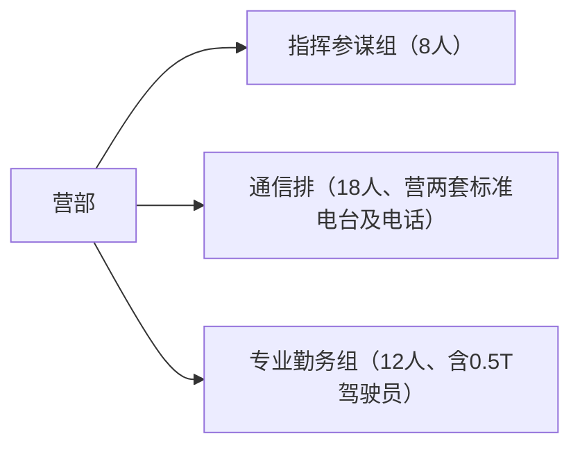

### 重武器连81人

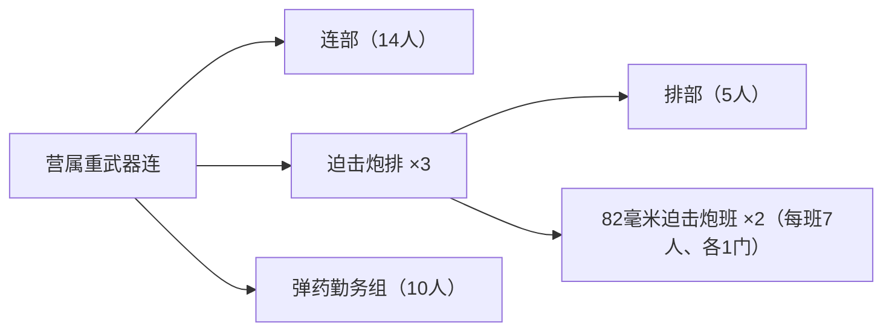

### 运输连30人

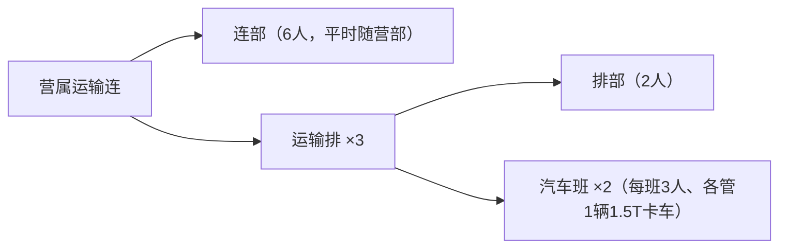

### 可受领的团级加强

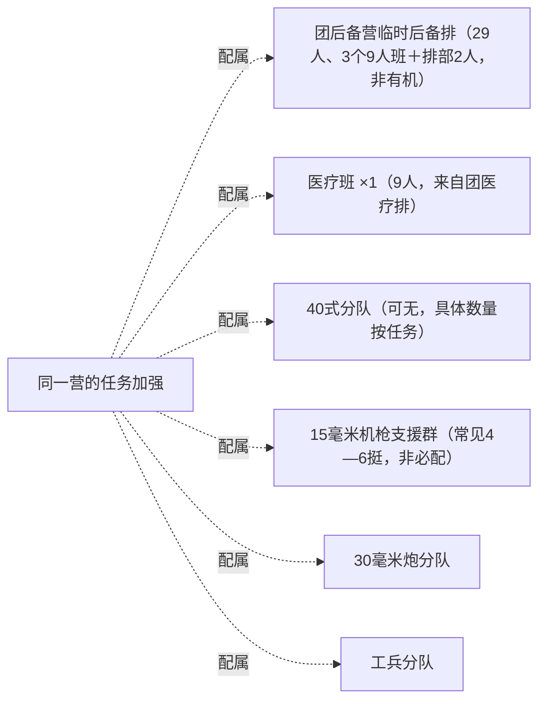

**下钻：** [ww2-co-1942 · 步兵连、排与11人班](#ww2-co-1942)。

| 已知小计 | 核算 | 结果 |
|---|---|---|
| 成熟营常设员额 | 145＋145＋145＋38＋81＋30 | 584人 |
| 申领后备排后可用（含临时） | 584＋29 | 613人 |
| 另计医疗班后现场可用（含临时） | 613＋9 | 622人 |

**边界与未定：**

- 按1942年成熟连排岗位口径：三个步兵连各145人＋营部38人＋重武器连81人＋营运输连30人，合计584人常设，已逐项定员。1938年不倒套后期换装。
- 团后备营可临时派出29人后备排（27名班员＋2名排部），负责一般勤务与轮换，不属于营常设员额；三个步兵连不设常备或常态申领后备班。
- 团医疗排配属9人医疗班不计入584人，三个步兵连各2人、营部3人。
- 6辆1.5T卡车配用：三个步兵连各1、营部1、重武器连2；运输连连部平时随营部。营部0.5T轻型车另计。
- 团属专业兵种按任务加强，不计入常设营额。

**依据：** [10号 · topic-01](10-二战陆军与空军编制.md#topic-01)。

</details>

<a id="ww2-co-1942"></a>

<details>
<summary>ww2-co-1942 · 步兵连、排与11人班</summary>

**适用阶段：** 1942年班排岗位基准。**记录性质：** 已确认编制；缺项另标。

### 连至班

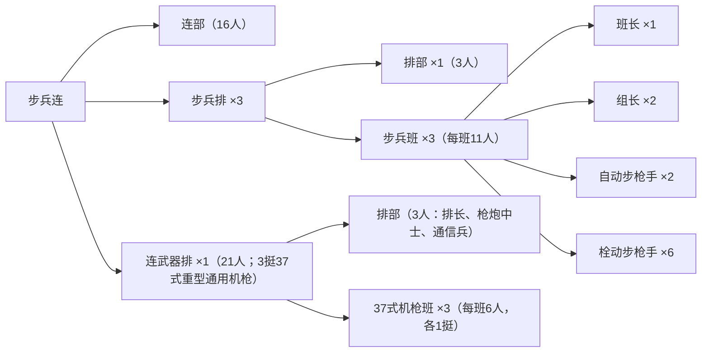

### 连部16人常设岗位

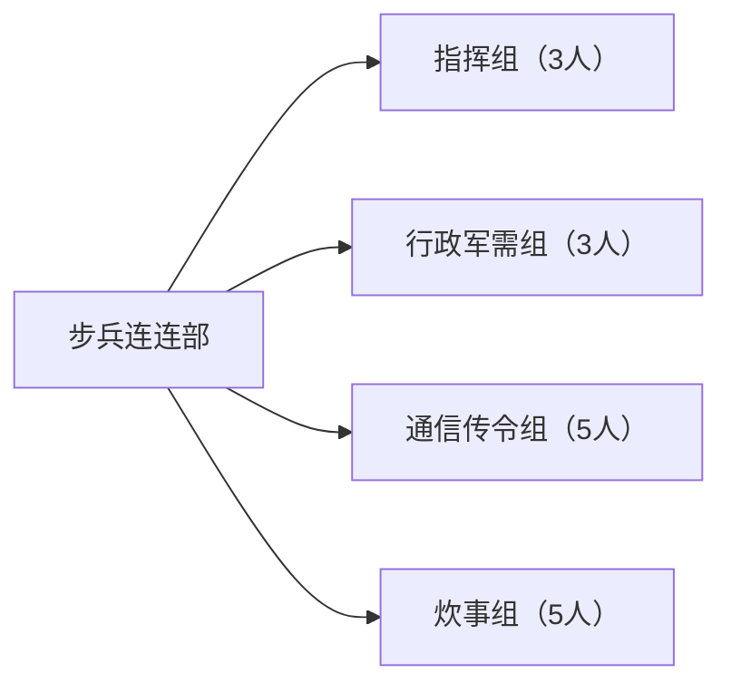

| 已知小计 | 核算 | 结果 |
|---|---|---|
| 每排人员 | 3＋11＋11＋11 | 36人 |
| 连基本人员 | 16＋36＋36＋36 | 124人 |
| 连含3挺机枪武器排定员 | 124＋21 | 145人 |

**边界与未定：**

- 连部16人＋三个36人步兵排＋21人武器排＝145人，均已定员；武器排3人排部、3个6人机枪班。
- 枪炮中士为武器排排部专业士官，兼任全连武器维护教官和连军士长之一；不因此在连部另增岗位。连部既有军械维修兵负责具体维修勤务。
- 不编驮马或独立辎重勤务组；连不设常备或常态申领后备班。配用卡车和3人车组属营运输连，2名配属医疗人员属团医疗排，均不重复计入145人。
- 1937—1940年曾有3挺十四式轻机枪临时顶用；1940年37式重型通用机枪服役后换装3挺，1941年前后逐步完成。

**依据：** [10号 · topic-01](10-二战陆军与空军编制.md#topic-01)。

</details>

<a id="ww2-reserve-1938"></a>

<details>
<summary>ww2-reserve-1938 · 团属后备营</summary>

**适用阶段：** 1938年基础团。**记录性质：** 已确认编制；缺项另标。

### 后备人员层级

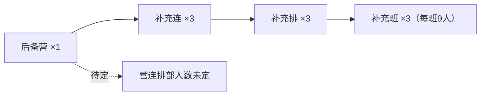

| 已知小计 | 核算 | 结果 |
|---|---|---|
| 班内人员 | 81＋81＋81 | 243人 |

**边界与未定：**

- 243为班内人员，不是全营总人数；无武器排、武器连和有机重武器。
- 先补充轮换三个一线营，再承担团纵深警戒；不能作为第四个同等火力突击营。
- 此模板的人数不移植到冷战或现代后备营。
- 三个补充连为后备营内部单位，直属后备营，不下挂一线营；后备营直接隶属团。
- 三个一线营可各临时申领29人后备排，最多示例性派出87人，从既有后备营调拨81名班员和6名排部人员，不另增编；连不直接申领后备班。

**依据：** [10号 · topic-01](10-二战陆军与空军编制.md#topic-01)。

</details>

<a id="ww2-transport-1938"></a>

<details>
<summary>ww2-transport-1938 · 团运输营与六资产连</summary>

**适用阶段：** 1938年基础团。**记录性质：** 已确认编制；缺项另标。

### 运输营

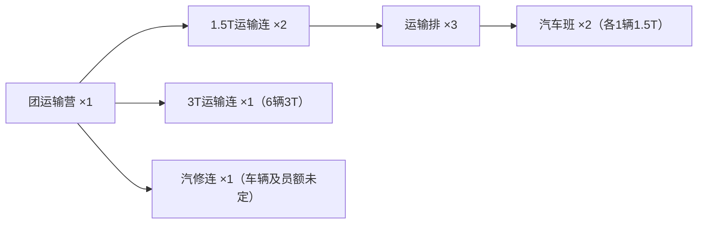

### 营属1.5T运输连（区别于团运输营所辖连）


| 已知小计 | 核算 | 结果 |
|---|---|---|
| 运输营已明确载货车辆 | 12＋6 | 18辆 |
| 营属运输连人员 | 6＋6＋18 | 30人 |

**边界与未定：**

- 营属运输连定员30人，6辆1.5T卡车：6人连部平时随营部、三个2人运输排部、六个3人汽车班；团运输营所属运输连的员额尚未确定。
- 每运输连3排×2班×1车＝6辆；汽修连不按六车制推填。
- 汽修连负责团、营运输连专业维修；各运输连仍负责日常保养。
- 其中一个1.5T连通常保障后备营，可按前线需求抽回。

**依据：** [10号 · topic-01](10-二战陆军与空军编制.md#topic-01)、[04号 · topic-02](04-二战陆军战术与保障.md#topic-02)。

</details>

<a id="ww2-medical-1938"></a>

<details>
<summary>ww2-medical-1938 · 团医疗排与下放医疗班</summary>

**适用阶段：** 1938年基础团。**记录性质：** 已确认编制；缺项另标。

### 医疗排的四班与排部

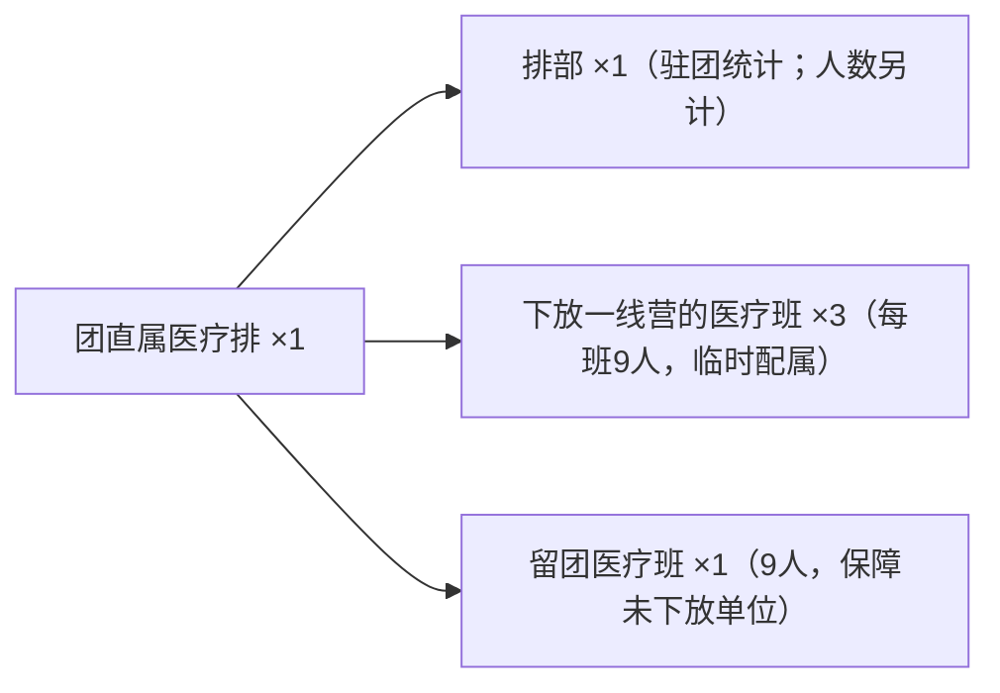

### 每个下放医疗班

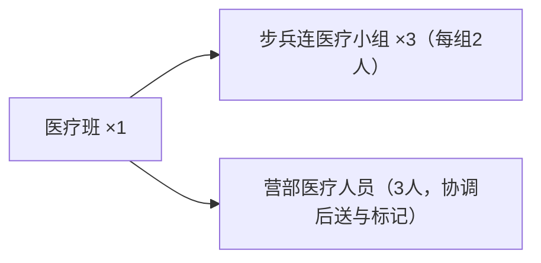

| 已知小计 | 核算 | 结果 |
|---|---|---|
| 四班人员 | 9＋9＋9＋9 | 36人（排部另计） |

**边界与未定：**

- 三班下放各一线营，但仍为团医疗排有机；留团班不是第四个一线营医疗班。
- 专业分队随受援营已有医疗班保障；未配属营者由留团班保障，不另增医疗班。
- 团排负责初始救治和前沿后送，协调军接收后继续后送；不画成团属野战医院。

**依据：** [10号 · topic-01](10-二战陆军与空军编制.md#topic-01)、[04号 · topic-02](04-二战陆军战术与保障.md#topic-02)。

</details>

<a id="ww2-mixed-1942"></a>

<details>
<summary>ww2-mixed-1942 · 坦克连阶段的混成团</summary>

**适用阶段：** 1942年起，部分团。**记录性质：** 已确认编制；缺项另标。

### 相对基础团的装甲新增

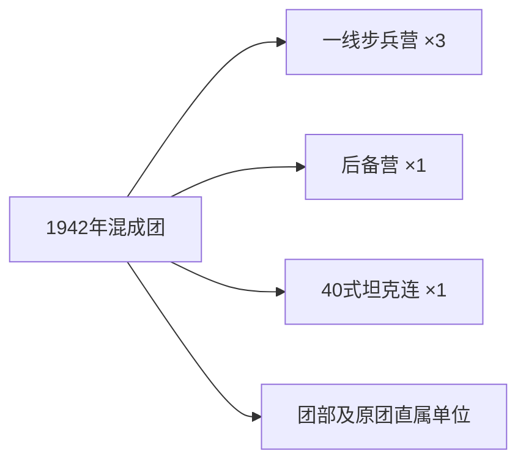

**下钻：** [armour-co-14 · 14车装甲连与四车排](#armour-co-14)；[ww2-bn-1938 · 一线步兵营](#ww2-bn-1938)；[ww2-reserve-1938 · 团属后备营](#ww2-reserve-1938)；[ww2-rgt-1938 · 标准徒步步兵团](#ww2-rgt-1938)。

**边界与未定：**

- 坦克连为团有机，营受领坦克仍属临时加强；未改编团保持普通步兵团。
- 14辆为后续统一坦克连组织定额，不据此确认1942年每个新编连实到14辆。
- 连级无线电在1942年继续普及，不能将40式型号改叫42式。

**依据：** [10号 · topic-01](10-二战陆军与空军编制.md#topic-01)、[44号 · topic-03](44-早期陆军武器与车辆.md#topic-03)。

</details>

<a id="ww2-mixed-1944"></a>

<details>
<summary>ww2-mixed-1944 · 坦克营阶段的混成团</summary>

**适用阶段：** 1944年起部分扩营；1944末—1946年逐步普及。**记录性质：** 已确认编制；缺项另标。

### 装甲连扩为营

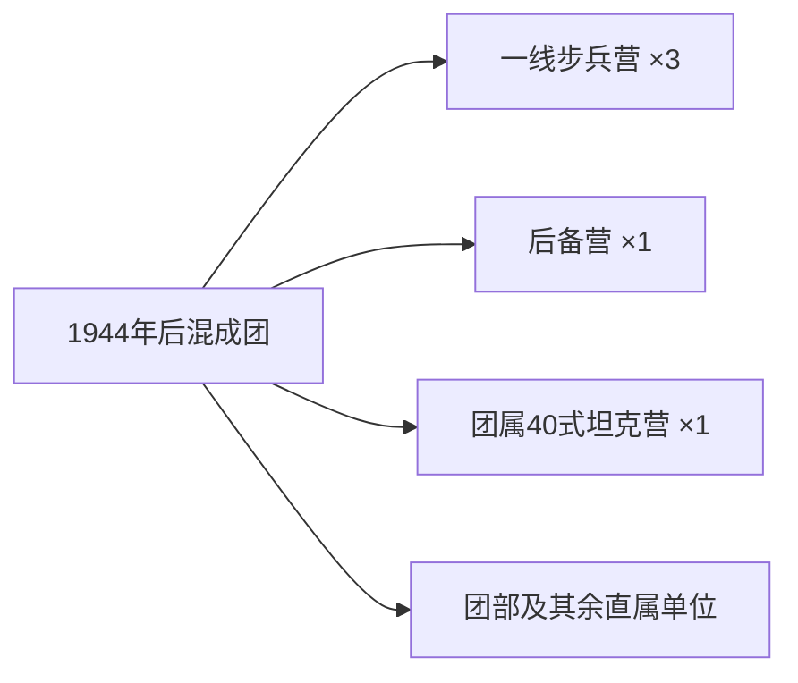

**下钻：** [armour-bn-44 · 44车坦克营／FSV营](#armour-bn-44)；[ww2-bn-1938 · 一线步兵营](#ww2-bn-1938)；[ww2-reserve-1938 · 团属后备营](#ww2-reserve-1938)；[ww2-rgt-1938 · 标准徒步步兵团](#ww2-rgt-1938)。

**边界与未定：**

- 坦克营替换此前团属坦克连，不在44辆外再加一个14辆连。
- 统一营额44辆与具体各团在1944—1946年的实到、改编进度分别记录。

**依据：** [10号 · topic-01](10-二战陆军与空军编制.md#topic-01)、[44号 · topic-03](44-早期陆军武器与车辆.md#topic-03)。

</details>

<a id="ww2-cavalry-46"></a>

<details>
<summary>ww2-cavalry-46 · 46辆混型装甲骑兵大队</summary>

**适用阶段：** 早期40式装甲骑兵组织；改编衔接未定。**记录性质：** 早期专业组织；非团属坦克营模板。

### 原装甲骑兵大队

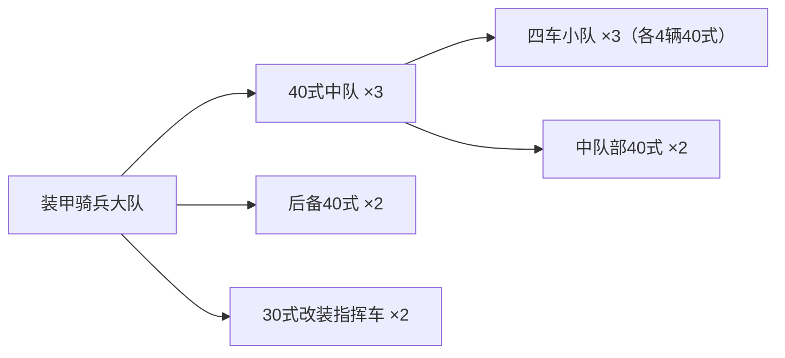

| 已知小计 | 核算 | 结果 |
|---|---|---|
| 履带车辆 | 42＋2＋2 | 46辆 |

**边界与未定：**

- 保留有效的早期组织记录；它不是团属44车坦克营，也不是在44车营外再加2辆指挥车的通用规则。

**依据：** [44号 · topic-03](44-早期陆军武器与车辆.md#topic-03)。

</details>

<a id="ww2-rocket-bn"></a>

<details>
<summary>ww2-rocket-bn · 43式250毫米自行火箭炮营</summary>

**适用阶段：** 1944年起优先战区列装。**记录性质：** 已确认编制；缺项另标。

### 营、连、火炮排与运输排

```mermaid
flowchart LR
    n0["43式火箭炮营"]
    n1["营部 ×1"]
    n2["通信排 ×1（车数及人员未定）"]
    n3["火箭炮连 ×4"]
    n4["连部FDC车 ×1（1.5T）"]
    n5["火炮排 ×2"]
    n6["12管发射车 ×2"]
    n7["运输排 ×2"]
    n8["整架自装卸运输车 ×4（每车12发模块）"]
    n1 --> n2
    n0 --> n1
    n3 --> n4
    n5 --> n6
    n3 --> n5
    n7 --> n8
    n3 --> n7
    n0 --> n3
```

| 已知小计 | 核算 | 结果 |
|---|---|---|
| 发射车 | 4＋4＋4＋4 | 16辆 |
| 整架运输车 | 8＋8＋8＋8 | 32辆 |
| 已明确机动车 | 16＋32＋4 | 52辆 |
| 携行弹量 | 192＋384 | 576发 |

**边界与未定：**

- 发射车和整架运输车分别由制式3T卡车改装；营不编有机炮兵侦察部队，情报来自战区。
- 运输排交替补充／待命；长期大宗弹药与整架装填由协调军承担。
- 576发是含两轮换装的库存量，不表示单位时间射速；营部通信及其他车辆未计入52辆。

**依据：** [10号 · topic-03](10-二战陆军与空军编制.md#topic-03)、[44号 · topic-06](44-早期陆军武器与车辆.md#topic-06)。

</details>

<a id="era-armour"></a>

## 统一装甲营连定额

此处集中维护14车连、44车营，具体采用阶段由引用它的团／营模板限定。

<a id="armour-bn-44"></a>

<details>
<summary>armour-bn-44 · 44车坦克营／FSV营</summary>

**适用阶段：** 团属坦克／FSV营的后续统一组织定额。**记录性质：** 已确认编制；缺项另标。

### 同类战斗车辆集中成营

```mermaid
flowchart LR
    n0["坦克营或FSV营"]
    n1["营部战斗车辆 ×2"]
    n2["坦克连或FSV连 ×3"]
    n0 --> n1
    n0 --> n2
```

**下钻：** [armour-co-14 · 14车装甲连与四车排](#armour-co-14)。

| 已知小计 | 核算 | 结果 |
|---|---|---|
| 战斗车辆 | 2＋14＋14＋14 | 44辆 |

**边界与未定：**

- 全营为同一类战斗车辆；坦克和FSV不是混合凑满44辆。救援、维修、油弹及其他保障车辆另定。
- 早期实际兑现与各团改编年份未定；不能向1938普通团、1965年前机械化团或未改编单位倒填。

**依据：** [19号 · topic-02](19-1970年代陆军野战体系与战区火力.md#topic-02)、[10号 · topic-01](10-二战陆军与空军编制.md#topic-01)。

</details>

<a id="armour-co-14"></a>

<details>
<summary>armour-co-14 · 14车装甲连与四车排</summary>

**适用阶段：** 统一连排定额；各阶段实到另核。**记录性质：** 已确认编制；缺项另标。

### 连至车辆排

```mermaid
flowchart LR
    n0["坦克连或FSV连"]
    n1["连部战斗车辆 ×2"]
    n2["车辆排 ×3"]
    n3["排长车 ×1"]
    n4["其他战斗车辆 ×3"]
    n0 --> n1
    n2 --> n3
    n2 --> n4
    n0 --> n2
```

| 已知小计 | 核算 | 结果 |
|---|---|---|
| 连战斗车辆 | 2＋4＋4＋4 | 14辆 |

**边界与未定：**

- 四车排与连部2车组成14车连；已明确的防空、通信、65E攻坚排等例外不套用四车制。

**依据：** [19号 · topic-02](19-1970年代陆军野战体系与战区火力.md#topic-02)。

</details>

<a id="era-coldwar"></a>

## 1950—1970年代：徒步、机步与卡车摩步

普通营无有机FSV连；混成团集中FSV营，机械化排另有本排有机FSV。1965年前后机械化团是否设坦克营分别画树。1970年代改革另列临时RTG／BTG／CTG任务链，与团营连永久树分开。

<a id="task-forces-1970s"></a>

<details>
<summary>task-forces-1970s · 纵队—RTG—BTG—CTG战区任务指挥体系</summary>

**适用阶段：** 1970年代改革后；具体改革年份未定。**记录性质：** 战时TG身份与逐级资源分配；不另建永久机关。

### 常设基干转入战区任务身份

```mermaid
flowchart LR
    n0["纵队司令部"]
    n1["RTG团战术群（以常设合成团为基干）"]
    n2["BTG营战术群（以常设营为基干）"]
    n3["CTG连战术群（以常设连为基干；无加强也成立）"]
    n2 -. 任务指挥 .-> n3
    n1 -. 任务指挥 .-> n2
    n0 -. 任务指挥 .-> n1
```

### 逐级受领、集中保留与下放

```mermaid
flowchart LR
    n0["纵队／战区加强资产"]
    n1["RTG团级统筹"]
    n2["RTG集中保留资产"]
    n3["向BTG下放资产"]
    n4["BTG集中保留资产"]
    n5["向CTG下放资产"]
    n1 --> n2
    n3 --> n4
    n3 -. 任务指挥 .-> n5
    n1 -. 任务指挥 .-> n3
    n0 -. 配属 .-> n1
```

**边界与未定：**

- 团、营、连是常设行政建制；RTG、BTG、CTG是部队进入战区受领任务后的作战身份，通常依托原指挥机关迅速形成，协同关系具有一定稳定性。
- TG身份不要求原编制发生增减；原建制连即使暂未获得坦克、工兵或医疗加强，作为BTG下辖任务单位时仍称CTG。
- 各级指挥官逐级受领、集中保留和下放资产；炮兵火力支援不等于炮兵单位实体转隶。
- 一团一RTG、三营三BTG、每营三连三CTG是常见情形，不是所有任务必须保持的硬定额；任务图也不把TG数量重复算作常设建制。
- 本制度不倒套二战；现代44车坦克营能提供九个四车坦克排支持九个CTG，但不将其车型、定额倒套1970年代。

**对照：** [modern-btg](#modern-btg)；[modern-ctg](#modern-ctg)。

**依据：** [03号 · bct-doctrine](03-陆军军制.md#bct-doctrine)、[19号 · bct-reform](19-1970年代陆军野战体系与战区火力.md#bct-reform)。

</details>

<a id="cw-infantry-rgt"></a>

<details>
<summary>cw-infantry-rgt · 普通步兵团的已知骨架</summary>

**适用阶段：** 冷战初期普通／半摩托化团。**记录性质：** 已知骨架；团属机构未全定。

### 已确认的团营层级

```mermaid
flowchart LR
    n0["普通步兵团"]
    n1["团部 ×1（战后细编未定）"]
    n2["步兵营 ×3"]
    n3["团属后备营 ×1（战后员额未定）"]
    n4["其余团属单位未定"]
    n0 --> n1
    n0 --> n2
    n0 --> n3
    n0 -. 待定 .-> n4
```

**下钻：** [cw-infantry-bn · 战后步兵营的火力重组](#cw-infantry-bn)。

**边界与未定：**

- 后备营保留补充轮换职责，不把1938年的243名班员直接套到战后。
- 普通徒步营、半摩托化营与摩步营没有永久有机FSV连。

**依据：** [03号 · topic-01](03-陆军军制.md#topic-01)、[16号 · topic-02](16-冷战陆军步兵编制演变.md#topic-02)、[16号 · topic-03](16-冷战陆军步兵编制演变.md#topic-03)。

</details>

<a id="cw-mixed-rgt"></a>

<details>
<summary>cw-mixed-rgt · 团属HZ-47 FSV营的混成团</summary>

**适用阶段：** 冷战初期，继承二战混成团路线。**记录性质：** 已确认编制；缺项另标。

### 装甲支援集中在团

```mermaid
flowchart LR
    n0["冷战初期混成团"]
    n1["团部 ×1（细编未定）"]
    n2["步兵营 ×3"]
    n3["团属HZ-47 FSV营 ×1"]
    n4["后备营 ×1（战后员额未定）"]
    n5["其余团属单位未定"]
    n0 --> n1
    n0 --> n2
    n0 --> n3
    n0 --> n4
    n0 -. 待定 .-> n5
```

**下钻：** [armour-bn-44 · 44车坦克营／FSV营](#armour-bn-44)；[cw-infantry-bn · 战后步兵营的火力重组](#cw-infantry-bn)。

**边界与未定：**

- 40式团属装甲营逐步转为HZ-47 FSV营；所属团数、逐团进度与实到未定。
- 四车FSV分队可按任务加强步兵连，不登记为普通步兵营有机连。

**依据：** [16号 · topic-03](16-冷战陆军步兵编制演变.md#topic-03)、[19号 · topic-02](19-1970年代陆军野战体系与战区火力.md#topic-02)。

</details>

<a id="cw-infantry-bn"></a>

<details>
<summary>cw-infantry-bn · 战后步兵营的火力重组</summary>

**适用阶段：** 1950年代至1960年代普通／半摩托化营。**记录性质：** 已确认编制；缺项另标。

### 营直属火力专业化

```mermaid
flowchart LR
    n0["普通或半摩托化步兵营"]
    n1["营部 ×1（人装未定）"]
    n2["步兵连 ×3（连属37式2挺、90毫米炮2门）"]
    n3["120毫米迫击炮连 ×1"]
    n4["迫击炮排 ×3（每排2门）"]
    n5["防空排 ×1"]
    n6["机枪班 ×3（每班1挺15毫米）"]
    n7["营属保障细编未定"]
    n0 --> n1
    n0 --> n2
    n3 --> n4
    n0 --> n3
    n5 --> n6
    n0 --> n5
    n0 -. 待定 .-> n7
```

| 已知小计 | 核算 | 结果 |
|---|---|---|
| 营属120毫米迫击炮 | 2＋2＋2 | 6门 |
| 营属15毫米防空机枪 | 1＋1＋1 | 3挺 |

**边界与未定：**

- 二战混合重武器连已经撤销；人员补充统一归团直属后备营。
- 普通班已由9人压缩至7人；具体9人过渡岗位及变更年份未定。
- 半摩托化阶段步兵本体主要徒步，临时载员车辆来自协调军；有机载员车数未定。

**对照：** [cw-squad-7](#cw-squad-7)。

**依据：** [16号 · topic-03](16-冷战陆军步兵编制演变.md#topic-03)、[16号 · topic-04](16-冷战陆军步兵编制演变.md#topic-04)。

</details>

<a id="cw-squad-7"></a>

<details>
<summary>cw-squad-7 · 战后7人步兵班</summary>

**适用阶段：** 1950年代起，先于机械化步兵。**记录性质：** 已确认编制；缺项另标。

### 班内对称火力组

```mermaid
flowchart LR
    n0["步兵班"]
    n1["班长 ×1"]
    n2["三人火力组 ×2（每组3人）"]
    n0 --> n1
    n0 --> n2
```

| 已知小计 | 核算 | 结果 |
|---|---|---|
| 班员 | 1＋3＋3 | 7人 |

**边界与未定：**

- 已知结构为1＋3×2，1950年代组内全部岗位未单独锁定，不倒填2014年组长下挂榴弹发射器配置。
- 49式推进药筒由普通步兵携用，不额外设专职射手。

**依据：** [16号 · topic-03](16-冷战陆军步兵编制演变.md#topic-03)。

</details>

<a id="cw-mech-rgt-1960"></a>

<details>
<summary>cw-mech-rgt-1960 · 早期无坦克营机械化团</summary>

**适用阶段：** 1960年前后成熟机械化团；1965年前。**记录性质：** 已确认编制；缺项另标。

### 早期机械化团

```mermaid
flowchart LR
    n0["早期机械化团"]
    n1["团部 ×1（细编未定）"]
    n2["机械化步兵营 ×3"]
    n3["后备营 ×1（冷战定额未定）"]
    n4["其余直属及保障未定"]
    n0 --> n1
    n0 --> n2
    n0 --> n3
    n0 -. 待定 .-> n4
```

**下钻：** [cw-mech-bn-1960 · 47式机械化步兵营](#cw-mech-bn-1960)。

**边界与未定：**

- 1955年是实验营阶段，不能把1960年成熟编制和完成年份倒填到试验开始时。
- 此时机械化团不另加有机坦克营；不得把混成团FSV营自动接到本模板。

**依据：** [16号 · topic-05](16-冷战陆军步兵编制演变.md#topic-05)、[19号 · topic-02](19-1970年代陆军野战体系与战区火力.md#topic-02)。

</details>

<a id="cw-mech-rgt-1965"></a>

<details>
<summary>cw-mech-rgt-1965 · 增设团属坦克营的机械化团</summary>

**适用阶段：** 1965年ZTZ-65服役后，逐团改编。**记录性质：** 已确认编制；缺项另标。

### 三机步营与团属坦克营

```mermaid
flowchart LR
    n0["改编后的机械化团"]
    n1["团部 ×1（细编未定）"]
    n2["机械化步兵营 ×3"]
    n3["团属T-65坦克营 ×1"]
    n0 --> n1
    n0 --> n2
    n0 --> n3
```

### 团直属支援与保障

```mermaid
flowchart LR
    n0["改编后的机械化团"]
    n1["机械化工兵连 ×1"]
    n2["通信连 ×1"]
    n3["防空连 ×1"]
    n4["155毫米炮兵连 ×1（6门）"]
    n0 --> n1
    n0 --> n2
    n0 --> n3
    n0 --> n4
```

### 团直属后备与运输

```mermaid
flowchart LR
    n0["改编后的机械化团"]
    n1["团直属后备营 ×1（乘坐ZS-47；数量未定）"]
    n2["团属运输营 ×1"]
    n3["3吨卡车运输连 ×2（每连6辆）"]
    n4["1.5吨卡车运输连 ×1（6辆）"]
    n5["汽修连 ×1（T-65底盘牵引车，数量未定）"]
    n6["其他直属机构细编未定"]
    n0 --> n1
    n2 --> n3
    n2 --> n4
    n2 --> n5
    n0 --> n2
    n0 -. 待定 .-> n6
```

**下钻：** [armour-bn-44 · 44车坦克营／FSV营](#armour-bn-44)；[cw-mech-bn-1960 · 47式机械化步兵营](#cw-mech-bn-1960)。

| 已知小计 | 核算 | 结果 |
|---|---|---|
| 已知核心战斗车辆 | 44＋44＋44＋44 | 176辆 |

**边界与未定：**

- 具体各团完成年份未定，不等于1965年全军同时配齐。
- 营内44辆APC／FSV为有机车辆，任务配属坦克不再与全团44辆坦克营重复累计。
- 坦克营加入后汽修连更新使用T-65底盘牵引车；后备营车辆数、炮兵牵引方式、防空武器及其余细编未定。

**依据：** [16号 · topic-05](16-冷战陆军步兵编制演变.md#topic-05)、[19号 · topic-02](19-1970年代陆军野战体系与战区火力.md#topic-02)。

</details>

<a id="cw-mech-bn-1960"></a>

<details>
<summary>cw-mech-bn-1960 · 47式机械化步兵营</summary>

**适用阶段：** 1960年前后成熟；1970年代延用核心结构。**记录性质：** 已确认编制；缺项另标。

### 营骨架

```mermaid
flowchart LR
    n0["47式机械化步兵营"]
    n1["营部APC ×2"]
    n2["机械化步兵连 ×3"]
    n3["营属120毫米迫击炮 ×6（运载形式未定）"]
    n4["辎重维修保障细编未定"]
    n0 --> n1
    n0 --> n2
    n0 --> n3
    n0 -. 待定 .-> n4
```

**下钻：** [cw-mech-co-1960 · 47式机械化步兵连与排](#cw-mech-co-1960)。

| 已知小计 | 核算 | 结果 |
|---|---|---|
| 核心APC | 2＋10＋10＋10 | 32辆 |
| 核心FSV | 4＋4＋4 | 12辆 |
| 核心履带车辆 | 32＋12 | 44辆 |

**边界与未定：**

- 32辆APC＋12辆HZ-47只算核心履带车辆；不包含迫击炮运载、营辎重或保障车。
- APC车组3人、步兵班7人分列；这一时期排部人数不套用2014年的24人统一定额。

**依据：** [16号 · topic-05](16-冷战陆军步兵编制演变.md#topic-05)、[19号 · topic-02](19-1970年代陆军野战体系与战区火力.md#topic-02)。

</details>

<a id="cw-mech-co-1960"></a>

<details>
<summary>cw-mech-co-1960 · 47式机械化步兵连与排</summary>

**适用阶段：** 1960年前后成熟；1970年代延用。**记录性质：** 已确认编制；缺项另标。

### 连部与三个排

```mermaid
flowchart LR
    n0["机械化步兵连"]
    n1["连部 ×1"]
    n2["APC指挥车 ×1"]
    n3["2IC乘坐的HZ-47 ×1"]
    n4["机械化步兵排 ×3"]
    n5["ZS-47 APC ×3（各3名车组＋7人班）"]
    n6["HZ-47排长车 ×1"]
    n1 --> n2
    n1 --> n3
    n0 --> n1
    n4 --> n5
    n4 --> n6
    n0 --> n4
```

| 已知小计 | 核算 | 结果 |
|---|---|---|
| APC | 1＋3＋3＋3 | 10辆 |
| FSV | 1＋1＋1＋1 | 4辆 |

**边界与未定：**

- 连部HZ为前线指挥与火力节点，不是长期闲置备用车。
- 不另设传统连属机枪／无后坐力炮重武器分队。

**依据：** [16号 · topic-05](16-冷战陆军步兵编制演变.md#topic-05)。

</details>

<a id="cw-motor-rgt"></a>

<details>
<summary>cw-motor-rgt · 冷战摩托化团</summary>

**适用阶段：** 1960年代后期全摩托化后；逐团改编进度未定。**记录性质：** 已确认编制；缺项另标。

### 摩步与团属FSV及支援

```mermaid
flowchart LR
    n0["冷战摩托化团"]
    n1["团部 ×1（细编未定）"]
    n2["摩托化步兵营 ×3"]
    n3["团属HZ-47 FSV营 ×1"]
    n0 --> n1
    n0 --> n2
    n0 --> n3
```

### 团直属支援与保障

```mermaid
flowchart LR
    n0["冷战摩托化团"]
    n1["摩托化工兵连 ×1"]
    n2["通信连 ×1"]
    n3["防空连 ×1"]
    n4["155毫米炮兵连 ×1（6门）"]
    n0 --> n1
    n0 --> n2
    n0 --> n3
    n0 --> n4
```

### 团直属后备与运输

```mermaid
flowchart LR
    n0["冷战摩托化团"]
    n1["团直属后备营 ×1（乘坐卡车；来源未定）"]
    n2["团属运输营 ×1"]
    n3["3吨卡车运输连 ×2（每连6辆）"]
    n4["1.5吨卡车运输连 ×1（6辆）"]
    n5["汽修连 ×1（ZS-47改装牵引车，数量未定；主要回收FSV）"]
    n6["其他直属机构细编未定"]
    n0 --> n1
    n2 --> n3
    n2 --> n4
    n2 --> n5
    n0 --> n2
    n0 -. 待定 .-> n6
```

**下钻：** [armour-bn-44 · 44车坦克营／FSV营](#armour-bn-44)；[cw-motor-bn-late1960s · 卡车全摩托化步兵营](#cw-motor-bn-late1960s)。

| 已知小计 | 核算 | 结果 |
|---|---|---|
| 运输营运输连卡车 | 6＋6＋6 | 18辆 |

**边界与未定：**

- FSV集中于团属营，可按任务加强摩步营；不作为摩步营有机FSV连。
- 运输营18辆卡车为已列运输连车辆；后备营车辆来源及牵引车数量未定，不重复计算。
- 1976年起适用增设反坦克导弹排的摩步营模板；逐团改编进度未定。

**对照：** [cw-motor-bn-1976](#cw-motor-bn-1976)。

**依据：** [16号 · topic-06](16-冷战陆军步兵编制演变.md#topic-06)、[19号 · topic-02](19-1970年代陆军野战体系与战区火力.md#topic-02)。

</details>

<a id="cw-motor-bn-late1960s"></a>

<details>
<summary>cw-motor-bn-late1960s · 卡车全摩托化步兵营</summary>

**适用阶段：** 1960年代后期起。**记录性质：** 已确认编制；缺项另标。

### 主战及营属火力

```mermaid
flowchart LR
    n0["全摩托化步兵营"]
    n1["营部 ×1（0.5T车2辆）"]
    n2["摩托化步兵连 ×3"]
    n3["120毫米迫击炮连 ×1（6门；1.5T车6辆）"]
    n4["防空排 ×1（15毫米3挺；1.5T车1辆）"]
    n5["运输排 ×1（3T车4辆）"]
    n0 --> n1
    n0 --> n2
    n0 --> n3
    n0 --> n4
    n0 --> n5
```

### 营运输排

```mermaid
flowchart LR
    n0["营运输排 ×1"]
    n1["3T普通货车 ×2"]
    n2["3T油罐车 ×1"]
    n3["3T水罐车 ×1"]
    n0 --> n1
    n0 --> n2
    n0 --> n3
```

**下钻：** [cw-motor-co · 卡车摩步连](#cw-motor-co)。

| 已知小计 | 核算 | 结果 |
|---|---|---|
| 原已明确1.5T卡车 | 18＋6＋1 | 25辆 |
| 原已明确3T车辆 | 3＋2＋1＋1 | 7辆 |
| 原已明确0.5T车辆 | 3＋2 | 5辆 |
| 已明确车辆小计 | 25＋7＋5 | 37辆 |

**边界与未定：**

- 运输排视图是同一营的组成，第二图不另加一个运输排。
- 营无有机FSV连或坦克连，可按任务获团／上级加强；团属后备与保障车辆另计。
- 不把迫击炮组、防空排、油罐和水罐专车当成自由货运车。

**依据：** [16号 · topic-06](16-冷战陆军步兵编制演变.md#topic-06)、[19号 · topic-03](19-1970年代陆军野战体系与战区火力.md#topic-03)。

</details>

<a id="cw-motor-bn-1976"></a>

<details>
<summary>cw-motor-bn-1976 · 增设营属ATGM排的摩步营</summary>

**适用阶段：** 1976年剑导弹成熟后。**记录性质：** 已确认编制；缺项另标。

### 主战及营属火力

```mermaid
flowchart LR
    n0["全摩托化步兵营"]
    n1["营部 ×1（0.5T车2辆）"]
    n2["摩托化步兵连 ×3"]
    n3["120毫米迫击炮连 ×1（6门；1.5T车6辆）"]
    n4["防空排 ×1（15毫米3挺；1.5T车1辆）"]
    n5["剑反坦克导弹排 ×1（发射器及人车未定）"]
    n0 --> n1
    n0 --> n2
    n0 --> n3
    n0 --> n4
    n0 --> n5
```

### 营运输排

```mermaid
flowchart LR
    n0["营运输排 ×1"]
    n1["3T普通货车 ×2"]
    n2["3T油罐车 ×1"]
    n3["3T水罐车 ×1"]
    n0 --> n1
    n0 --> n2
    n0 --> n3
```

**下钻：** [cw-motor-co · 卡车摩步连](#cw-motor-co)。

| 已知小计 | 核算 | 结果 |
|---|---|---|
| 原已明确1.5T卡车 | 18＋6＋1 | 25辆 |
| 原已明确3T车辆 | 3＋2＋1＋1 | 7辆 |
| 原已明确0.5T车辆 | 3＋2 | 5辆 |
| 已明确车辆小计 | 25＋7＋5 | 37辆 |

**边界与未定：**

- 运输排视图是同一营的组成，第二图不另加一个运输排。
- 营无有机FSV连或坦克连，可按任务获团／上级加强；团属后备与保障车辆另计。
- 37辆只包括明确载员、迫击炮、防空、营部和运输排车辆；ATGM排人车未定，不在原37辆中补造。

**依据：** [16号 · topic-06](16-冷战陆军步兵编制演变.md#topic-06)、[19号 · topic-03](19-1970年代陆军野战体系与战区火力.md#topic-03)。

</details>

<a id="cw-motor-co"></a>

<details>
<summary>cw-motor-co · 卡车摩步连</summary>

**适用阶段：** 1960年代后期全摩托化基准。**记录性质：** 已确认编制；缺项另标。

### 载员、辎重与连级火力

```mermaid
flowchart LR
    n0["摩托化步兵连"]
    n1["连部0.5T轻型车 ×1"]
    n2["步兵排 ×3（各1.5T载员车2辆）"]
    n3["连辎重3T卡车 ×1"]
    n4["37式重型机枪 ×2"]
    n5["90毫米无后坐力炮 ×2"]
    n0 --> n1
    n0 --> n2
    n0 --> n3
    n0 --> n4
    n0 --> n5
```

| 已知小计 | 核算 | 结果 |
|---|---|---|
| 载员1.5T卡车 | 2＋2＋2 | 6辆 |

**边界与未定：**

- 步兵班沿用战后7人班；本图不据卡车座位倒推连排部员额。

**依据：** [16号 · topic-06](16-冷战陆军步兵编制演变.md#topic-06)。

</details>

<a id="cw-armoured-cavalry"></a>

<details>
<summary>cw-armoured-cavalry · 装甲骑兵战斗群</summary>

**适用阶段：** 1970年代战区专业力量。**记录性质：** 已确认编制；缺项另标。

### 已定骨架

```mermaid
flowchart LR
    n0["装甲骑兵战斗群"]
    n1["T-65坦克连 ×2"]
    n2["HZ-47 FSV连 ×1"]
    n3["机械化步兵连 ×1"]
    n4["群级机关及保障未定"]
    n0 --> n1
    n0 --> n2
    n0 --> n3
    n0 -. 待定 .-> n4
```

**下钻：** [armour-co-14 · 14车装甲连与四车排](#armour-co-14)；[cw-mech-co-1960 · 47式机械化步兵连与排](#cw-mech-co-1960)。

| 已知小计 | 核算 | 结果 |
|---|---|---|
| 标准坦克 | 14＋14 | 28辆 |

**边界与未定：**

- FSV连可用三个4车排加强机步连三个排；机步连本有的有机HZ仍保留，不把加强当成额外固定排级建制。
- 全国数量另待分期确认，不能由专业战斗群数量反推普通团数。

**依据：** [19号 · topic-04](19-1970年代陆军野战体系与战区火力.md#topic-04)。

</details>

<a id="era-postcoldwar"></a>

## 1990年代：专业装甲骑兵

保留当时有效的团级专业组织，2014年撤编不追溯抹去其历史阶段。

<a id="late-cavalry-regiment"></a>

<details>
<summary>late-cavalry-regiment · 装甲骑兵团</summary>

**适用阶段：** 1990年代至2014年撤编前。**记录性质：** 已确认编制；缺项另标。

### 行政编成

```mermaid
flowchart LR
    n0["装甲骑兵团"]
    n1["坦克连 ×3"]
    n2["机械化步兵连 ×3"]
    n3["团属FSV连 ×1"]
    n4["团部与保障细编未定"]
    n0 --> n1
    n0 --> n2
    n0 --> n3
    n0 -. 待定 .-> n4
```

**下钻：** [armour-co-14 · 14车装甲连与四车排](#armour-co-14)；[cw-mech-co-1960 · 47式机械化步兵连与排](#cw-mech-co-1960)。

| 已知小计 | 核算 | 结果 |
|---|---|---|
| 坦克 | 14＋14＋14 | 42辆 |
| APC | 10＋10＋10 | 30辆 |
| 全团FSV | 4＋4＋4＋14 | 26辆 |

**边界与未定：**

- 行政树显示机步连本有4辆FSV；团属14辆FSV中9辆战时前推各机步排，余5辆仍由团掌握。
- 加强后每机步连10 APC＋7 FSV，其中新增3辆来自团属FSV连，不能再另加14辆。
- 2014年撤编，不作为当代团内常设骑兵团。

**对照：** [mission-fast-group-1998](#mission-fast-group-1998)。

**依据：** [23号 · topic-03](23-陆军裁军与数字化转型.md#topic-03)、[19号 · topic-09](19-1970年代陆军野战体系与战区火力.md#topic-09)。

</details>

<a id="era-modern"></a>

## 2014—2020年后：现代团营、合成编组与专业营

基本班排、常设团营与战区RTG／BTG／CTG任务身份分别维护；即使暂未增减实际资产，TG身份仍然成立。13式从2020年开始列装。

<a id="modern-force-baseline"></a>

<details>
<summary>modern-force-baseline · 现代17团规模清单</summary>

**适用阶段：** 2014年改革后的现代初步基准。**记录性质：** 作者确认的现代初步规模；战区与战史后续整理。

### 团型数量清单

```mermaid
flowchart LR
    n0["现代团规模"]
    n1["摩托化步兵团 ×10"]
    n2["机械化步兵团 ×4"]
    n3["轻步兵团 ×2"]
    n4["特战第56团 ×1"]
    n0 --> n1
    n0 --> n2
    n0 --> n3
    n0 --> n4
```

**下钻：** [light-rgts-current · 第118、第234轻步兵团](#light-rgts-current)；[modern-mech-rgt · 现代机械化团](#modern-mech-rgt)；[modern-motor-rgt · 现代摩托化团](#modern-motor-rgt)；[special-rgt-56 · 特战第56团](#special-rgt-56)。

| 已知小计 | 核算 | 结果 |
|---|---|---|
| 现代团数 | 10＋4＋2＋1 | 17团 |

**边界与未定：**

- 这是规模和类型清单，不是新设全国指挥机关，不表示17团同属一个战区或OG。
- 普通14团按低号优先从现有台账选取，另保留第118、第234轻步兵团及特战第56团；名单见42号。
- 每团另直属一个后备营，共17个；战役额外配属单位不计入这份常设规模清单。
- 此数不倒填冷战或具体战役实到，历史300团峰值与150条团史分别登记。

**依据：** [23号 · topic-10](23-陆军裁军与数字化转型.md#topic-10)、[42号 · modern-roster](42-陆军团番号与沿革台账.md#modern-roster)。

</details>

<a id="modern-reserve-bn"></a>

<details>
<summary>modern-reserve-bn · 现代团直属后备营</summary>

**适用阶段：** 2014年改革后的现代基准。**记录性质：** 营级设置与团直属关系已定；内部人装留白。

### 直接归团的营级组织

```mermaid
flowchart LR
    n0["团直属后备营"]
    n1["营部及内部连排人装待定"]
    n0 -. 待定 .-> n1
```

**边界与未定：**

- 每团一个，对全团组织人员补充、训练筛选、轮换和战力再生，不挂在一线作战营下。
- 特战及轻步兵团补充人员须符合各自专业资格，不自动套用普通团条件；不作为第四个同等火力作战营。
- 不套用1938年243名班员的历史数额；军区和国家预备役继续提供动员训练与跨团人员调配。

**依据：** [41号 · topic-03](41-2014年摩托化BTG与CTG编制战术.md#topic-03)、[57号 · topic-02](57-特战第56团与特种作战部队编制沿革.md#topic-02)。

</details>

<a id="modern-personnel"></a>

<details>
<summary>modern-personnel · 统一7人班与24人排</summary>

**适用阶段：** 2014年后机步、摩步、战斗工兵。**记录性质：** 已确认编制；缺项另标。

### 排、班与火力组

```mermaid
flowchart LR
    n0["排属人员"]
    n1["排部 ×1"]
    n2["排长 ×1"]
    n3["副排长 ×1"]
    n4["排军士长 ×1"]
    n5["七人班 ×3"]
    n6["班长 ×1"]
    n7["三人火力组 ×2"]
    n8["组长 ×1"]
    n9["步枪手 ×2"]
    n1 --> n2
    n1 --> n3
    n1 --> n4
    n0 --> n1
    n5 --> n6
    n7 --> n8
    n7 --> n9
    n5 --> n7
    n0 --> n5
```

| 已知小计 | 核算 | 结果 |
|---|---|---|
| 班人员 | 1＋3＋3 | 7人 |
| 排人员 | 3＋7＋7＋7 | 24人 |

**边界与未定：**

- 24人不含装甲车辆专业车组，也不含连部和连属专业小组。
- 每组组长10式步枪配40毫米下挂；战斗工兵每组三人须覆盖爆破、排障资质，不增加人员。
- 不可倒套1950—1970年代的排部岗位。

**依据：** [41号 · topic-06](41-2014年摩托化BTG与CTG编制战术.md#topic-06)。

</details>

<a id="modern-motor-rgt"></a>

<details>
<summary>modern-motor-rgt · 现代摩托化团</summary>

**适用阶段：** 2014年后，05式体系。**记录性质：** 已确认编制；缺项另标。

### 已知固定核心

```mermaid
flowchart LR
    n0["摩托化步兵团"]
    n1["团部 ×1（员额未定）"]
    n2["摩托化步兵营 ×3（团内第1至第3营）"]
    n3["团属坦克营 ×1"]
    n4["团直属后备营 ×1（现代定额未定）"]
    n5["其余直属及保障未定"]
    n0 --> n1
    n0 --> n2
    n0 --> n3
    n0 --> n4
    n0 -. 待定 .-> n5
```

**下钻：** [armour-bn-44 · 44车坦克营／FSV营](#armour-bn-44)；[modern-motor-bn · 现代摩步营有机编制](#modern-motor-bn)；[modern-reserve-bn · 现代团直属后备营](#modern-reserve-bn)。

| 已知小计 | 核算 | 结果 |
|---|---|---|
| 防空满额时已知车辆 | 52＋52＋52＋44 | 200辆 |

**边界与未定：**

- 三个摩步营各44辆核心装甲车，另各有6辆迫击炮车与满编2辆防空车；加44辆坦克共200辆，不含其他保障车。
- 全国现代初步基准为10摩步、4机步，加2轻步兵及1特战团，本模板只描述一个团。
- 团属后备营随团机动、负责人员补充与轮换，原则上不参与主要战斗；它不同于作为战役机动预备队的主战步兵营。
- 团属44辆坦克营的九个四车坦克排可分别加强九个基础连级CTG，营／连部另有8辆；实际由团、营逐级集中保留和下放，不要求每个CTG必获坦克排。

**依据：** [41号 · topic-03](41-2014年摩托化BTG与CTG编制战术.md#topic-03)、[23号 · topic-10](23-陆军裁军与数字化转型.md#topic-10)。

</details>

<a id="modern-motor-bn"></a>

<details>
<summary>modern-motor-bn · 现代摩步营有机编制</summary>

**适用阶段：** 2014—2015年基准；05式B型2015年成熟。**记录性质：** 已确认编制；缺项另标。

### 基干营的永久编制

```mermaid
flowchart LR
    n0["05式摩托化步兵营"]
    n1["营部 ×1（2辆营部装甲车；车型与人员未定）"]
    n2["摩托化步兵连 ×3"]
    n3["120毫米自行迫击炮连 ×1（6车；47／05底盘渐进换装）"]
    n4["近程自行防空排 ×1（2车，实际常缺编）"]
    n5["其余保障人车未定"]
    n0 --> n1
    n0 --> n2
    n0 --> n3
    n0 --> n4
    n0 -. 待定 .-> n5
```

**下钻：** [modern-motor-co · 05式摩步连](#modern-motor-co)。

| 已知小计 | 核算 | 结果 |
|---|---|---|
| 含迫击炮与满编防空的已知车辆 | 27＋9＋6＋2＋6＋2 | 52辆 |
| 九个摩步排排属人员 | 72＋72＋72 | 216人（车组等另计） |

**边界与未定：**

- 没有有机坦克连；BTG获得坦克时用临时配属树。
- 迫击炮连不强行分为三个两车排，也不固定给每个CTG两门。
- 三个14车连加营部2车，共44辆核心装甲车；连营部车型和其他保障车辆未定。

**依据：** [41号 · topic-03](41-2014年摩托化BTG与CTG编制战术.md#topic-03)、[27号 · topic-08](27-05式轮式车族与HZ-00采购转型.md#topic-08)。

</details>

<a id="modern-motor-co"></a>

<details>
<summary>modern-motor-co · 05式摩步连</summary>

**适用阶段：** 2014年后。**记录性质：** 已确认编制；缺项另标。

### 连部、三排及连属小组

```mermaid
flowchart LR
    n0["摩托化步兵连"]
    n1["连部 ×1（2辆连部装甲车；车型与人员未定）"]
    n2["摩步排 ×3"]
    n3["连属防空小组 ×2（通常兼修医护；人数未定）"]
    n0 --> n1
    n0 --> n2
    n0 --> n3
```

**下钻：** [modern-wheel-platoon · 轮式摩步排的人员与车辆](#modern-wheel-platoon)。

| 已知小计 | 核算 | 结果 |
|---|---|---|
| 三个排人员 | 24＋24＋24 | 72人（连部、专业组另计） |

**边界与未定：**

- 72为三个排的人员，不是完整连员额；连为72＋连部x＋专业组y。
- 三个四车排12辆，加连部2辆，共14辆；连部车型未定。

**依据：** [41号 · topic-03](41-2014年摩托化BTG与CTG编制战术.md#topic-03)、[41号 · topic-06](41-2014年摩托化BTG与CTG编制战术.md#topic-06)。

</details>

<a id="modern-wheel-platoon"></a>

<details>
<summary>modern-wheel-platoon · 轮式摩步排的人员与车辆</summary>

**适用阶段：** 2014年后05式摩步排。**记录性质：** 已确认编制；缺项另标。

### 三班车和排级FSV

```mermaid
flowchart LR
    n0["轮式摩步排"]
    n1["ZS-05 APC ×3（各2名车组＋7人班）"]
    n2["HZ-05 FSV ×1（3名车组＋3个排部席位）"]
    n3["排属人员（24人，车组另计）"]
    n0 --> n1
    n0 --> n2
    n0 --> n3
```

**下钻：** [modern-personnel · 统一7人班与24人排](#modern-personnel)。

| 已知小计 | 核算 | 结果 |
|---|---|---|
| 排有机战斗车辆 | 3＋1 | 4辆 |

**边界与未定：**

- HZ-05是有机排级FSV；配属坦克不替代或额外重复增加排内FSV。
- 人员分支与车辆分支是同一排的两种构成，不把乘员和载员重复相加。

**依据：** [41号 · topic-03](41-2014年摩托化BTG与CTG编制战术.md#topic-03)、[27号 · topic-03](27-05式轮式车族与HZ-00采购转型.md#topic-03)。

</details>

<a id="modern-mech-rgt"></a>

<details>
<summary>modern-mech-rgt · 现代机械化团</summary>

**适用阶段：** 2014年后；2020年起13式逐步换装。**记录性质：** 已确认编制；缺项另标。

### 已知固定核心

```mermaid
flowchart LR
    n0["现代机械化团"]
    n1["团部 ×1（员额未定）"]
    n2["机械化步兵营 ×3（团内第1至第3营）"]
    n3["团属坦克营 ×1"]
    n4["团直属后备营 ×1（现代定额未定）"]
    n5["其余直属及保障未定"]
    n0 --> n1
    n0 --> n2
    n0 --> n3
    n0 --> n4
    n0 -. 待定 .-> n5
```

**下钻：** [armour-bn-44 · 44车坦克营／FSV营](#armour-bn-44)；[modern-mech-bn · 现代履带机步营已知骨架](#modern-mech-bn)；[modern-reserve-bn · 现代团直属后备营](#modern-reserve-bn)。

**边界与未定：**

- 固定核心为三机步营＋团属坦克营；2020年开始换装，不等于所有营在当年完成13式化。
- 三个机步营各44辆核心装甲车与44辆团属坦克；连营部车型与支援车辆总数未定。
- 团属后备营随团机动、负责人员补充与轮换，原则上不参与主要战斗；它不同于作为战役机动预备队的主战步兵营。
- 团属44辆坦克营的九个四车坦克排可分别加强九个基础连级CTG，营／连部另有8辆；实际由团、营逐级集中保留和下放，不要求每个CTG必获坦克排。

**依据：** [28号 · topic-02](28-13式履带步兵战车族.md#topic-02)、[23号 · topic-10](23-陆军裁军与数字化转型.md#topic-10)。

</details>

<a id="modern-mech-bn"></a>

<details>
<summary>modern-mech-bn · 现代履带机步营已知骨架</summary>

**适用阶段：** 2014年后；2020年起前沿排渐换13式。**记录性质：** 已确认编制；缺项另标。

### 已确认部分

```mermaid
flowchart LR
    n0["现代机械化步兵营"]
    n1["营部 ×1（2辆营部装甲车；车型与人员未定）"]
    n2["机械化步兵连 ×3"]
    n3["营属120毫米自行迫击炮连 ×1（6车，底盘按换装阶段）"]
    n4["近程自行防空排 ×1（标准2车，常缺编）"]
    n5["保障及支援车辆未定"]
    n0 --> n1
    n0 --> n2
    n0 --> n3
    n0 --> n4
    n0 -. 待定 .-> n5
```

**下钻：** [modern-ifv-co · 13式机步连已知部分](#modern-ifv-co)。

**边界与未定：**

- 13式下钻为2020年开始列装的新排型；换装前仍有3 APC＋1 HZ-00的旧排，不能一图抹掉过渡期。
- 支援任务能用05式轮式底盘优先用05式，不因机步营换13式就全员保障履带化。
- 三个14车连加营部2车，共44辆核心装甲车；连营部车型和其他保障车辆未定。

**依据：** [28号 · topic-02](28-13式履带步兵战车族.md#topic-02)、[41号 · topic-06](41-2014年摩托化BTG与CTG编制战术.md#topic-06)、[41号 · topic-07](41-2014年摩托化BTG与CTG编制战术.md#topic-07)。

</details>

<a id="modern-ifv-co"></a>

<details>
<summary>modern-ifv-co · 13式机步连已知部分</summary>

**适用阶段：** 2020年起13式列装单位。**记录性质：** 已确认编制；缺项另标。

### 连部两车与三个排

```mermaid
flowchart LR
    n0["13式机械化步兵连"]
    n1["连部 ×1（2辆连部装甲车；车型与人员未定）"]
    n2["机步排 ×3"]
    n3["连属防空小组 ×2（通常兼修医护，人数未定）"]
    n0 --> n1
    n0 --> n2
    n0 --> n3
```

**下钻：** [modern-ifv-platoon · 四车13式机步排](#modern-ifv-platoon)。

| 已知小计 | 核算 | 结果 |
|---|---|---|
| 三个排车辆 | 4＋4＋4 | 12辆 |
| 连核心装甲车 | 12＋2 | 14辆（连部车型未定） |

**边界与未定：**

- 三个四车排12辆，加连部2辆，共14辆；连部车型未定。

**依据：** [28号 · topic-02](28-13式履带步兵战车族.md#topic-02)、[41号 · topic-06](41-2014年摩托化BTG与CTG编制战术.md#topic-06)。

</details>

<a id="modern-ifv-platoon"></a>

<details>
<summary>modern-ifv-platoon · 四车13式机步排</summary>

**适用阶段：** 2020年开始列装；未定义全军换装完成年。**记录性质：** 已确认编制；缺项另标。

### 三辆班车与一辆排部车

```mermaid
flowchart LR
    n0["13式机步排"]
    n1["BZ-13班车 ×3（各3名车组＋7人班）"]
    n2["BZ-13排长车 ×1（专业车组完整；后部排部席位）"]
    n3["排属人员（24人，车组另计）"]
    n0 --> n1
    n0 --> n2
    n0 --> n3
```

**下钻：** [modern-personnel · 统一7人班与24人排](#modern-personnel)。

| 已知小计 | 核算 | 结果 |
|---|---|---|
| 每排IFV | 3＋1 | 4辆 |

**边界与未定：**

- 第四辆是排长／排部IFV，不是第四个7人步兵班；观察、火力协调或空军联络等按任务取舍，不增常设岗位。
- IFV已承担原FSV作用，不另加一辆HZ-00。

**依据：** [28号 · topic-02](28-13式履带步兵战车族.md#topic-02)、[41号 · topic-06](41-2014年摩托化BTG与CTG编制战术.md#topic-06)。

</details>

<a id="modern-btg"></a>

<details>
<summary>modern-btg · 现代BTG整营基干加强示例</summary>

**适用阶段：** 2014年后；按具体任务临时组成。**记录性质：** 临时战术编组；非永久建制。

### RTG重排形成BTG的一个整营示例

```mermaid
flowchart LR
    n0["临时BTG"]
    n1["作为基干的摩步营 ×1"]
    n2["团属坦克连或排（可无；按任务）"]
    n3["专业工兵连或排（可无或集中加强）"]
    n4["其他获授权分队（可无；另列任务清单，不在小计内）"]
    n0 -. 任务指挥 .-> n1
    n0 -. 配属 .-> n2
    n0 -. 配属 .-> n3
    n0 -. 配属 .-> n4
```

**下钻：** [armour-co-14 · 14车装甲连与四车排](#armour-co-14)；[modern-ce-co · 普通战斗工兵连与旧ZS-47排](#modern-ce-co)；[modern-motor-bn · 现代摩步营有机编制](#modern-motor-bn)。

| 已知小计 | 核算 | 结果 |
|---|---|---|
| 完整坦克连加强且防空满额 | 52＋14 | 66辆（已知小计） |

**边界与未定：**

- 本例由RTG以一个完整摩步营及加强力量形成BTG；该BTG可按三个原摩步连组织CTG。实际可重排分队，不固定每BTG三个CTG。
- 52辆基干车（含满额防空）加14辆配属坦克为66辆；64／66取决于两辆防空车是否计入。
- 一个BTG的配属坦克不能在全团44辆坦克营之外再累计一遍。
- 这是2014年人装条件下的整营示例，不把数字倒套1970年代；重排后调入或调出的分队须另核算。

**对照：** [task-forces-1970s](#task-forces-1970s)；[modern-ctg](#modern-ctg)。

**依据：** [41号 · topic-03](41-2014年摩托化BTG与CTG编制战术.md#topic-03)。

</details>

<a id="modern-ctg"></a>

<details>
<summary>modern-ctg · 现代CTG整连基干加强示例</summary>

**适用阶段：** 2014年后；条件性合成加强。**记录性质：** 临时战术编组；加强量按任务。

### BTG重排形成CTG的一个整连示例

```mermaid
flowchart LR
    n0["临时CTG"]
    n1["作为基干的摩步连 ×1"]
    n2["坦克排（获配属时1排）"]
    n3["ZTZ-90坦克 ×4"]
    n4["战斗工兵连或排（按任务可无或多排）"]
    n0 -. 任务指挥 .-> n1
    n2 --> n3
    n0 -. 配属 .-> n2
    n0 -. 配属 .-> n4
```

**下钻：** [modern-motor-co · 05式摩步连](#modern-motor-co)。

| 已知小计 | 核算 | 结果 |
|---|---|---|
| 获一个完整坦克排后的已知车 | 12＋4 | 16辆 |

**边界与未定：**

- 本例由BTG以一个完整摩步连及获配属力量形成CTG，保留三个原摩步排；其他任务可重排，不把本例固定为每个CTG的下辖表。
- CTG基干12辆排属车，获4辆坦克排时已知16辆；连部2辆不计入该排级小计，任务分配与其他保障车另定。
- CTG的临时指挥关系不改变原连排行政隶属；12／16辆只适用于本例，不能据名号推出所有CTG车数。

**对照：** [task-forces-1970s](#task-forces-1970s)。

**依据：** [41号 · topic-04](41-2014年摩托化BTG与CTG编制战术.md#topic-04)。

</details>

<a id="modern-ce-bn"></a>

<details>
<summary>modern-ce-bn · 四连制战斗工兵营</summary>

**适用阶段：** 2014—2015年及后续专业CE基准。**记录性质：** 已确认编制；缺项另标。

### 专业营的常设结构

```mermaid
flowchart LR
    n0["战斗工兵营"]
    n1["营部 ×1（人装未定）"]
    n2["普通CEC ×3"]
    n3["重装工兵连 ×1"]
    n4["其余保障细编未定"]
    n0 --> n1
    n0 --> n2
    n0 --> n3
    n0 -. 待定 .-> n4
```

**下钻：** [modern-ce-co · 普通战斗工兵连与旧ZS-47排](#modern-ce-co)；[modern-ce-heavy-co · 三排制重装工兵连](#modern-ce-heavy-co)。

| 已知小计 | 核算 | 结果 |
|---|---|---|
| 九个普通CE排人员 | 72＋72＋72 | 216人（机关、车组、专业组另计） |

**边界与未定：**

- 综合排障归协调军，不作为CE营第四连；第四连为三专业排的重装连。
- 不恢复全国工兵营番号台账；仅管理通用编制模板。

**依据：** [47号 · topic-01](47-现代战斗工兵营与专业车辆.md#topic-01)。

</details>

<a id="modern-ce-co"></a>

<details>
<summary>modern-ce-co · 普通战斗工兵连与旧ZS-47排</summary>

**适用阶段：** 2014年后。**记录性质：** 已确认编制；缺项另标。

### CEC连属重火力

```mermaid
flowchart LR
    n0["普通战斗工兵连"]
    n1["连部 ×1（员额未定）"]
    n2["CE排 ×3"]
    n3["37式重型机枪组 ×2"]
    n4["无后坐力炮组 ×2"]
    n0 --> n1
    n0 --> n2
    n0 --> n3
    n0 --> n4
```

**下钻：** [modern-ce-platoon · 战斗工兵排](#modern-ce-platoon)。

**边界与未定：**

- 连为72＋连部x＋专业组y；不将机枪与无后坐力炮组直接归入每个CE排。
- 无后坐力炮的现代具体型号未确认，不用1950年代90毫米型号直接倒填。

**依据：** [47号 · topic-01](47-现代战斗工兵营与专业车辆.md#topic-01)、[41号 · topic-06](41-2014年摩托化BTG与CTG编制战术.md#topic-06)。

</details>

<a id="modern-ce-platoon"></a>

<details>
<summary>modern-ce-platoon · 战斗工兵排</summary>

**适用阶段：** 2014年人员基准；既有ZS-47配车阶段。**记录性质：** 已确认编制；缺项另标。

### 排属人员与运输

```mermaid
flowchart LR
    n0["普通CE排"]
    n1["排属人员（24人；车组另计）"]
    n2["ZS-47 APC ×4（既有配车基线）"]
    n0 --> n1
    n0 --> n2
```

**下钻：** [modern-personnel · 统一7人班与24人排](#modern-personnel)。

**边界与未定：**

- 排没有有机HZ火力支援车，外围掩护由受援合成部队提供。
- 普通运兵车后续转向05式；逐批实装和05式排内确切配车另核，不把旧4车直接当成所有新阶段实到。

**依据：** [47号 · topic-01](47-现代战斗工兵营与专业车辆.md#topic-01)、[41号 · topic-06](41-2014年摩托化BTG与CTG编制战术.md#topic-06)。

</details>

<a id="modern-ce-heavy-co"></a>

<details>
<summary>modern-ce-heavy-co · 三排制重装工兵连</summary>

**适用阶段：** 2014—2015年专业编制；少数攻坚排实装。**记录性质：** 已确认编制；缺项另标。

### 三个专业排与车辆例外

```mermaid
flowchart LR
    n0["重装工兵连"]
    n1["连部 ×1（人车未定）"]
    n2["防化喷火排 ×1"]
    n3["FH-47 ×4"]
    n4["机械排雷排 ×1"]
    n5["PL-47 ×4"]
    n6["特殊攻坚排 ×1（仅少数营实装）"]
    n7["ZTZ-65E ×2"]
    n0 --> n1
    n2 --> n3
    n0 --> n2
    n4 --> n5
    n0 --> n4
    n6 --> n7
    n0 --> n6
```

| 已知小计 | 核算 | 结果 |
|---|---|---|
| 三排全实装的专业车 | 4＋4＋2 | 10辆 |
| 仅前两排实装的典型专业车 | 4＋4 | 8辆 |

**边界与未定：**

- 65E排法定2车，不套四车通则；2015年751营确有两辆E2，不能由此推为所有营普及。
- PL-47排不另设旧两班扫雷突击工兵，下车工程人员由普通CEC提供。

**依据：** [47号 · topic-02](47-现代战斗工兵营与专业车辆.md#topic-02)。

</details>

<a id="modern-signal-bn"></a>

<details>
<summary>modern-signal-bn · 专业通信营通用模板</summary>

**适用阶段：** 2015年前后战区集中掌握。**记录性质：** 已确认编制；缺项另标。

### 营、连与双车排

```mermaid
flowchart LR
    n0["专业通信营"]
    n1["营部 ×1（员额及车数未定）"]
    n2["通信连 ×1—3"]
    n3["通信排 ×3"]
    n4["地面中继通信车 ×1"]
    n5["卫星通信车 ×1"]
    n6["维修保障编制未定"]
    n0 --> n1
    n3 --> n4
    n3 --> n5
    n2 --> n3
    n0 --> n2
    n0 -. 待定 .-> n6
```

**边界与未定：**

- 营连数随战区／任务决定，不将霍姆斯双连制当成所有营固定两连。
- 两车展开后有线连接，不是两个独立排；通信网络拓扑不改变部队指挥链。

**对照：** [mission-signal-homs](#mission-signal-homs)。

**依据：** [43号 · topic-04](43-2015年空气战术互联网与战区通信营.md#topic-04)。

</details>

<a id="air-cavalry-regiment"></a>

<details>
<summary>air-cavalry-regiment · 空中骑兵团</summary>

**适用阶段：** 冷战后期至1998年等已定阶段。**记录性质：** 已确认编制；缺项另标。

### 侦察、打击和有限机降

```mermaid
flowchart LR
    n0["空中骑兵团"]
    n1["侦察直升机连 ×1（ZZ-79麻雀；架数未定）"]
    n2["武装直升机连 ×3（鱼鹰；架数未定）"]
    n3["机降连 ×1"]
    n4["运输直升机排 ×1（YZ-70白鹭；架数未定）"]
    n5["团部及保障细编未定"]
    n0 --> n1
    n0 --> n2
    n0 --> n3
    n0 --> n4
    n0 -. 待定 .-> n5
```

**边界与未定：**

- 它是既有专业团，图形集中管理不把团改名为团。
- 原第6团改成特种作战直属航空队后，不能将本模板直接套为改编后的航空队定额。
- 大宗战役航空运输主要由战役协调军掌握。

**依据：** [24号 · topic-07](24-陆军航空兵与直升机平台.md#topic-07)。

</details>

<a id="era-special"></a>

## 空降、特战与两个轻步兵团的分期编制

第56团和第118、第234团各自按沿革阶段登记，三个团所属九个作战营不再平行直属司令部。

<a id="special-command"></a>

<details>
<summary>special-command · 特种作战司令部三个团</summary>

**适用阶段：** 当前已确认组织；转隶年份各自待定。**记录性质：** 已确认编制；缺项另标。

### 三个团及直属航空队

```mermaid
flowchart LR
    n0["特种作战司令部"]
    n1["特战第56团 ×1"]
    n2["第118轻步兵团 ×1"]
    n3["第234轻步兵团 ×1"]
    n4["直属航空队 ×1（原第6空骑团；机队未定）"]
    n5["司令部机关及保障员额未定"]
    n0 --> n1
    n0 --> n2
    n0 --> n3
    n0 --> n4
    n0 -. 待定 .-> n5
```

**下钻：** [light-rgts-current · 第118、第234轻步兵团](#light-rgts-current)；[special-rgt-56 · 特战第56团](#special-rgt-56)。

**边界与未定：**

- 现已明确九个作战营经三个团管理；不把它们还原为九个平行直属营。
- 航空队直属司令部；团获得其支援不改变建制归属。
- 现代三个团另各直属一个后备营，共九个作战营、三个后备营，不含其他机关和直属航空队。

**依据：** [57号 · topic-04](57-特战第56团与特种作战部队编制沿革.md#topic-04)。

</details>

<a id="special-56-airborne"></a>

<details>
<summary>special-56-airborne · 第56空降团</summary>

**适用阶段：** 1960年代，具体改编年未定。**记录性质：** 已知团营骨架；下级未全定。

### 已知团营层级

```mermaid
flowchart LR
    n0["第56空降团"]
    n1["团部 ×1（细编未定）"]
    n2["空降营 ×3"]
    n3["保障编成未定"]
    n0 --> n1
    n0 --> n2
    n0 -. 待定 .-> n3
```

**边界与未定：**

- 三个营的专业化节点沿既有历史承接；营以下连排编制未确认，不套用普通机摩步营。
- 团部和保障全额未定，不按1938年普通团自动补齐火力或运输。

**依据：** [57号 · topic-01](57-特战第56团与特种作战部队编制沿革.md#topic-01)。

</details>

<a id="special-56-1973"></a>

<details>
<summary>special-56-1973 · 第56特种空降团</summary>

**适用阶段：** 1973年起。**记录性质：** 已知团营骨架；下级未全定。

### 已知团营层级

```mermaid
flowchart LR
    n0["第56特种空降团"]
    n1["团部 ×1（细编未定）"]
    n2["特种空降营 ×3"]
    n3["保障编成未定"]
    n0 --> n1
    n0 --> n2
    n0 -. 待定 .-> n3
```

**边界与未定：**

- 三个营的专业化节点沿既有历史承接；营以下连排编制未确认，不套用普通机摩步营。
- 团部和保障全额未定，不按1938年普通团自动补齐火力或运输。

**依据：** [57号 · topic-01](57-特战第56团与特种作战部队编制沿革.md#topic-01)。

</details>

<a id="special-rgt-56"></a>

<details>
<summary>special-rgt-56 · 特战第56团</summary>

**适用阶段：** 至1983年前后完成专业化；直属后备营按现代基准登记。**记录性质：** 已确认编制；缺项另标。

### 三个专业营

```mermaid
flowchart LR
    n0["特战第56团"]
    n1["第1特种空中突击营 ×1（白虎；1983年改现名）"]
    n2["第2特种空降营 ×1（云豹）"]
    n3["第3特种空降营 ×1（雪狼）"]
    n4["团部 ×1（编制未定）"]
    n0 --> n1
    n0 --> n2
    n0 --> n3
    n0 --> n4
```

### 现代直属后备与其余保障边界

```mermaid
flowchart LR
    n0["同一特战第56团"]
    n1["团直属后备营 ×1"]
    n2["其余专业保障编成未定"]
    n0 --> n1
    n0 -. 待定 .-> n2
```

**下钻：** [modern-reserve-bn · 现代团直属后备营](#modern-reserve-bn)。

**边界与未定：**

- 特战营以下连排与小组人装尚未确认，以排及更小分队行动不等于已定24人普通步兵排。
- 现代直属一个后备营，其人员须符合专业选拔条件；不套用普通团坦克营和人车，不反推1983年已具有同样内部保障编制。

**依据：** [57号 · topic-02](57-特战第56团与特种作战部队编制沿革.md#topic-02)。

</details>

<a id="light-rgts-1940s"></a>

<details>
<summary>light-rgts-1940s · 两个海军陆战团</summary>

**适用阶段：** 1940年代，日本投降前改编；精确年份未定。**记录性质：** 团营隶属已定；详细编制留白。

### 第118海军陆战团

```mermaid
flowchart LR
    n0["第118海军陆战团"]
    n1["团部 ×1（细编未定）"]
    n2["第118海军陆战队营 ×1"]
    n3["第309海军陆战队营 ×1"]
    n4["第584海军陆战队营 ×1"]
    n5["团属保障编成未定"]
    n0 --> n1
    n0 --> n2
    n0 --> n3
    n0 --> n4
    n0 -. 待定 .-> n5
```

### 第234海军陆战团

```mermaid
flowchart LR
    n0["第234海军陆战团"]
    n1["团部 ×1（细编未定）"]
    n2["第693海军陆战队营 ×1"]
    n3["第759海军陆战队营 ×1"]
    n4["第794海军陆战队营 ×1"]
    n5["团属保障编成未定"]
    n0 --> n1
    n0 --> n2
    n0 --> n3
    n0 --> n4
    n0 -. 待定 .-> n5
```

**边界与未定：**

- 两张图是两个团，每团三个作战营；团号来自原150条台账，不新增至152团。
- 海军陆战、滨海战斗至轻步兵路线按团承接；现行轻步兵称谓与特战司令部隶属不倒填到早期。
- 所属营的专业徒步战斗、林地、水域与机降／空降能力已定，营内连排和团属保障尚未定；不据普通团模板凑编。

**依据：** [57号 · topic-03](57-特战第56团与特种作战部队编制沿革.md#topic-03)。

</details>

<a id="light-rgts-1960s"></a>

<details>
<summary>light-rgts-1960s · 两个滨海战斗团</summary>

**适用阶段：** 1960年代改称；具体年份未定。**记录性质：** 团营隶属已定；详细编制留白。

### 第118滨海战斗团

```mermaid
flowchart LR
    n0["第118滨海战斗团"]
    n1["团部 ×1（细编未定）"]
    n2["第118滨海战斗营 ×1"]
    n3["第309滨海战斗营 ×1"]
    n4["第584滨海战斗营 ×1"]
    n5["团属保障编成未定"]
    n0 --> n1
    n0 --> n2
    n0 --> n3
    n0 --> n4
    n0 -. 待定 .-> n5
```

### 第234滨海战斗团

```mermaid
flowchart LR
    n0["第234滨海战斗团"]
    n1["团部 ×1（细编未定）"]
    n2["第693滨海战斗营 ×1"]
    n3["第759滨海战斗营 ×1"]
    n4["第794滨海战斗营 ×1"]
    n5["团属保障编成未定"]
    n0 --> n1
    n0 --> n2
    n0 --> n3
    n0 --> n4
    n0 -. 待定 .-> n5
```

**边界与未定：**

- 两张图是两个团，每团三个作战营；团号来自原150条台账，不新增至152团。
- 海军陆战、滨海战斗至轻步兵路线按团承接；现行轻步兵称谓与特战司令部隶属不倒填到早期。
- 所属营的专业徒步战斗、林地、水域与机降／空降能力已定，营内连排和团属保障尚未定；不据普通团模板凑编。

**依据：** [57号 · topic-03](57-特战第56团与特种作战部队编制沿革.md#topic-03)。

</details>

<a id="light-rgts-current"></a>

<details>
<summary>light-rgts-current · 第118、第234轻步兵团</summary>

**适用阶段：** 最终改名与转隶年份未定；当前轻步兵建制。**记录性质：** 团营隶属已定；详细编制留白。

### 第118轻步兵团

```mermaid
flowchart LR
    n0["第118轻步兵团"]
    n1["团部 ×1（细编未定）"]
    n2["第1轻步兵营 ×1（第118团内序号）"]
    n3["第2轻步兵营 ×1（第118团内序号）"]
    n4["第3轻步兵营 ×1（第118团内序号）"]
    n5["团直属后备营 ×1"]
    n0 --> n1
    n0 --> n2
    n0 --> n3
    n0 --> n4
    n0 --> n5
```

### 第234轻步兵团

```mermaid
flowchart LR
    n0["第234轻步兵团"]
    n1["团部 ×1（细编未定）"]
    n2["第1轻步兵营 ×1（第234团内序号）"]
    n3["第2轻步兵营 ×1（第234团内序号）"]
    n4["第3轻步兵营 ×1（第234团内序号）"]
    n5["团直属后备营 ×1"]
    n0 --> n1
    n0 --> n2
    n0 --> n3
    n0 --> n4
    n0 --> n5
```

**下钻：** [modern-reserve-bn · 现代团直属后备营](#modern-reserve-bn)。

**边界与未定：**

- 两图是两个团，每团三个作战营和一个直属后备营；其他专业机构及保障人装待定。
- 海军陆战、滨海战斗至轻步兵路线按团承接；现行轻步兵称谓与特战司令部隶属不倒填到早期。
- 旧118、309、584营依次对应第118团第1至第3营；旧693、759、794营依次对应第234团第1至第3营。早期模板保留历史营号，营内连排人装未定。

**依据：** [57号 · topic-03](57-特战第56团与特种作战部队编制沿革.md#topic-03)。

</details>

<a id="era-missions"></a>

## 战役附录：1998年与2015年任务编组

只登记已确认的常设团营基干、TG任务身份和专业配属；不把纸面满编误认为实际战场人车。

<a id="mission-fast-group-1998"></a>

<details>
<summary>mission-fast-group-1998 · 装甲骑兵快速集群</summary>

**适用阶段：** 1998年沙漠军刀；任务编组。**记录性质：** 战役任务编组；非永久团营。

### 一坦克连与一加强机步连

```mermaid
flowchart LR
    n0["快速集群"]
    n1["坦克连 ×1（T-65系列14辆）"]
    n2["加强机步连 ×1"]
    n3["机步排 ×3"]
    n4["APC ×3"]
    n5["FSV ×2"]
    n6["连部 ×1"]
    n7["APC ×1"]
    n8["FSV ×1"]
    n0 -. 任务指挥 .-> n1
    n3 --> n4
    n3 --> n5
    n2 --> n3
    n6 --> n7
    n6 --> n8
    n2 --> n6
    n0 -. 任务指挥 .-> n2
```

| 已知小计 | 核算 | 结果 |
|---|---|---|
| 已知核心车辆 | 14＋10＋7 | 31辆 |

**边界与未定：**

- 每骑兵团形成3群，两团共6群；各团仍掌握5辆团级FSV，不在每群中重复计入。
- 10 APC＋7 FSV含3辆来自团属FSV连的任务加强；不是机步连永久多出3辆。
- 1998年海外坦克为T-65系列，无ZTZ-90。

**依据：** [25号 · topic-04](25-1998科威特战争与中国中东战区.md#topic-04)。

</details>

<a id="mission-logistics-bn-1998"></a>

<details>
<summary>mission-logistics-bn-1998 · 海湾战争额外加强后勤营</summary>

**适用阶段：** 1998年科威特战争（海湾战争）。**记录性质：** 战役配属比例已定；内部编制与实际团数待核。

### 配属营的已知组织

```mermaid
flowchart LR
    n0["后勤营"]
    n1["营部及内部连排人装待定"]
    n0 -. 待定 .-> n1
```

**边界与未定：**

- 每个参战团额外配属一个，组织该团远征中的随队运输、物资集散及油弹前送，承接战役协调军交付。
- 这是此次战役加强，不是团永久有机单位，不自动改变原行政归属；原属、番号、归建时间和内部人装另定。
- 参战团数和名单尚未确认，不计算全国或全战区后勤营总数；人员包含在6万余人级CMEF远征总额中。
- 不把这个配属比例自动套用2015年或其他战争。

**依据：** [25号 · topic-04](25-1998科威特战争与中国中东战区.md#topic-04)。

</details>

<a id="mission-cmef-1998"></a>

<details>
<summary>mission-cmef-1998 · CMEF团级接口与专业任务力量</summary>

**适用阶段：** 1998年增援完成后的阶段性战役序列。**记录性质：** 保留已定战役节点；常规团级序列待核。

### 地面机动力量

```mermaid
flowchart LR
    n0["1998年中国中东战区"]
    n1["重型纵队 ×3"]
    n2["受领团重排的RTG及轮替任务力量（团号、RTG数及任务关系待核）"]
    n3["装甲骑兵团 ×2"]
    n4["独立坦克营 ×1（专业资产池；实到车数待核）"]
    n1 -. 待定 .-> n2
    n0 -. 任务指挥 .-> n1
    n0 -. 任务指挥 .-> n3
    n0 -. 任务指挥 .-> n4
```

### 专业加强与保障

```mermaid
flowchart LR
    n0["同一远征战区"]
    n1["空中骑兵团 ×1"]
    n2["J-59F中队 ×2（非团营有机）"]
    n3["战区直属155毫米炮营 ×1（2月增援）"]
    n4["配属各纵队155毫米炮营 ×3（每纵队1营；2月增援）"]
    n5["战役协调军及远征保障"]
    n0 -. 任务指挥 .-> n1
    n0 -. 任务指挥 .-> n2
    n0 -. 任务指挥 .-> n3
    n0 -. 任务指挥 .-> n4
    n0 -. 支援 .-> n5
```

### 单个参战团的额外后勤加强

```mermaid
flowchart LR
    n0["每个参战团"]
    n1["后勤营 ×1"]
    n2["既有团属部队（参战团号和内部序列后续整理）"]
    n0 -. 配属 .-> n1
    n0 -. 待定 .-> n2
```

**下钻：** [air-cavalry-regiment · 空中骑兵团](#air-cavalry-regiment)；[late-cavalry-regiment · 装甲骑兵团](#late-cavalry-regiment)；[mission-logistics-bn-1998 · 海湾战争额外加强后勤营](#mission-logistics-bn-1998)。

**边界与未定：**

- 1998年按纵队—RTG—BTG—CTG通则理解任务组织；原团营来源、实际RTG数、辖队和轮替保障接口，留待与作者逐场核定。
- 西侧OG由梁光烈兼任指挥，具体所辖纵队待定。
- 旧营数和坦克乘算原文已转入维护记录，标准定额不等于战场实到。
- 6万余人为整个远征战区口径，含协调、航空与保障。
- 每个参战团额外加强一个后勤营；原属与实际团数待核，此项不改变普通团永久编制，也不自动套用其他战役。

**依据：** [25号 · topic-04](25-1998科威特战争与中国中东战区.md#topic-04)。

</details>

<a id="mission-homs-2015"></a>

<details>
<summary>mission-homs-2015 · 霍姆斯两个RTG与六个BTG现行任务序列</summary>

**适用阶段：** 2015年霍姆斯战役；第6、第12摩步团整建制参战。**记录性质：** 已确认团营基干、任务与专业加强；实到待核。

### 第37纵队下辖两个团战术群

```mermaid
flowchart LR
    n0["霍姆斯OG"]
    n1["第37纵队司令部（韩维钧兼任两级主官）"]
    n2["第6摩步团RTG（原驻中东）"]
    n3["第12摩步团RTG（国内修整后增援）"]
    n1 -. 任务指挥 .-> n2
    n1 -. 任务指挥 .-> n3
    n0 -. 任务指挥 .-> n1
```

### 第6摩步团RTG：全部已知团直属单位同级并列

```mermaid
flowchart LR
    n0["第6摩步团RTG"]
    n1["团部（原团部为RTG指挥核心）"]
    n2["第1摩步营BTG（中央机动预备、攻坚；751工兵营加强）"]
    n3["第2摩步营BTG（CTG分散侧后方；1/2/6th执行红丘村）"]
    n4["第3摩步营BTG（CTG分散侧后方安全）"]
    n5["团属坦克营（44辆标准；依任务分配或保留）"]
    n6["团属后备营（随团机动；不参与主要战斗）"]
    n7["其他团属专业保障（其余单位人车待核）"]
    n0 --> n1
    n0 --> n2
    n0 --> n3
    n0 --> n4
    n0 --> n5
    n0 --> n6
    n0 -. 待定 .-> n7
```

### 第12摩步团RTG：全部已知团直属单位同级并列

```mermaid
flowchart LR
    n0["第12摩步团RTG"]
    n1["团部（原团部为RTG指挥核心）"]
    n2["第1摩步营BTG（中央攻坚与机动增援）"]
    n3["第2摩步营BTG（宽正面第一梯队进攻）"]
    n4["第3摩步营BTG（宽正面第一梯队进攻）"]
    n5["团属坦克营（44辆标准；依任务分配或保留）"]
    n6["团属后备营（随团机动；不参与主要战斗）"]
    n7["其他团属专业保障（其余单位人车待核）"]
    n0 --> n1
    n0 --> n2
    n0 --> n3
    n0 --> n4
    n0 --> n5
    n0 --> n6
    n0 -. 待定 .-> n7
```

### 专业工兵加强与任务重点

```mermaid
flowchart LR
    n0["第37纵队战术任务分配"]
    n1["第6团第1营BTG（中央机动预备／攻坚）"]
    n2["第751战斗工兵营（整营加强；两辆ZTZ-65E2实到）"]
    n3["第12团第1营BTG（中央攻坚／两翼增援）"]
    n4["第12团第2、第3营BTG（宽大正面主攻）"]
    n5["第6团第2、第3营BTG（下辖CTG分散侧翼和后方安全）"]
    n1 -. 配属 .-> n2
    n0 -. 任务指挥 .-> n1
    n0 -. 任务指挥 .-> n3
    n0 -. 任务指挥 .-> n4
    n0 -. 任务指挥 .-> n5
```

### OG受领专业力量

```mermaid
flowchart LR
    n0["同一霍姆斯OG"]
    n1["双连制通信营 ×1"]
    n2["J-59K中队 ×1"]
    n3["战役协调及后勤营加强力量（向RTG及BTG分配；战区保留长期保障）"]
    n0 -. 配属 .-> n1
    n0 -. 配属 .-> n2
    n0 -. 配属 .-> n3
```

**下钻：** [mission-signal-homs · 霍姆斯专业通信营](#mission-signal-homs)。

**边界与未定：**

- 常设第6、第12摩步团各有团部、三个摩步营、团属坦克营、团属后备营；战区任务下以两团为基干组织RTG，下辖六个摩步BTG及所属CTG，不额外创设常设营。
- 两团后备营随团机动，原则上不参与主要战斗；第6团第1摩步营是战役中央预备力量，不等于团直属后备营。
- 第751战斗工兵营整营加强第6团第1营BTG；第6团第2营第1CTG即1/2/6th CTG参加红丘村事件，行动时未获坦克排和CE排，但TG身份不因此取消。
- 两团RTG接受纵队／战区战役协调、后勤营等资产加强；具体后勤营番号、实有人车与分配关系待核。
- 2015年第751营确认实有两辆65E2；FH／PL排额不等于全部逐车实到。旧五个独立摩步营番号仅在废案归档中保留。
- 既有约一万人总员额须按两支整建制团及专业保障重新核算，不从本树直接推断参战总数。

**依据：** [40号 · topic-02](40-2015年叙利亚反恐战争与多国军事干预.md#topic-02)。

</details>

<a id="mission-signal-homs"></a>

<details>
<summary>mission-signal-homs · 霍姆斯专业通信营</summary>

**适用阶段：** 2015年霍姆斯OG受领的双连制。**记录性质：** 该战役已定双连制；非全军统一连数。

### 营、连与双车排

```mermaid
flowchart LR
    n0["专业通信营"]
    n1["营部 ×1（员额及车数未定）"]
    n2["通信连 ×2"]
    n3["通信排 ×3"]
    n4["地面中继通信车 ×1"]
    n5["卫星通信车 ×1"]
    n6["维修保障编制未定"]
    n0 --> n1
    n3 --> n4
    n3 --> n5
    n2 --> n3
    n0 --> n2
    n0 -. 待定 .-> n6
```

| 已知小计 | 核算 | 结果 |
|---|---|---|
| 主要通信车辆 | 6＋6 | 12辆 |

**边界与未定：**

- 2个通信连、6个通信排、12辆主要专业通信车辆；营部及保障车未计入。
- 战区行政隶属保留，OG按任务统筹；不平均给六个BTG各一个通信排。

**依据：** [43号 · topic-04](43-2015年空气战术互联网与战区通信营.md#topic-04)、[40号 · topic-04](40-2015年叙利亚反恐战争与多国军事干预.md#topic-04)。

</details>

<a id="gaps"></a>

## 尚不能画成完整编制树的部分

| 阶段／单位 | 已知与缺项 | 详细依据 |
|---|---|---|
| 师团制及1938年改编衔接 | 1938年由师团制直接改为纵队—团制；原各师团的具体编制、撤并及团史承接尚待细化，本页不补造改制前的完整编制树。 | [03号](03-陆军军制.md#topic-01) |
| 1955年实验机械化营 | 实验存在已定，精确试验编制未定；不直接套1960年成熟32 APC＋12 FSV。 | [16号](16-冷战陆军步兵编制演变.md#topic-05) |
| 1950年代9人班过渡 | 9→7的过程已定，9人阶段具体岗位和11→9的年份未定。 | [16号](16-冷战陆军步兵编制演变.md#topic-12) |
| 冷战卡车摩步团的完整团属机构 | 营级37车模板、团属后备及混成团FSV来源已定；各时期团部、直属火力和全团后勤精确编制未全定，不从1938年模板原样外推。 | [16、19号](19-1970年代陆军野战体系与战区火力.md#topic-10) |
| 105／155／180毫米专业炮兵营 | 任务、配属边界及部分火炮特征已定；完整营连排、每营炮数或发射器数未定。43式250毫米营则已有可画模板。 | [10、19号](19-1970年代陆军野战体系与战区火力.md#topic-10) |
| 特战、海军陆战／滨海与轻步兵营以下 | 当前三团各三个作战营和一个直属后备营已定；作战连排、小组员额、后备营人装及团部专业保障未全定，历史阶段不倒套现代机构。 | [57号](57-特战第56团与特种作战部队编制沿革.md#topic-05) |
| 13式连营全车数 | 每排4辆、每连3排加连部2辆为14辆；每营3连加营部2辆为44辆核心装甲车。连营部车型及其余支援车辆未定。 | [28号](28-13式履带步兵战车族.md#topic-05) |
| 各时期全国团数与类型比例 | 现代初步基准已定10摩步、4机步、2轻步兵、1特战共17团，名单见42号；2014年前各期数量、逐年调整和驻区仍待整理，历史峰值与团史条数分别统计。 | [23号](23-陆军裁军与数字化转型.md#topic-10) |

<a id="maintenance"></a>

## 统一维护方法

1. 在所属专题确认设定与年代边界；在[编制数据](编制树/编制数据.json)更新对应模板，新增年代另建模板，保留有效历史版本。
2. 下级编制用`ref`引用已有模板；常设隶属、临时配属、支援和任务指挥用不同`relation`记录。多张视图不重复增加单位，四个改编类型列仍只由42号维护。
3. 运行`python 编制树/生成编制树.py`生成本页；运行`python 编制树/生成编制树.py --check`核对数据、引用、算式及生成内容一致。无需第三方Python依赖。
4. 回补受影响的时代专题和05号问题清单；图不替代战役证据，也不自动填补全军团数、比例、车辆实到或人员总额。
